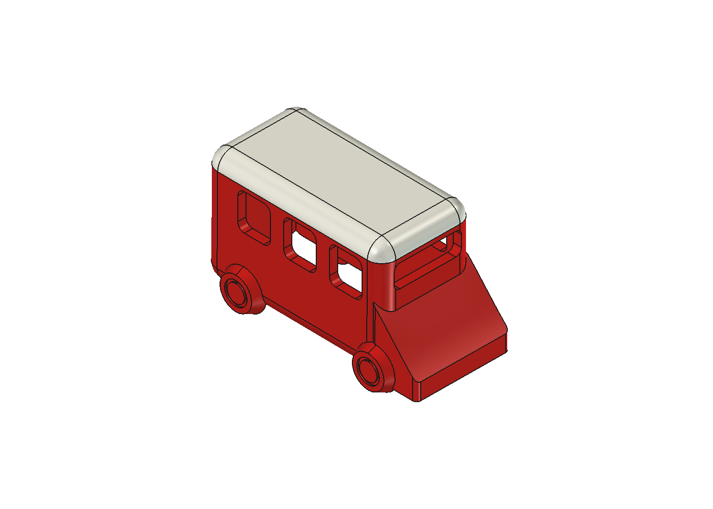
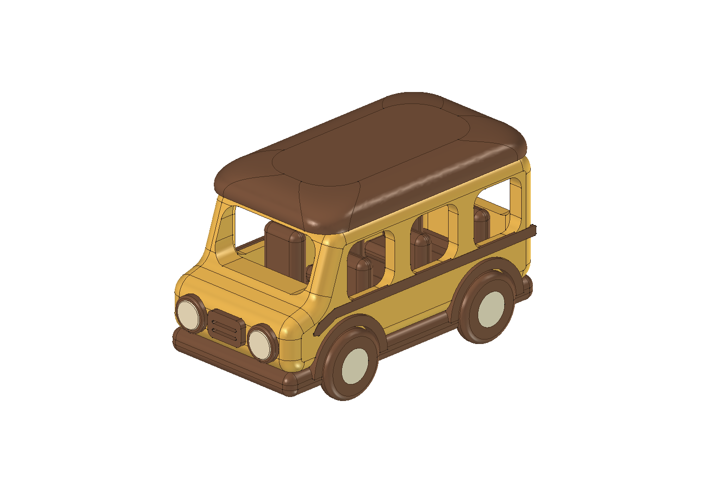
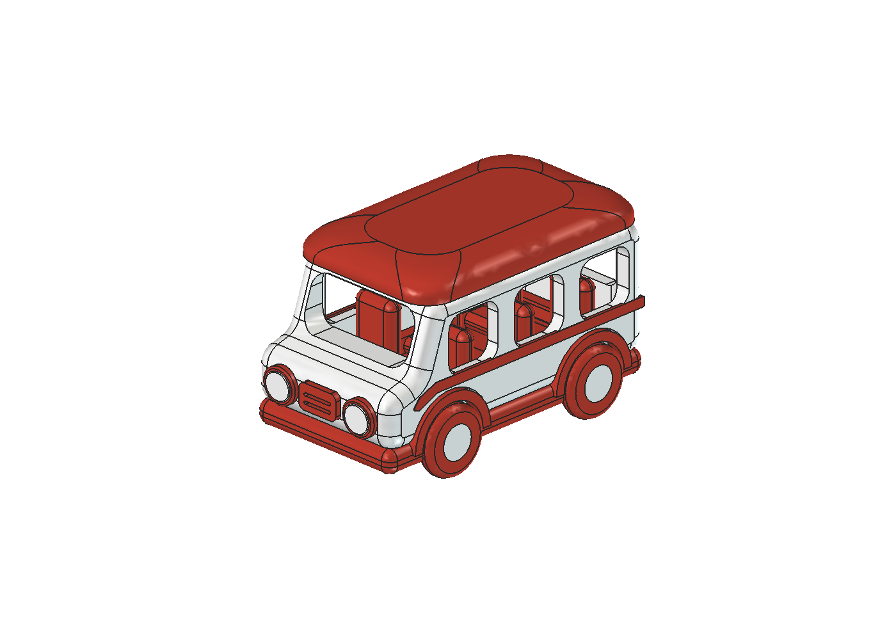
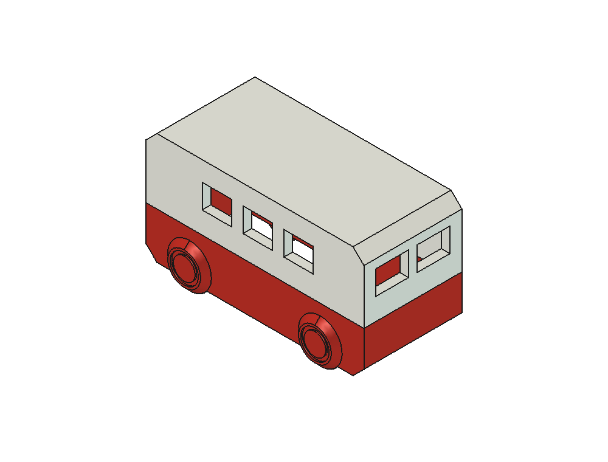
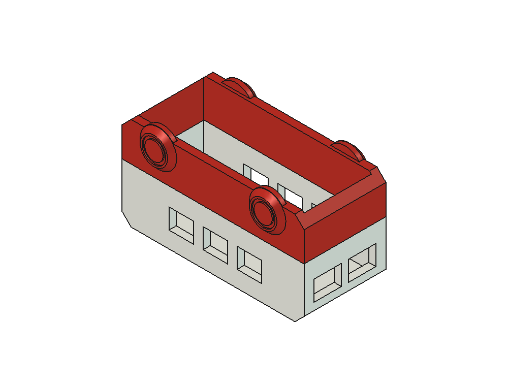
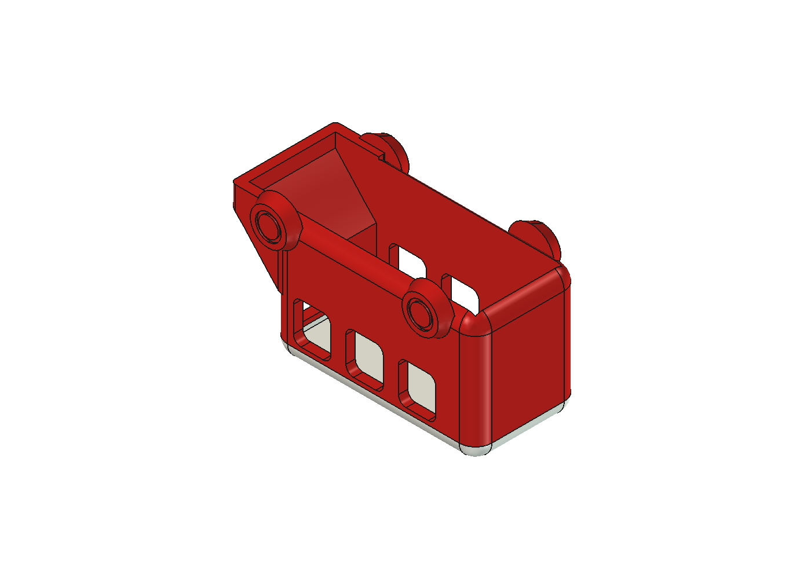

# ネコネコインダストリー

**NEKONEKO INDUSTRIES**

製品ブランド: **NEKOMO**

> **わくわくを、どこへでも。**
>
> Wonder to Go.

ねこのAI職人たちが乗り物のおもちゃを作る工場をテーマに、FreeCADとA1 miniで設計・試作するプロジェクトです。人間のレビューと造形結果を記録し、次の設計に生かしています。

現在はバス型のおもちゃを試作しています。車・船・飛行機・潜水艦は今後の構想で、製作済みの製品ではありません。NEKOMOは、これまでの設計データや記録で使ってきた識別子として残しています。

## ロゴ案を比べる

船が伝わるシンプルな[追加5案（21〜25）](docs/brand/boat-logo-concepts.md)を制作しました。抽象的な[16〜20案は保留](docs/brand/minimal-logo-concepts.md)とし、商品を連想しやすい船の案を優先して比較しています。[01〜05案](docs/brand/README.md)、[06〜10案](docs/brand/mission-logo-concepts.md)、[11〜15案](docs/brand/wonder-to-go-logo-concepts.md)も保存しています。正式採用はまだ決まっていません。

| 21 ねこの帆船 | 22 ひと折りの舟 | 23 小さなタグボート | 24 波と帆 | 25 車輪付きの遊び舟 |
| --- | --- | --- | --- | --- |
|  |  |  |  |  |

## 現在のバス試作

**v09・傾斜ボンネット案**は、42 × 21 × 24 mmの床なしバスです。ボンネットの形を見直し、逆さ姿勢での造形経路を調べました。画像はCADレンダです。

[v09のFreeCADモデル](designs/school-bus-v09-sloped/cad/sloped-bus.FCStd) · [STEP](designs/school-bus-v09-sloped/exports/sloped-bus.step) · [スライス済み3MF](designs/school-bus-v09-sloped/exports/sloped-two-color-sliced.3mf) · [設計スクリプト](designs/school-bus-v09-sloped/build_sloped.py) · [版の案内](docs/designs/school-bus-v09-sloped/版の案内.md)

### 印刷と現物の記録

公開記録で印刷完了を確認しているのは2件です。

| 版 | 印刷の根拠 | 現物について確認できること |
| --- | --- | --- |
| v06・赤タイヤ | 本人の完了報告 | サポートがほぼ全部外れなかったとの報告があります。写真の配色は一致しますが、印刷ジョブIDは直接照合されていません。[品質記録](docs/evidence/print-quality-feedback.json) |
| v09・傾斜ボンネット | 実機のFINISH・100%・119層と本人の完了報告 | 完成品の品質レビューは記録されていません。[印刷記録](docs/evidence/print-confirmation.json) |

印刷完了は、外観・強度・耐久性・浮力や子どもの使用可否を確認したことを意味しません。公開記録に、子どもの使用を承認した版はありません。v04には保存CADのハッシュ不一致が残り、再梱包は停止しています。[照合記録](docs/evidence/v04-packaging-check.json)

## 設計ギャラリー

画像は各版のCADレンダです。形状の違いと設計記録を見比べられます。

| v02・大型3部品 | v03・60 mm級の3部品 |
| --- | --- |
|  |  |
| 車体・シャーシ・屋根を分け、位置決めと部品の干渉を確認しました。[CAD](designs/school-bus-v02/cad/nekomo-school-bus-v02.FCStd) · [設計記録](docs/designs/school-bus-v02/版の案内.md) | 赤白の配色と60 mm級の大きさに合わせ、肉厚と組立形状を調整しました。[CAD](designs/school-bus-v03-mini/cad/nekomo-school-bus-v03.FCStd) · [設計記録](docs/designs/school-bus-v03-mini/版の案内.md) |

| v04・60 mm級の一体構造 | v07・40 mm級の床なし構造 |
| --- | --- |
|  |  |
| 屋根と底板を一体化し、幅34 mmの形状と内部の補強を検討しました。[CAD](designs/school-bus-v04-dr/cad/nekomo-school-bus-v04.FCStd) · [設計記録](docs/designs/school-bus-v04-dr/版の案内.md) | 床をなくし、窓の開口、輪の張り出し、赤白の色境界を見直しました。[CAD](designs/school-bus-v07-open-bottom/candidate-r00/cad/nekomo-bus-v07-final.FCStd) · [設計記録](docs/designs/school-bus-v07-open-bottom/版の案内.md) |

| v07・底側から見る空洞 | v09・逆さ姿勢で見るボンネット |
| --- | --- |
|  |  |
| 開いた底面と車内の形状を確認しました。G-codeでも空洞中央を横切る押出経路を調べています。[レビュー記録](docs/designs/school-bus-v07-open-bottom/evidence/design-review-r00.md) | 前層との経路の重なりをボンネット中央で調べました。[検査コード](designs/school-bus-v09-sloped/verify_toolpaths.py) · [比較手順](docs/reproduce.md) |

## バス各版の設計データ

v06は40 mmのシンプル版と60 mm級の空洞版が別系統です。赤タイヤ版は60 mm級の空洞版から派生しています。各行からCAD、造形データまたは版ごとの記録へ進めます。

| 版・派生 | 設計の違い | FreeCAD | 造形データ・記録 |
| --- | --- | --- | --- |
| v01 | 大型・一体固定輪。外観と窓上端の橋渡しを検討 | [CAD](designs/school-bus-v01/cad/nekomo-school-bus-v01.FCStd) | [2色3MF](designs/school-bus-v01/print/nekomo-school-bus-v01-two-color-sliced.3mf) · [版の案内](docs/designs/school-bus-v01/版の案内.md) |
| v02 | 車体・シャーシ・屋根の3部品 | [CAD](designs/school-bus-v02/cad/nekomo-school-bus-v02.FCStd) | [3部品の造形データと記録](docs/designs/school-bus-v02/版の案内.md) |
| v03 | 60 mm級・赤白・3部品 | [CAD](designs/school-bus-v03-mini/cad/nekomo-school-bus-v03.FCStd) | [3部品の造形データと記録](docs/designs/school-bus-v03-mini/版の案内.md) |
| v04 | 60 mm級・幅34 mm・一体構造 | [CAD](designs/school-bus-v04-dr/cad/nekomo-school-bus-v04.FCStd) | [3MF](designs/school-bus-v04-dr/print/final-bus-sliced.3mf) · [版の案内](docs/designs/school-bus-v04-dr/版の案内.md) |
| v05 | 底面2開口とサポート除去の検討 | [CAD](designs/school-bus-v05-dfam/cad/nekomo-school-bus-v05-open-underside.FCStd) | 本体のスライスなし · [検証片と記録](docs/designs/school-bus-v05-dfam/版の案内.md) |
| v06・シンプル | 40 × 20 × 22 mm・単色・一体 | [CAD](designs/school-bus-v06-simple/candidate-r01/cad/final-bus-r01.FCStd) | [3MF](designs/school-bus-v06-simple/candidate-r01/print/school-bus-r01-sliced.3mf) · [版の案内](docs/designs/school-bus-v06-simple/版の案内.md) |
| v06・空洞 | 60 mm級・床と座席を抜いた車内 | [CAD](designs/school-bus-v06-empty-inverted/corrected/nekomo-v06-clear-cabin.FCStd) | [設計・造形記録](docs/designs/school-bus-v06-empty-inverted/版の案内.md) |
| v06・赤タイヤ | 赤い屋根・タイヤ、白い車体・ハブ | [CAD](designs/school-bus-v06-empty-inverted/two-color-red-tyres/nekomo-v06-red-tyres.FCStd) | [スライス済み3MF](designs/school-bus-v06-empty-inverted/two-color-red-tyres/red-tyres-inverted-sliced.3mf) · [不具合記録](docs/evidence/print-quality-feedback.json) |
| v07 | 40 mm級・床なし・空洞・2色 | [CAD](designs/school-bus-v07-open-bottom/candidate-r00/cad/nekomo-bus-v07-final.FCStd) | [3MF](designs/school-bus-v07-open-bottom/candidate-r00/print/bus-two-colour-final.3mf) · [版の案内](docs/designs/school-bus-v07-open-bottom/版の案内.md) |
| v08 | 42 × 21 × 24 mm・写真型のボンネット | [CAD](designs/school-bus-v08-photo/cad/photo-bus-fast.FCStd) | [3MF](designs/school-bus-v08-photo/exports/fast-two-color-sliced.3mf) · [版の案内](docs/designs/school-bus-v08-photo/版の案内.md) |
| v09 | 42 × 21 × 24 mm・連続した傾斜ボンネット | [CAD](designs/school-bus-v09-sloped/cad/sloped-bus.FCStd) | [STEP](designs/school-bus-v09-sloped/exports/sloped-bus.step) · [3MF](designs/school-bus-v09-sloped/exports/sloped-two-color-sliced.3mf) · [設計スクリプト](designs/school-bus-v09-sloped/build_sloped.py) · [版の案内](docs/designs/school-bus-v09-sloped/版の案内.md) |

## 設計審査と品質方針

[バスの版一覧](docs/バスの版一覧.md)には、版ごとの設計差、当時の要望、DRの審査履歴、印刷・現物の記録があります。DR番号と判定は記録当時の履歴として保持し、別の定義へ読み替えていません。審査の進め方と記録様式は[NEKOMOのDRレビュー手順](.agents/skills/nekomo-dr-review/SKILL.md)を参照してください。

PLAモデルにサポートが必要な場合は、専用のSupport for PLAを本体との接触面へ明示的に割り当てます。スライス後の界面経路と本体への材料混入がないことをファイルで確認し、送信前に実物AMSとの対応を確かめます。工具の通り道や破損リスクを設計で検討し、代表形状の検証片で実際の除去を確認します。ファイル検査と実物での除去確認は別の記録です。[サポート材のファイル検査](quality/support-removal-preflight.py)

人間の要望、エージェントの検査、機械記録、実物の報告を分けて保存しています。[人間のレビュー記録](docs/人間のレビュー記録.md) · [公開データ](docs/data/) · [v06赤タイヤ版の品質記録](docs/evidence/print-quality-feedback.json)。ファイル検査や印刷完了だけで、製品の品質や子どもの使用可否を判定しません。

## 取得して検証する

GitとPython 3.12を用意し、リポジトリのルートで実行します。

~~~sh
git clone https://github.com/Sunwood-ai-labs/NEKONEKO-INDUSTRIES.git
cd NEKONEKO-INDUSTRIES
python tools/update_manifest.py --check
python tools/verify_snapshot.py
~~~

[取得後の検証と再現手順](docs/reproduce.md)では、公開ファイルの照合、サポート材の検査、v08とv09の経路比較、v09のCAD生成を案内しています。[GitHub Actionsの検証結果](https://github.com/Sunwood-ai-labs/NEKONEKO-INDUSTRIES/actions/workflows/verify.yml)

## リポジトリの中身

~~~text
designs/                          版ごとのCAD・STEP・STL・3MF・設計コード
docs/                             設計記録、人間のレビュー、再現手順
docs/brand/                       社名ロゴの5つの比較案
.agents/skills/nekomo-dr-review/  DRの審査方法と記録様式
quality/                          サポート材のファイル検査
tools/                            マニフェスト更新・スナップショット検証
~~~

活動の背景と品質方針は[NEKOMOのコンセプト](docs/NEKOMO-concept-and-quality.md)にあります。

## ライセンス

[MITライセンス](LICENSE)の適用範囲は、NEKOMOで作成したCADモデルとそのSTEP・STL出力、および制作・検証コードです。
