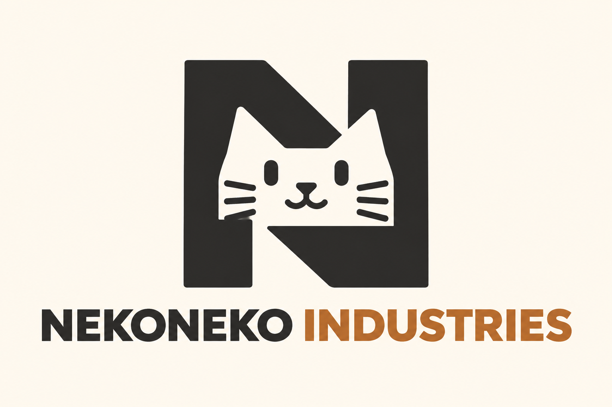
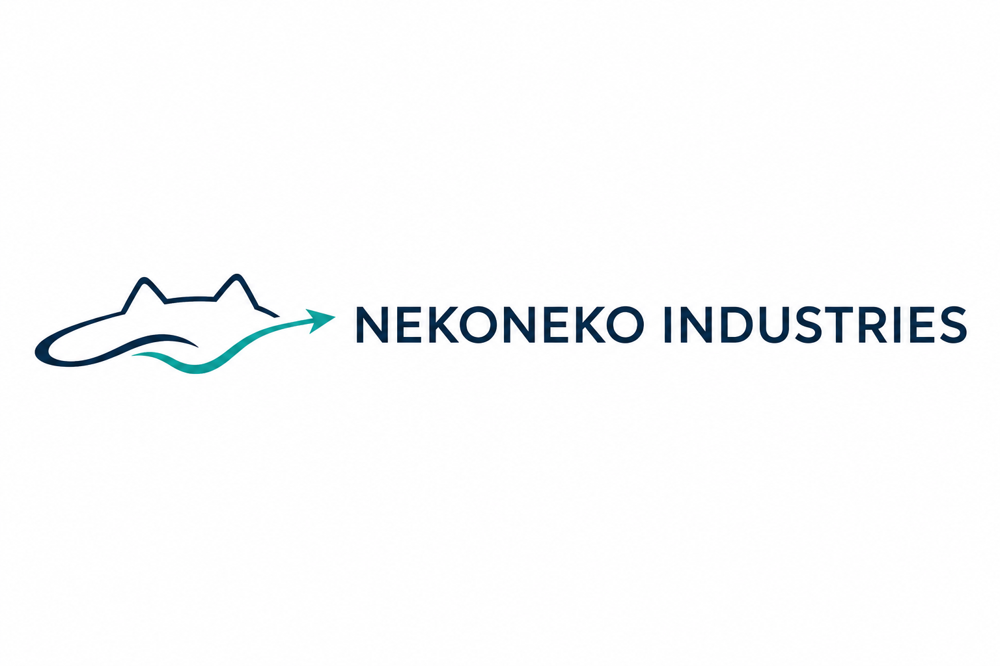
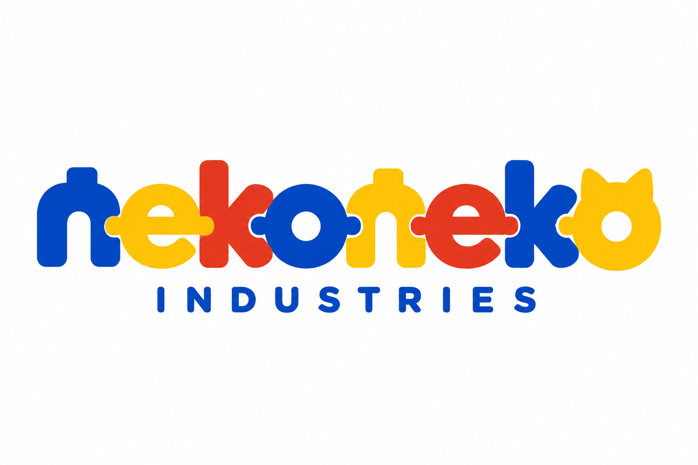
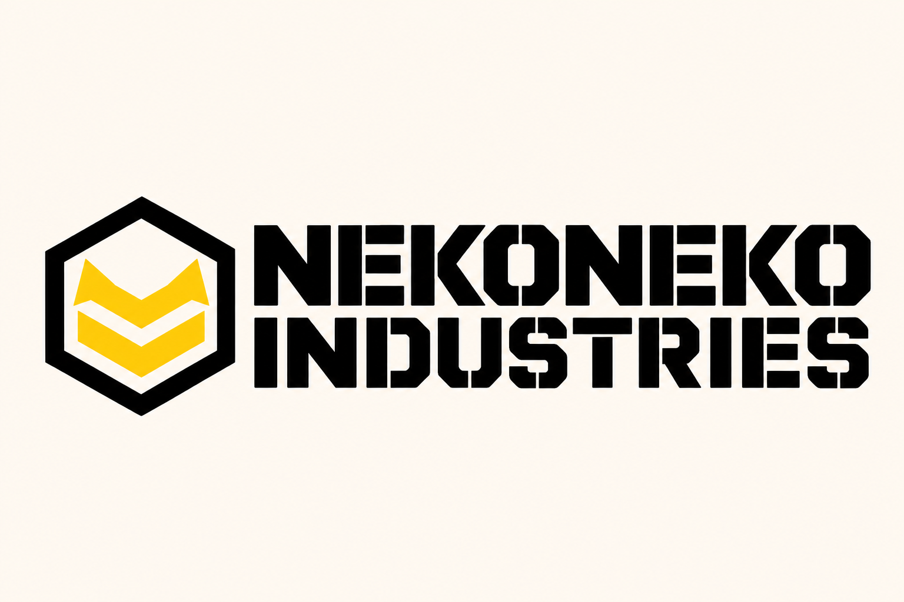
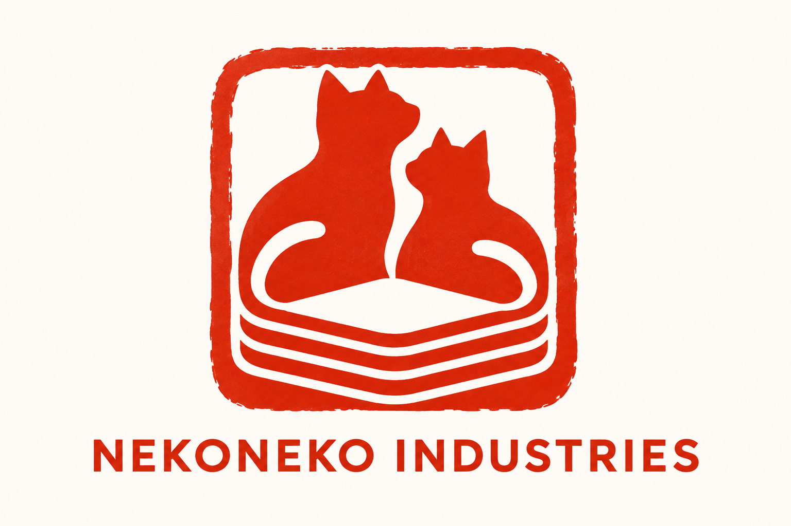

# ネコネコインダストリーのロゴ案

社名は「ネコネコインダストリー」、英語表記は「NEKONEKO INDUSTRIES」です。NEKOMOは乗り物の製品ブランドとして継続します。

ミッションは「わくわくを、どこへでも。／Wonder to Go.」に決まりました。[ミッションを反映した追加5案（06〜10）](mission-logo-concepts.md)も比較できます。以下は初回の5案です。

以下は、異なるコンセプトで制作した5つの比較案です。正式なロゴはまだ選んでいません。現在のバス試作に加え、車・船・飛行機・潜水艦を構想する、ねこのAI職人たちのおもちゃ工場を表現しています。

## 5案の比較

| 案 | コンセプト | 主な色 | 表したい印象 |
| --- | --- | --- | --- |
| 01 工房のモノグラム | ねこの輪郭とNを組み合わせる | チャコール・銅色 | 職人の技術と親しみ |
| 02 陸海空の航路 | 波と進行方向を表す線に、ねこの耳を重ねる | ネイビー・ティール | 乗り物の広がりと探究心 |
| 03 組み替える玩具 | 文字を玩具のブロックのように構成する | 青・黄・朱色 | 作る楽しさと遊び心 |
| 04 重工メーカー | ねこの耳を思わせる形と工業的な紋章 | 黒・白・黄色 | 精密さと力強さ |
| 05 和の印章 | 二匹のねこと積層の形を印章にする | 朱色・生成り | 手仕事と日本の工房 |

## 01 工房のモノグラム

ねこの輪郭とNを一つの記号にする案です。落ち着いた工房の印象を目指し、製品の刻印や部品袋にも使うことを想定しています。

## 02 陸海空の航路

車・船・飛行機・潜水艦を、移動と探索という共通のテーマで表す案です。車種ごとの絵に頼らず、今後の製品の広がりを表現します。

## 03 組み替える玩具

文字そのものを組み立てて遊ぶようなロゴです。親子で楽しむ玩具や、カラフルなパッケージを想定しています。

## 04 重工メーカー

おもちゃを本格的な工業製品のように扱う、力強いメーカーの案です。ねこの耳を思わせる記号を、工業的な紋章としてまとめます。

## 05 和の印章

ねこの工房が作品に押す印をイメージした案です。和の手仕事と3Dプリントの積層を組み合わせます。

## 制作と採用

画像は内蔵の画像生成ツールで制作したPNGのコンセプト案です。SVGなどのベクターデータ、正式な書体指定、印刷用データはまだ作成していません。

採用後に、単色表示、小さなサイズでの読みやすさ、実際の製品への刻印を確認し、用途に合わせて形を整えます。

[01・02の制作プロンプト](logo-concepts/prompts01-02.md) · [03〜05の制作プロンプト](logo-concepts/prompts03-05.md) · [リポジトリの紹介へ戻る](../../README.md)
