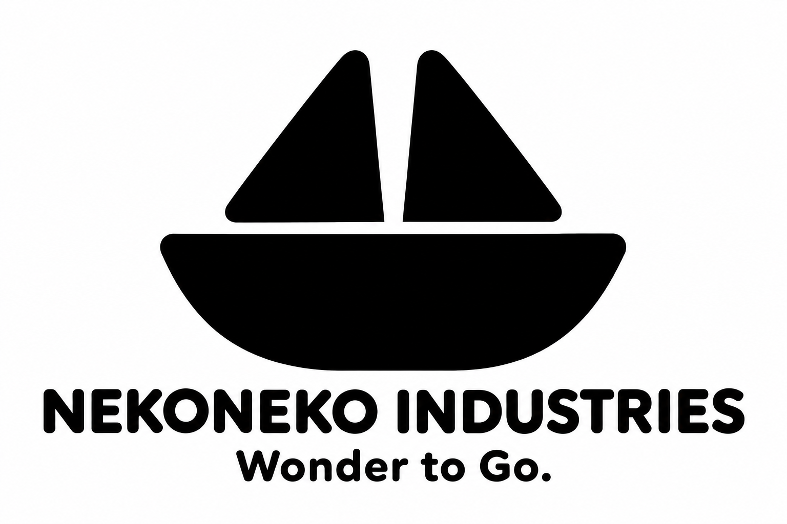
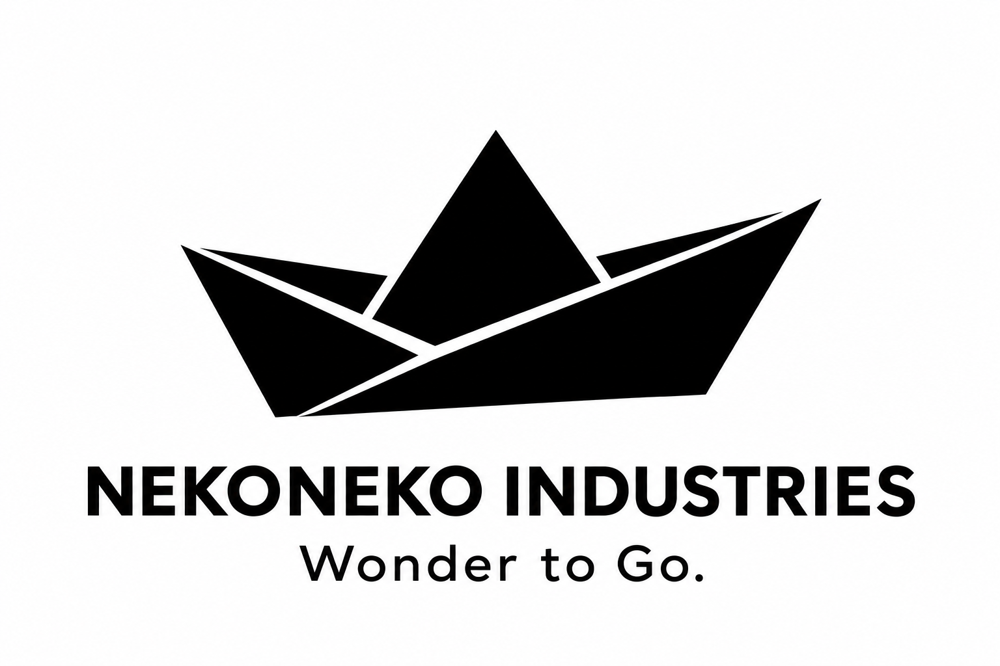
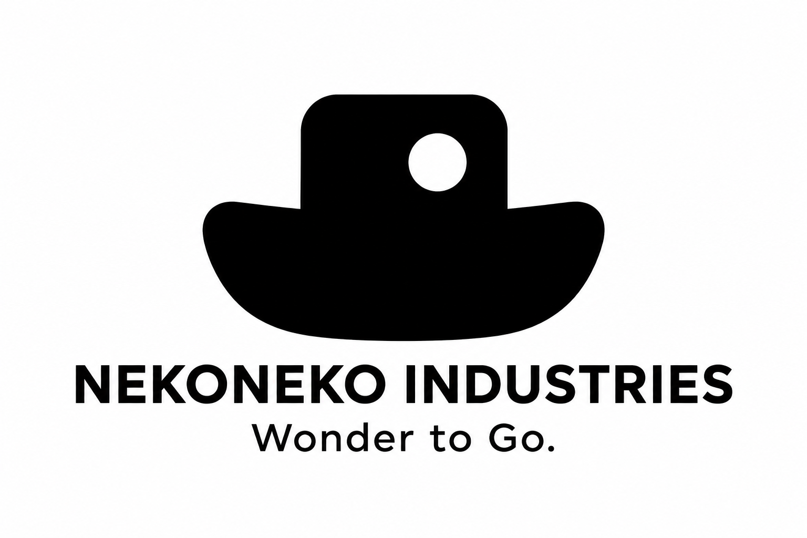
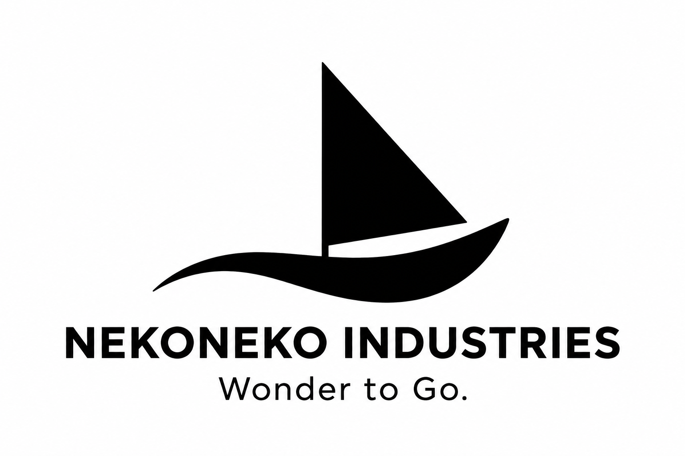
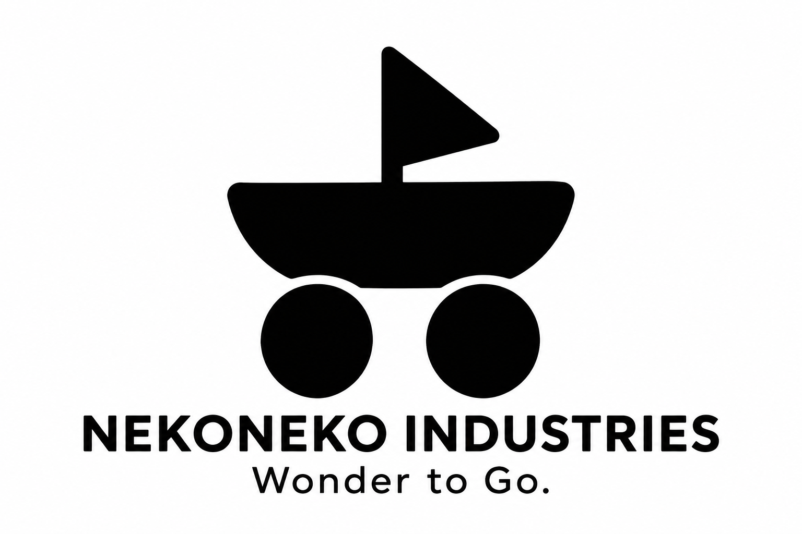

# 船が伝わるシンプルなロゴ5案

**わくわくを、どこへでも。／Wonder to Go.**

[車・船・飛行機をまとめた26〜30案](land-sea-air-logo-concepts.md)と[帆船だけに絞った31〜35案](sailship-logo-concepts.md)も比較できます。

抽象的なマークでは商品を連想しにくいという指摘を受け、船のシルエットを中心に21〜25の5案を制作しました。黒一色と少ない形という条件を残し、まず船として読めること、そのうえでねこや出発の楽しさを感じられることを重視しています。

社名はネコネコインダストリー（NEKONEKO INDUSTRIES）、製品ブランドはNEKOMOです。船や車などの乗り物のおもちゃを構想する活動の、比較用のロゴ案です。正式採用は未定です。

## 5案の比較

| 案 | 一目で見せたい形 | 加える意味 |
| --- | --- | --- |
| 21 ねこの帆船 | 船体と二つの帆 | 帆がねこの耳にも見える楽しさ |
| 22 ひと折りの舟 | 折り紙の舟 | 小さな手作りの遊びを持ち出す |
| 23 小さなタグボート | 丸い船体と小さな船室 | 手に取りたくなる乗り物のおもちゃ |
| 24 波と帆 | 帆と、船体を兼ねる波 | 水の上を進む軽やかさ |
| 25 車輪付きの遊び舟 | 車輪で走る帆船 | 陸でも海でも広がる想像の遊び |

## 21 ねこの帆船

船体の上に二つの短い帆を置き、ねこの耳にも見える形にする案です。船体と帆だけで、船と「ネコネコ」のつながりを表します。

## 22 ひと折りの舟

折り紙の舟を、少ない面と折り目で表す案です。身近な遊びと、どこへでも持っていける小ささをイメージします。

## 23 小さなタグボート

丸みのある船体と小さな船室、丸窓で、おもちゃらしい船を表す案です。親しみやすい乗り物の輪郭を重視します。

## 24 波と帆

帆と、船体から波へつながる曲線の二つを使う案です。船としての読みやすさを保ちながら、進む動きを表します。

## 25 車輪付きの遊び舟

船体に車輪を付けた、空想の乗り物を表す案です。船と車を一つのおもちゃの形にし、場所を越えて遊ぶ「Wonder to Go.」につなげます。製作済みの製品を示すものではありません。

## 比較と制作記録

[抽象的な16〜20案](minimal-logo-concepts.md)は、今回の指摘を受けて保留として残しています。[01〜05案](README.md)、[06〜10案](mission-logo-concepts.md)、[11〜15案](wonder-to-go-logo-concepts.md)も保存しています。

画像は内蔵の画像生成ツールで制作したPNGの比較案です。ベクターデータと、製品への刻印・印刷用データはまだ作成していません。

[21・22の制作プロンプト](logo-concepts/prompts21-22.md) · [23〜25の制作プロンプト](logo-concepts/prompts23-25.md) · [リポジトリへ戻る](../../README.md)
