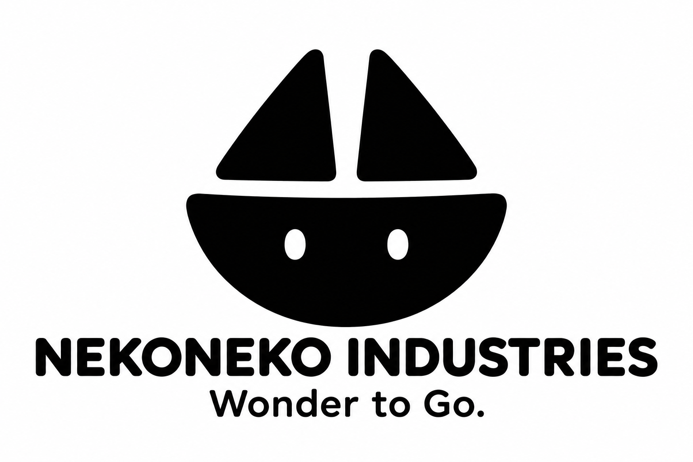
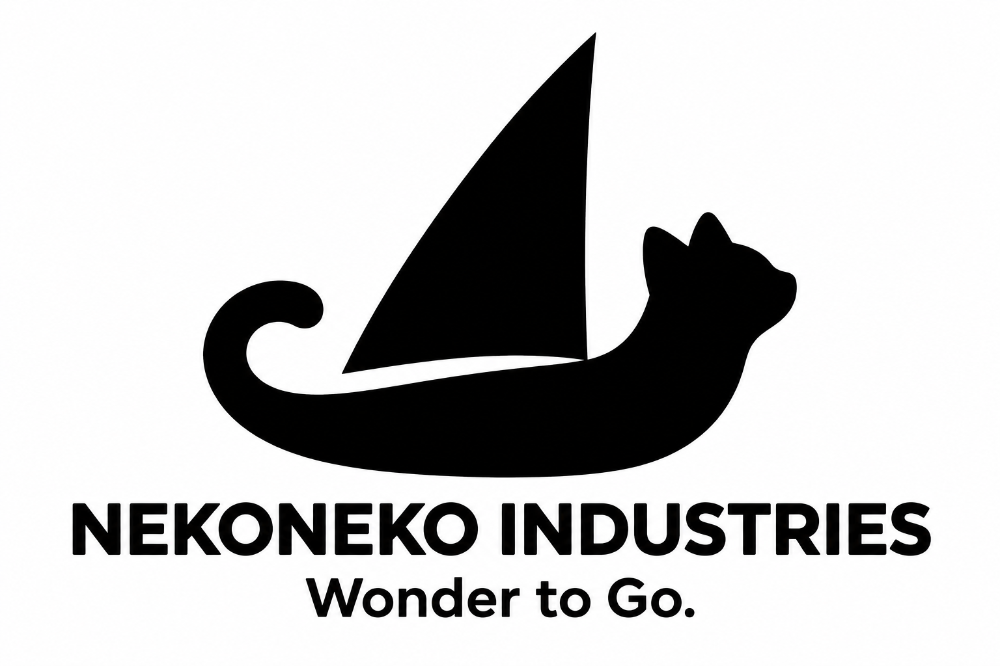
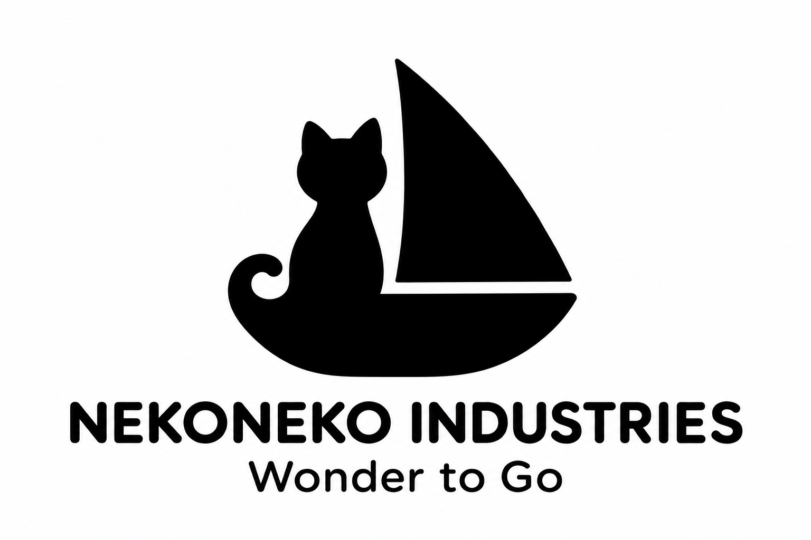
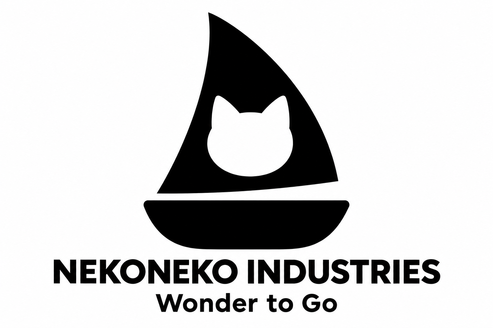
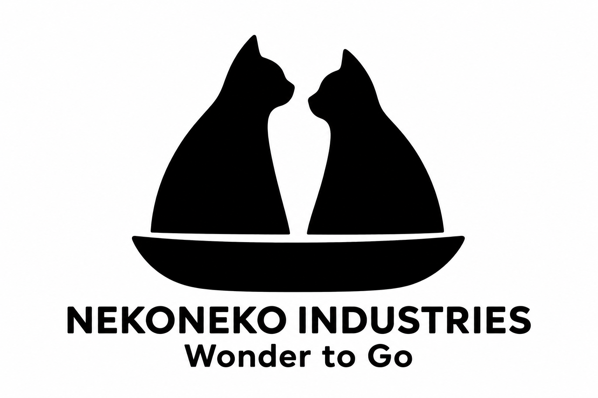

# ネコと帆船を組み合わせたロゴ5案

**わくわくを、どこへでも。／Wonder to Go.**

2026年11月13日に38「ねこ船長」を正式採用しました。採用データと使用方針は[ブランド基本情報](identity.md)を参照してください。以下は比較時の案を残した記録です。

今回は、ネコと帆船を一つのマークに組み合わせた36〜40の5案です。耳を帆に、しっぽを船体にするなど、形が二つの役割を兼ねる組み合わせを比較しています。黒一色を基本に、少ない形でネコと帆船の両方を見せることを目指します。

社名はネコネコインダストリー（NEKONEKO INDUSTRIES）、製品ブランドはNEKOMOです。このページは36〜40案の比較記録です。

## 5案の比較

| 案 | ネコの表現 | 帆船との組み合わせ |
| --- | --- | --- |
| 36 耳が帆になるねこ舟 | 耳と二つの目 | 耳が帆、顔の下部が船体になる |
| 37 しっぽで進む帆船 | 横顔と曲がったしっぽ | 体としっぽを船体に見立てる |
| 38 ねこ船長 | 船に座るネコの輪郭 | ネコの姿と帆を一つの船にまとめる |
| 39 帆の中のネコ | ネコの頭の白抜き | 大きな帆の中にネコを見せる |
| 40 ふたりのネコの帆 | 向かい合う二匹の横顔 | 二匹の体が二枚の帆になる |

## 36 耳が帆になるねこ舟

二枚の帆を耳に、船体を顔の下部に見立てる案です。船体に小さな目を入れ、ネコらしさをはっきりさせます。

## 37 しっぽで進む帆船

ネコの横顔としっぽの曲線を、船体の輪郭として使う案です。そこへ一枚帆を添え、ネコのしなやかさと出航する姿を重ねます。

## 38 ねこ船長（採用ロゴ）

小さなネコが乗る帆船を、少ないシルエットでまとめる案です。おもちゃで物語を考えて遊ぶ楽しさにつなげます。

この案を2026年11月13日に採用しました。採用データは[logo.png](logo.png)です。

## 39 帆の中のネコ

大きな黒い帆に、ネコの頭を白く抜く案です。帆船の輪郭と、その中に発見するネコを一つの図案にします。

## 40 ふたりのネコの帆

向かい合う二匹のネコの体を、二枚の帆に見立てる案です。「ネコネコ」の名前と帆船の形を結び付けます。

## 比較と制作記録

[帆船だけに絞った31〜35案](sailship-logo-concepts.md)、[車・船・飛行機を組み合わせた26〜30案](land-sea-air-logo-concepts.md)、[それ以前の案](README.md)も保存しています。[抽象的な16〜20案](minimal-logo-concepts.md)は保留です。

画像は内蔵の画像生成ツールで制作したPNGの比較案です。ベクターデータ化、小さなサイズでの調整、刻印・印刷用データの作成はまだ行っていません。

[36・37の制作プロンプト](logo-concepts/prompts36-37.md) · [38〜40の制作プロンプト](logo-concepts/prompts38-40.md) · [リポジトリへ戻る](../../README.md)
