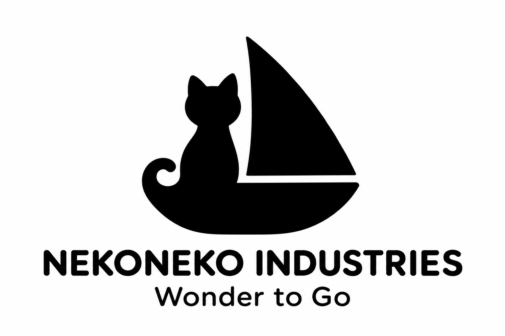

# ブランド基本情報

## 採用ロゴ

2026年11月13日に、38「ねこ船長」をネコネコインダストリーのロゴとして正式採用しました。

採用データは [logo.png](logo.png) です。原案の [38-cat-captain.png](logo-concepts/38-cat-captain.png) を同じ内容で保存しています。

## 名称と使命

| 種別 | 正式表記 |
| --- | --- |
| 会社名 | ネコネコインダストリー / NEKONEKO INDUSTRIES |
| 製品ブランド | NEKOMO |
| 使命 | わくわくを、どこへでも。 / Wonder to Go. |

会社名と製品ブランドは区別して表記します。使命の英語表記は末尾にピリオドを付けます。

## 使用方針

- 社名ロゴには採用PNGを使います。
- 画像の英語タグラインは、原案の仕様に合わせて `Wonder to Go` と表示します。画像内にピリオドがない表記は、使命の正式表記とは区別します。
- 採用データはPNGのみです。SVGなどのベクターデータと刻印用データは未作成です。別形式や用途別のデータを作成した場合は、採用データと区別して記録します。

[ロゴ案の比較記録](README.md)
