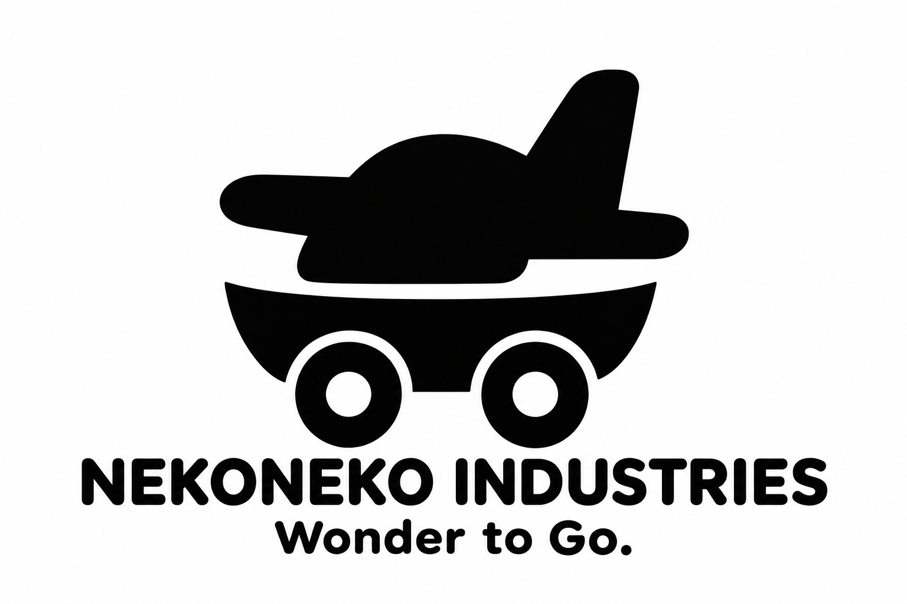
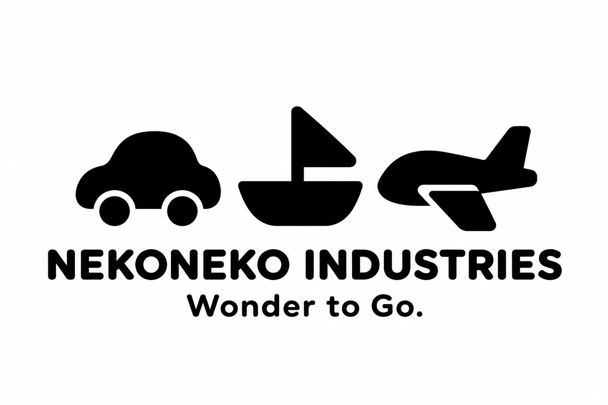
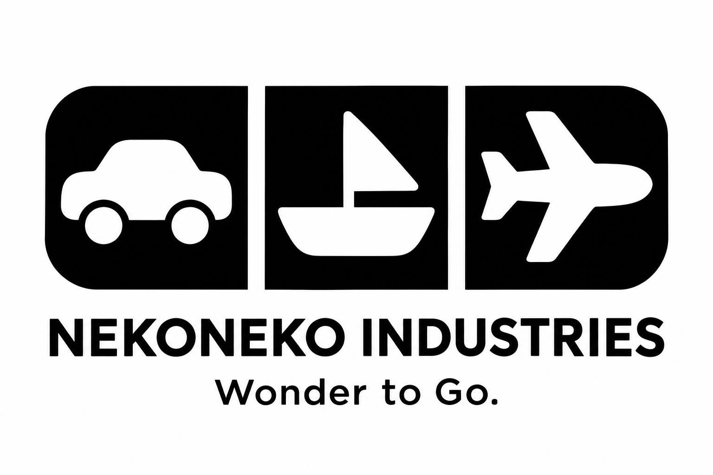
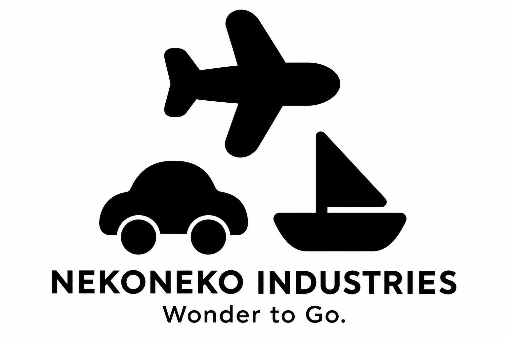
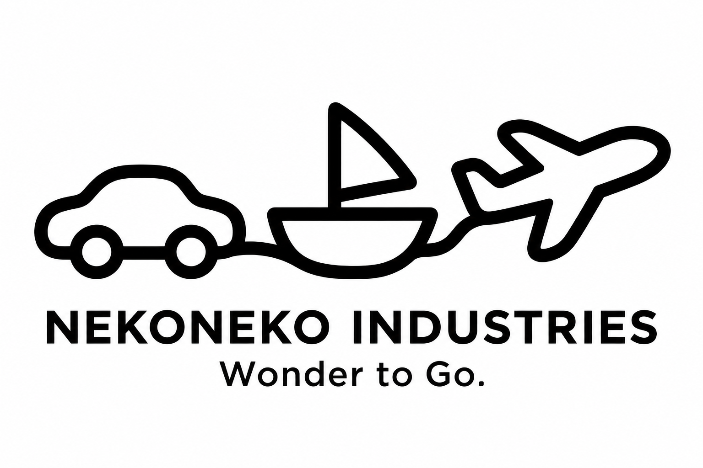

# 車・船・飛行機が伝わるシンプルなロゴ5案

**わくわくを、どこへでも。／Wonder to Go.**

[帆船だけに絞った追加5案（31〜35）](sailship-logo-concepts.md)も比較できます。

今回は、車・船・飛行機の3つが読み取れる26〜30の5案です。黒一色と少ない形という条件を保ち、車輪・船体・翼をどうまとめるかを比較しています。

社名はネコネコインダストリー（NEKONEKO INDUSTRIES）、製品ブランドはNEKOMOです。乗り物のおもちゃを構想する活動の比較用ロゴで、正式採用は未定です。

## 5案の比較

| 案 | まとめ方 | 特徴 |
| --- | --- | --- |
| 26 陸海空のおもちゃ | 船体・車輪・翼を一つの空想の乗り物にする | 一つのマークで、場所を越えて遊ぶ楽しさを表す |
| 27 ならぶ乗り物 | 車・船・飛行機の輪郭を横にそろえる | 3種類の乗り物を素直に見せる |
| 28 みっつの窓 | 3つの黒い面に乗り物を白抜きする | まとまりのあるタイル状のマーク |
| 29 遊びのトライアングル | 3種類の乗り物を三角形に配置する | 3種類の輪郭で一つのまとまりを作る |
| 30 ひと続きの旅 | 3種類の輪郭を一本の線でつなぐ | 遊びが陸・海・空へ続く様子を表す |

## 26 陸海空のおもちゃ

船体に車輪と飛行機の翼を組み合わせる案です。実際の製品の仕様ではなく、自由に遊ぶ空想の乗り物を表します。

26案は細部を減らした修正版です。[初稿](logo-concepts/26-all-terrain-wonder.png)も保存しています。

## 27 ならぶ乗り物

車・船・飛行機の丸みや太さをそろえ、横に並べる案です。構想する乗り物の広がりを、そのまま輪郭で伝えます。

## 28 みっつの窓

黒い面の中に3種類の乗り物を白抜きする案です。まとまりのある外形と、乗り物ごとの読みやすさの両立を目指します。

## 29 遊びのトライアングル

上に飛行機、下に車と船を置き、三角形にまとめる案です。それぞれの乗り物を見せながら、一つの集まりとして表します。

## 30 ひと続きの旅

車・船・飛行機の輪郭を太めの線でつなぐ案です。一つの線が続く形で、場所を変えても遊びが続くことを表します。

## 比較と制作記録

[船を中心にした21〜25案](boat-logo-concepts.md)も残しています。[01〜05案](README.md)、[06〜10案](mission-logo-concepts.md)、[11〜15案](wonder-to-go-logo-concepts.md)と、[保留中の抽象案16〜20](minimal-logo-concepts.md)も保存しています。

画像は内蔵の画像生成ツールで制作したPNGの比較案です。ベクターデータ化、小さなサイズでの調整、製品への刻印・印刷用データの作成はまだ行っていません。

[26・27の制作プロンプト](logo-concepts/prompts26-27.md) · [28〜30の制作プロンプト](logo-concepts/prompts28-30.md) · [リポジトリへ戻る](../../README.md)
