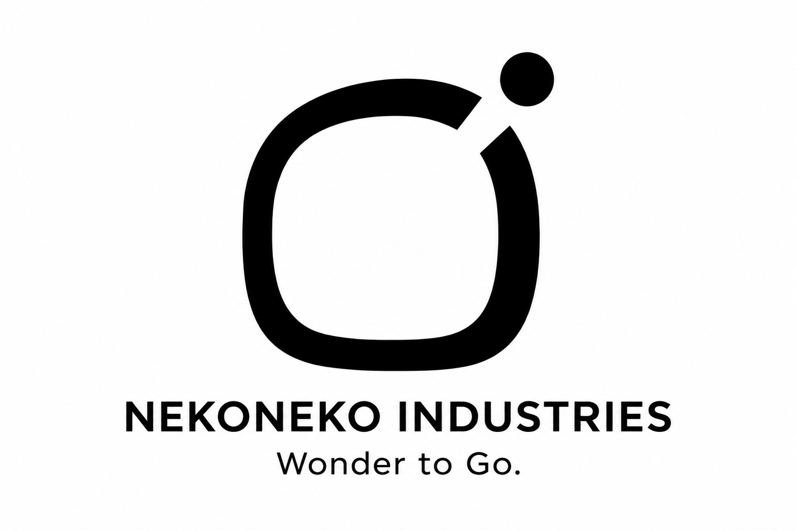
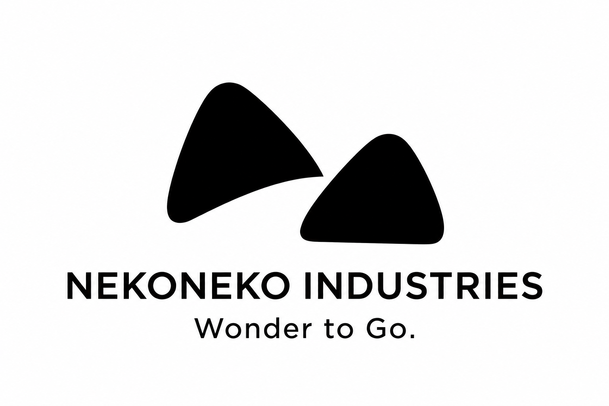
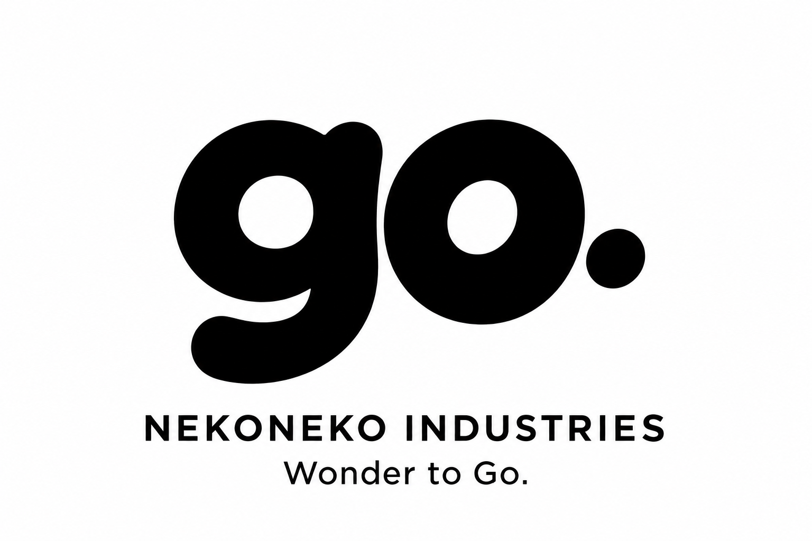
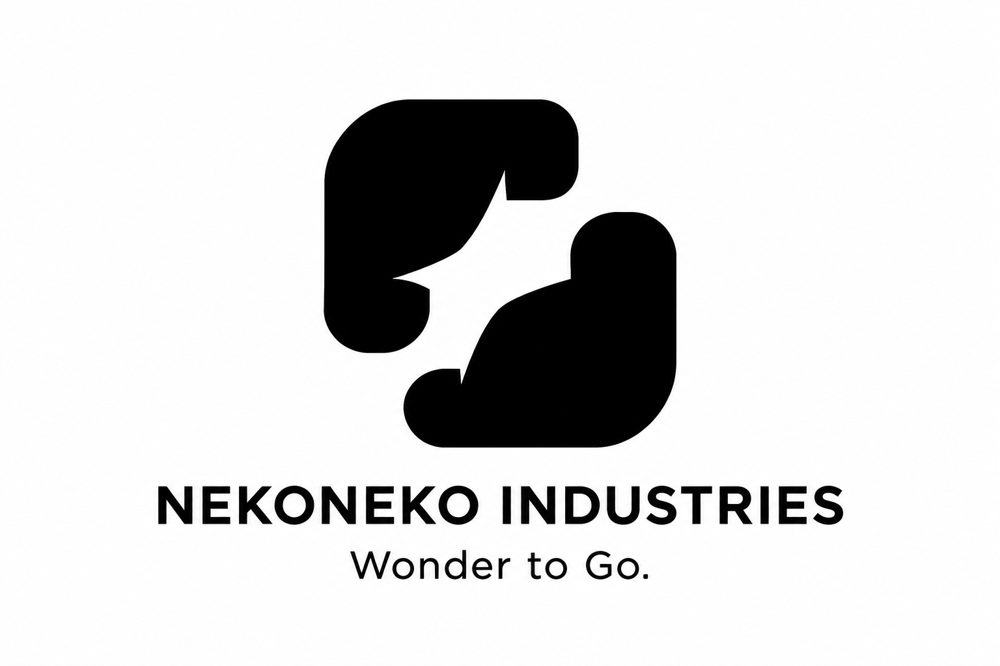
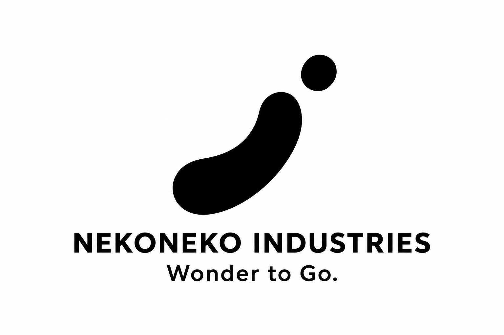

# ユニークでシンプルな追加ロゴ5案

**わくわくを、どこへでも。／Wonder to Go.**

この抽象的な5案は保留です。商品を連想しやすい方向へ見直し、現在は[帆船だけに絞った31〜35案](sailship-logo-concepts.md)を優先して比較しています。

今回は16〜20の5案を、黒一色のマークとして制作しました。色やイラストの細部に頼らず、形と余白で違いを出す案です。小さな表示や単色の印刷を想定し、マークを構成する要素を絞っています。

社名はネコネコインダストリー（NEKONEKO INDUSTRIES）、製品ブランドはNEKOMOです。各画像には社名とミッションを添えています。正式採用は未定で、実際の刻印・印刷用データはまだ作成していません。

[01〜05案](README.md) · [06〜10案](mission-logo-concepts.md) · [11〜15案](wonder-to-go-logo-concepts.md)

## 5案の比較

| 案 | 主な形 | Wonder to Go.とのつながり |
| --- | --- | --- |
| 16 抜けだす丸 | 開いた角丸の輪と、外へ出た丸 | 小さなわくわくを外へ連れ出す |
| 17 跳ねる耳 | ねこの耳を思わせる二つの形 | ねこらしさと、跳ねる軽やかさ |
| 18 小さなgo. | 独自の形にした短い文字 | 出発する言葉を小さくまとめる |
| 19 余白の星 | 二つの形の間に生まれる白い星 | 隙間に発見するわくわく |
| 20 一歩踏み出す！ | 前に傾いた曲線と丸 | 驚きと、踏み出す動き |

## 16 抜けだす丸

閉じた輪から小さな丸が抜け出す形で、わくわくを外へ連れ出す様子を表す案です。輪を真円にせず、角丸の形と切れ目の位置で特徴を付けます。

## 17 跳ねる耳

目や口を描かず、ねこの耳を思わせる二つの形だけを使う案です。左右を少しずらして、跳ねるような軽やかさを表します。

## 18 小さなgo.

短い「go.」を、独自の文字の形と丸の位置で表す案です。ミッション全体を大きく見せた15案とは違い、出発を意味する短い言葉を記号として扱います。

## 19 余白の星

星を描き足す代わりに、二つの形の間の余白で星を作る案です。形を見てから、その中に別の形を発見する楽しさを表します。

## 20 一歩踏み出す！

感嘆符を思わせる曲線と丸に、前へ踏み出す姿勢を付ける案です。顔や手足を描かず、驚きと動きを最小限の形で表します。

## 制作データ

画像は内蔵の画像生成ツールで制作したPNGの比較案です。マークの単純さを検討する段階で、ベクターデータ化、小さなサイズでの調整、実際の製品への刻印確認はまだ行っていません。前回までの15案は変更せず残しています。

[16・17の制作プロンプト](logo-concepts/prompts16-17.md) · [18〜20の制作プロンプト](logo-concepts/prompts18-20.md) · [リポジトリへ戻る](../../README.md)
