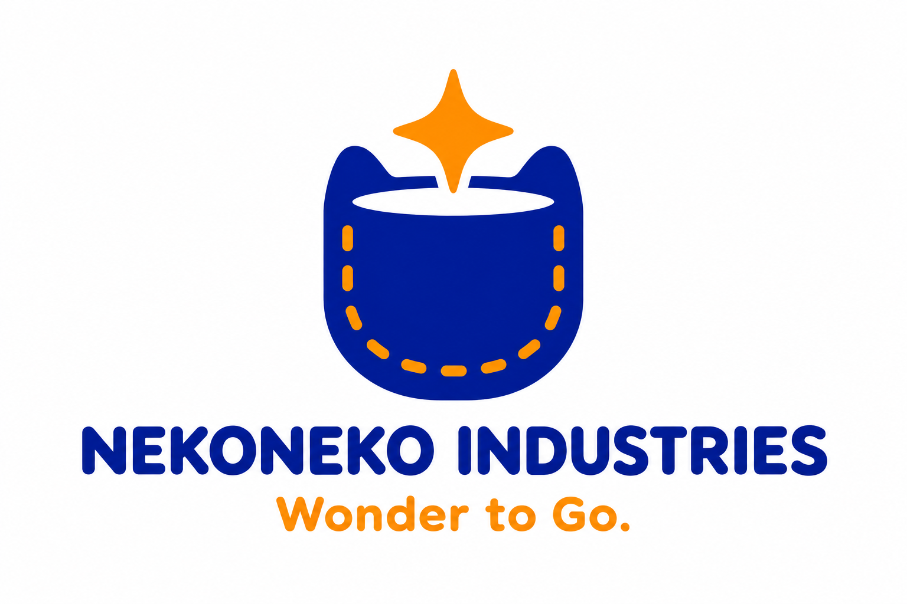
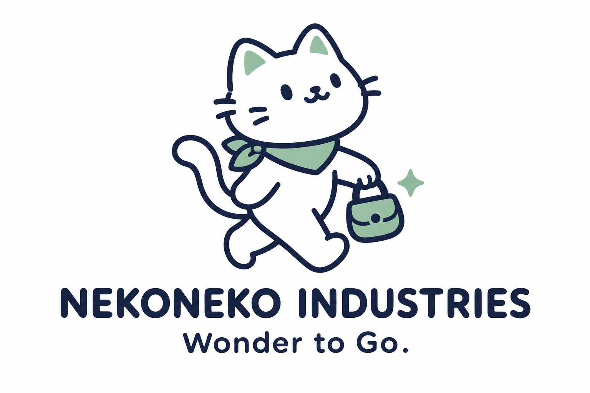
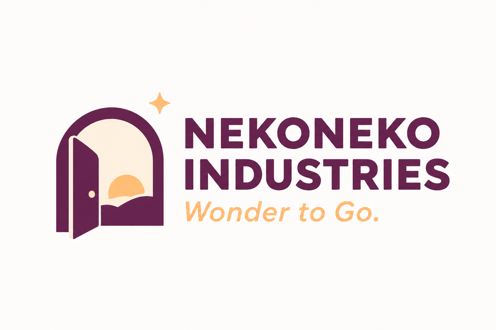
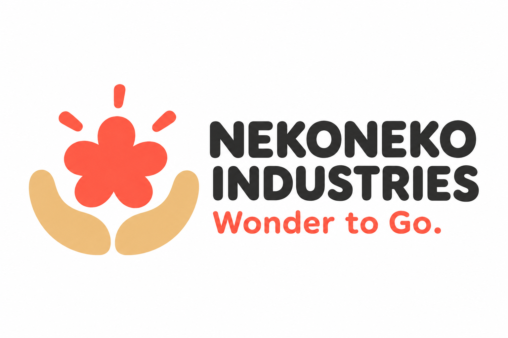
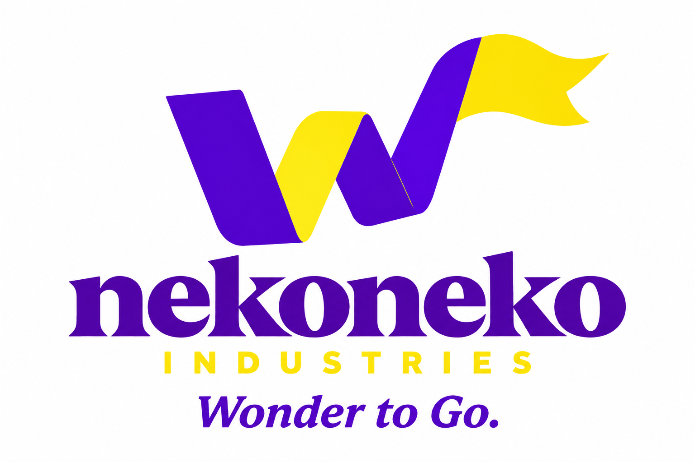

# ミッションを表す追加ロゴ5案

**わくわくを、どこへでも。**

**Wonder to Go.**

決定したミッションをもとに、06〜10の5案を追加しました。子どもがどこへでも持ち運び、安全に遊べるおもちゃを目指す構想を、「持ち歩く楽しさ」「相棒」「冒険」「発見」「動き」の5方向で表します。AIエージェントによる設計自動化は、そのための開発方法として扱います。

社名はネコネコインダストリー（NEKONEKO INDUSTRIES）、製品ブランドはNEKOMOです。今回も比較用の提案であり、正式採用は未定です。[初回01〜05のロゴ案](README.md)も残しています。

[Wonder to Go.を直感で伝える追加5案（11〜15）](wonder-to-go-logo-concepts.md)も比較できます。

## 5案の比較

| 案 | ロゴのモチーフ | ミッションとのつながり | 主な色 |
| --- | --- | --- | --- |
| 06 ポケットのわくわく | ポケットと小さなきらめき | 楽しさをポケットに入れて持ち歩く | オレンジ・青 |
| 07 いつもの相棒 | 小さなバッグを持つねこ | どこへ行くときも一緒にいたくなる | ミント・ネイビー |
| 08 冒険への小さな扉 | 開いた扉とその向こうの景色 | 身近な場所から想像の冒険が始まる | 紫・アプリコット |
| 09 手のひらの発見 | 手のひらに包まれたきらめき | 小さなおもちゃを手に取る喜び | コーラル・砂色 |
| 10 はずむW | Wを思わせる動きのあるリボン | Wonderを持って出かける軽やかさ | バイオレット・黄 |

## 06 ポケットのわくわく

「どこへでも」を、ポケットに入れて持ち歩く形で表す案です。小さなきらめきに、おもちゃを取り出すときのわくわくを込めます。

## 07 いつもの相棒

小さなバッグを持って出かけるねこを、おもちゃと一緒に過ごす子どもの相棒として表す案です。工場の職人という前回の世界観から、使う子どもの日常へ視点を移します。

## 08 冒険への小さな扉

おもちゃを持って出かけた先で、遊びの世界が広がることを表す案です。乗り物の種類を限定せず、小さな扉の向こうに冒険を描きます。

## 09 手のひらの発見

花のようなきらめきを両手で受ける形で、おもちゃを手に取る喜びを表す案です。工業的な強さより、親しみやすさと温かさを重視します。

## 10 はずむW

Wonderの頭文字Wを、動きのある記号として表す案です。具体的な乗り物やねこの絵を使わず、ミッションの言葉と印象を結び付けます。

## 制作データ

内蔵の画像生成ツールで制作したPNGのコンセプト案です。SVGなどのベクターデータと、製品への刻印・印刷用データはまだ作成していません。

[06・07の制作プロンプト](logo-concepts/prompts06-07.md) · [08〜10の制作プロンプト](logo-concepts/prompts08-10.md) · [リポジトリへ戻る](../../README.md)
