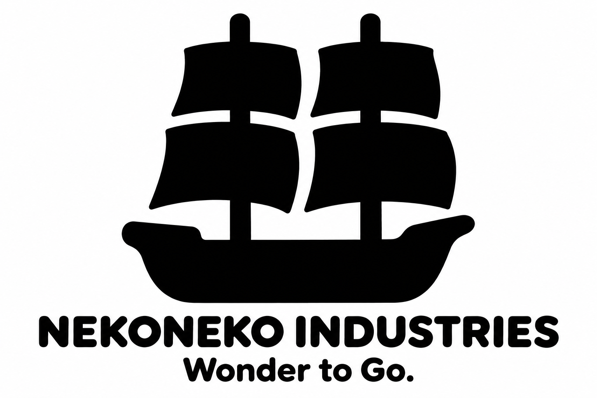
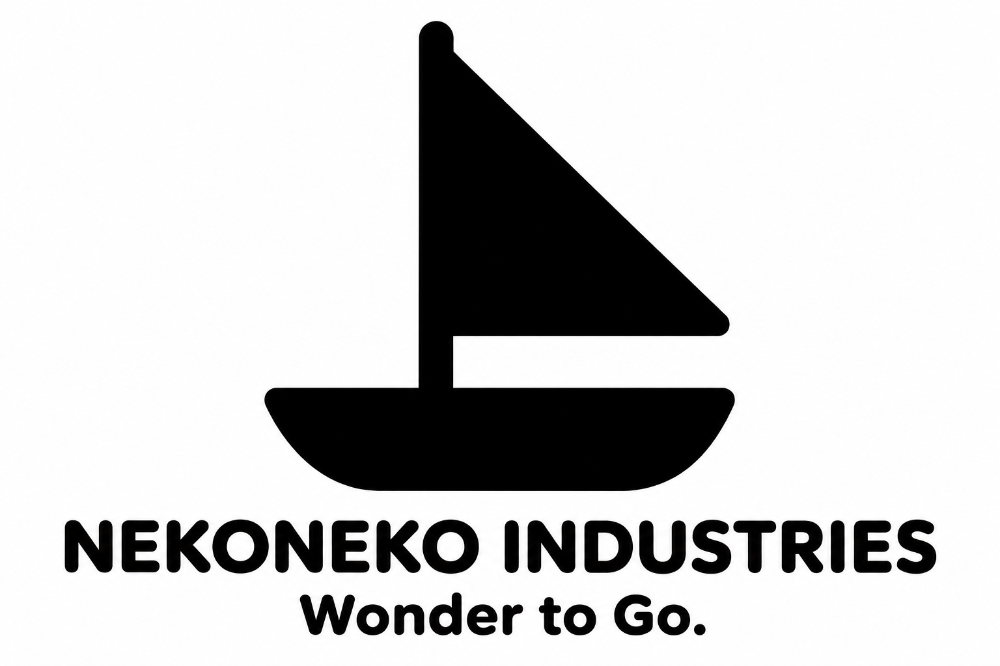
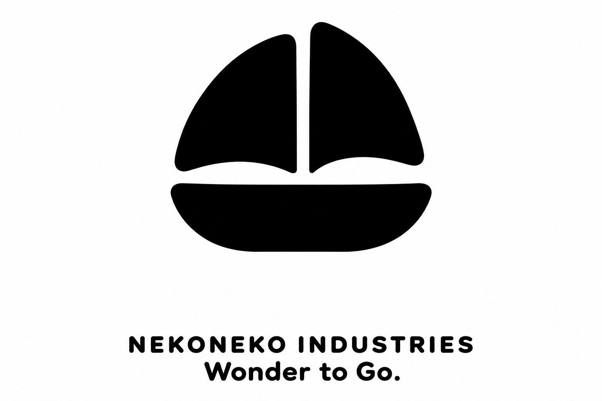
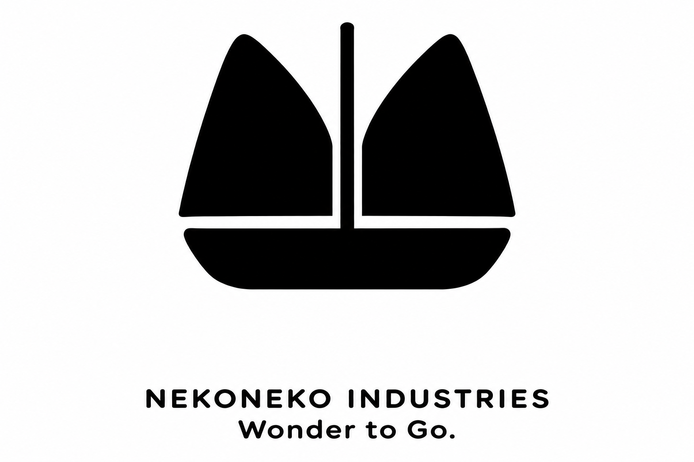
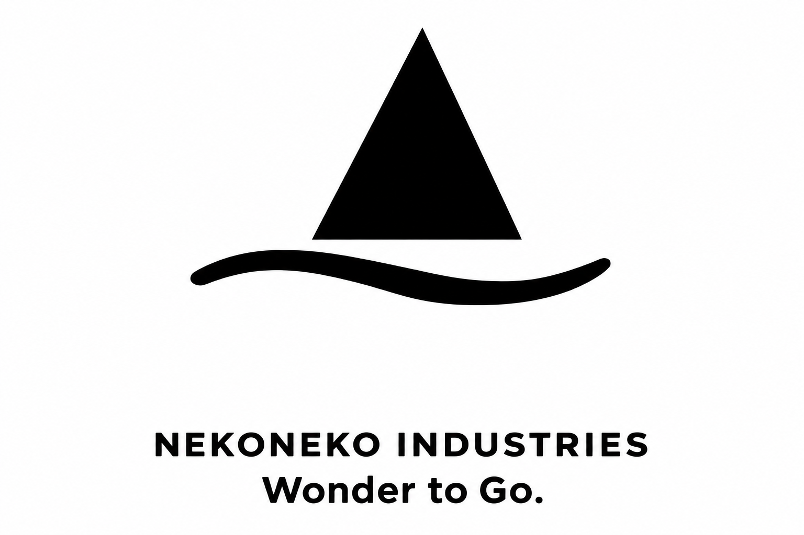

# 帆船だけに絞ったシンプルなロゴ5案

**わくわくを、どこへでも。／Wonder to Go.**

[ネコと帆船を組み合わせた追加5案（36〜40）](cat-sailship-logo-concepts.md)も比較できます。

最新の希望に合わせて、帆船を単独で表す31〜35の5案です。黒一色を基本に、マストの数、帆の形、船体の曲線で違いを出しています。

社名はネコネコインダストリー（NEKONEKO INDUSTRIES）、製品ブランドはNEKOMOです。いずれも比較用のロゴ案で、正式採用は未定です。

## 5案の比較

| 案 | 帆と船体の特徴 | 目指す印象 |
| --- | --- | --- |
| 31 二本マストの帆船 | 二本のマストと四角い帆 | 冒険に出発する帆船らしさ |
| 32 大きな一枚帆 | 大きな三角帆と船体 | 少ない形で伝わる軽やかさ |
| 33 絵本のような二枚帆 | 開いたページを思わせる丸い帆 | 想像が広がる遊び心 |
| 34 ねこの耳の帆 | 耳にも見える二枚帆 | ネコネコらしさと親しみ |
| 35 波につながる帆船 | 帆と、船体を兼ねる波 | 風と水に乗って進む動き |

## 31 二本マストの帆船

二本のマストと四角い帆を中心にする案です。ロープなどの細部を省き、冒険へ出かける帆船の輪郭を表します。

## 32 大きな一枚帆

大きな三角帆と船体を、少ない形でまとめる案です。帆の広がりと船体のバランスを重視します。

## 33 絵本のような二枚帆

二枚の丸みのある帆に、絵本を開くような形を重ねる案です。帆船と想像する楽しさを結び付けます。

## 34 ねこの耳の帆

短い二枚の帆を、ねこの耳にも見える形にする案です。船の輪郭を主役にしながら、「ネコネコ」の名前につなげます。

## 35 波につながる帆船

船体と波を一つの曲線にまとめ、帆を添える案です。風と水に乗って進む印象を表します。

## 比較と制作記録

[車・船・飛行機を組み合わせた26〜30案](land-sea-air-logo-concepts.md)、[船を中心にした21〜25案](boat-logo-concepts.md)、[それ以前の案](README.md)も保存しています。[抽象的な16〜20案](minimal-logo-concepts.md)は保留です。

画像は内蔵の画像生成ツールで制作したPNGの比較案です。ベクターデータ化、小さなサイズでの調整、刻印・印刷用データの作成はまだ行っていません。

33〜35案は、社名の表示をそろえた修正版です。変更前の[33案](logo-concepts/33-openbook-sails.png)、[34案](logo-concepts/34-cat-ear-sails.png)、[35案](logo-concepts/35-wave-sailboat.png)も検討記録として残しています。

[31・32の制作プロンプト](logo-concepts/prompts31-32.md) · [33〜35の制作プロンプト](logo-concepts/prompts33-35.md) · [リポジトリへ戻る](../../README.md)
