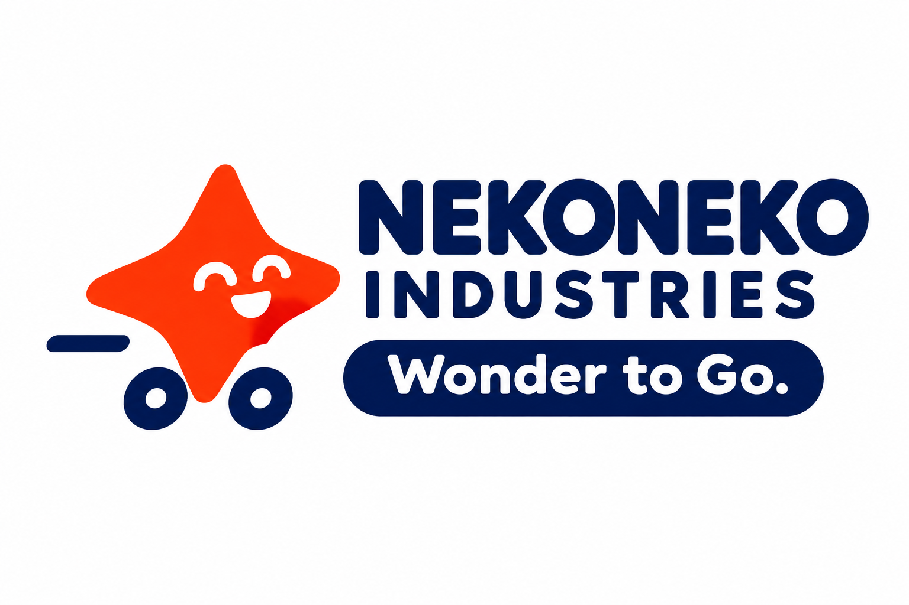
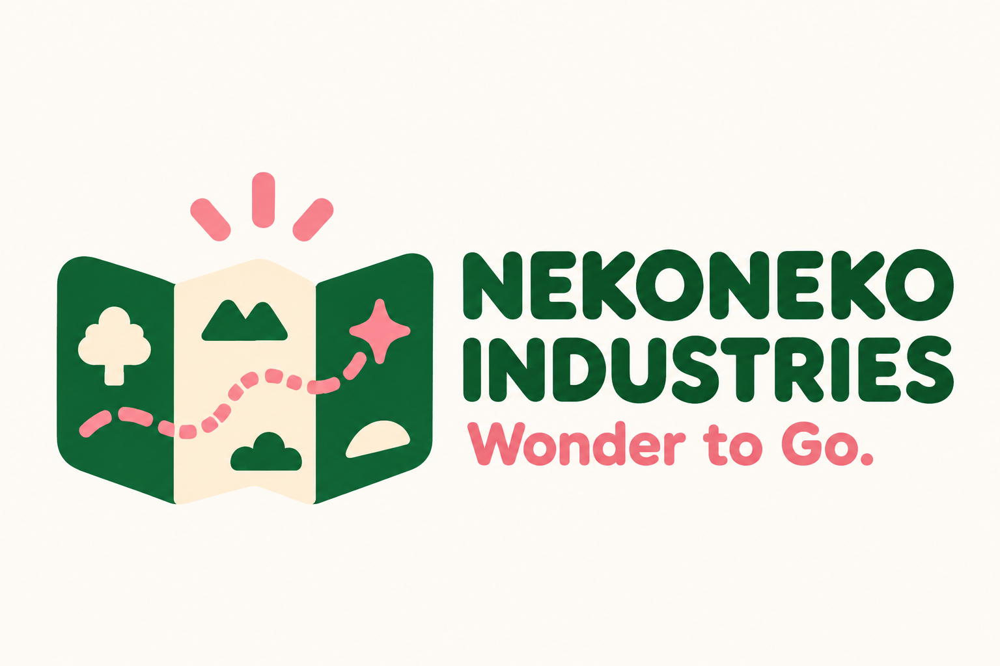

# Wonder to Go.を直感で伝える追加ロゴ5案

**わくわくを、どこへでも。／Wonder to Go.**

今回は、マーク自体から「わくわくを連れて出かける」様子が伝わることを重視した11〜15の5案です。走る、飛ばす、出発する、地図を開く、言葉を動かすという異なる表現で、ミッションを図案にします。

社名はネコネコインダストリー（NEKONEKO INDUSTRIES）、製品ブランドはNEKOMOです。15案目はミッションを大きく見せる表現であり、社名を変更する案ではありません。正式採用は未定です。

[初回の01〜05案](README.md) · [ミッションを反映した06〜10案](mission-logo-concepts.md)

## 5案の比較

| 案 | Wonderの表現 | Goの表現 | 主な色 |
| --- | --- | --- | --- |
| 11 走るわくわく | きらめく星 | 小さな車輪で走る | 朱色・ネイビー |
| 12 想像を飛ばす | 紙飛行機の中の星 | 手作りの遊びが飛び立つ | 水色・ライム |
| 13 冒険の切符 | 星を抜いた切符 | 遊びに出かけるための一枚 | ティール・オレンジ |
| 14 持ち歩く冒険地図 | 地図の中のきらめき | 地図を開いて行き先を探す | 深緑・クリーム・ピンク |
| 15 言葉が出発する | Wonder to Go.の文字 | Goに進行方向の形を組み込む | 黒・オレンジ |

## 11 走るわくわく

星に車輪を付け、わくわくそのものが走り出す形にする案です。小さな乗り物のおもちゃと「Go」を、一つの記号でつなぎます。

## 12 想像を飛ばす

手のひらサイズの紙飛行機を、想像を遠くへ運ぶ象徴にする案です。身近な材料で作った遊びが飛び立つ様子を表します。

## 13 冒険の切符

小さなおもちゃを、どこでも遊びを始められる「冒険への切符」として表す案です。切符に星を組み込み、出かける期待感を表します。

## 14 持ち歩く冒険地図

折りたためる地図に、遊びの行き先を発見する楽しさを込める案です。旅先だけでなく、いつもの場所でも冒険を想像できることを表します。

## 15 言葉が出発する

「Wonder to Go.」をロゴの中心に置き、言葉とマークを一体にする案です。社名は小さく添え、ミッションを先に読める構成にします。

## 制作データ

画像は内蔵の画像生成ツールで制作したPNGのコンセプト案です。ベクターデータや製品への刻印・印刷用データはまだ作成していません。前回までの10案は変更せず残しています。

[11・12の制作プロンプト](logo-concepts/prompts11-12.md) · [13〜15の制作プロンプト](logo-concepts/prompts13-15.md) · [リポジトリへ戻る](../../README.md)
