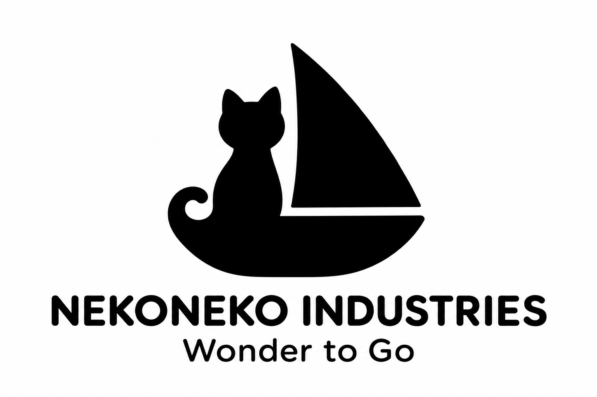
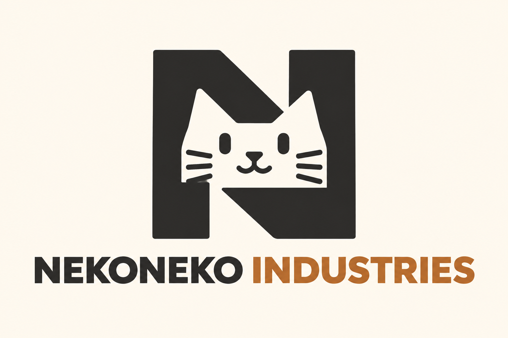
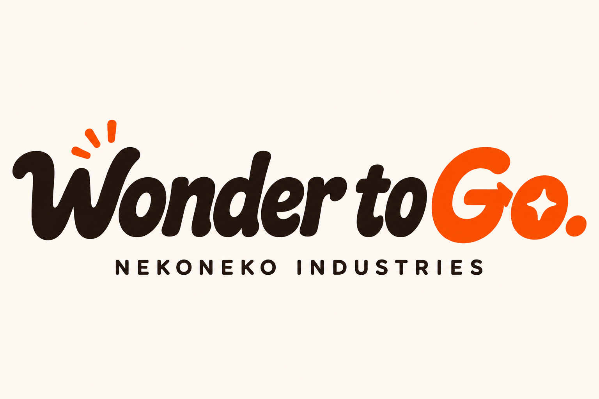
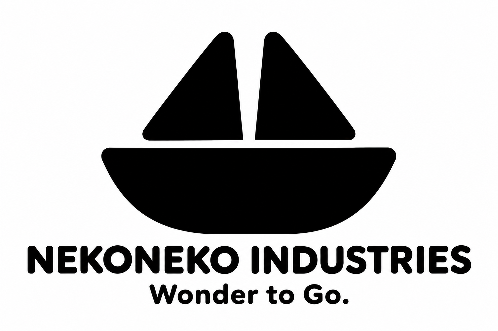

# ねこのAIおもちゃ工場「NEKONEKO INDUSTRIES」誕生記

FreeCAD と家庭用3Dプリンター（Bambu Lab A1 mini）を使って、ねこのAI職人たちが乗り物のおもちゃを作るプロジェクトを立ち上げました。最初は **NEKOMO** という名前でスタートしましたが、車や船など乗り物全般を扱うおもちゃ工場として **ネコネコインダストリー**（NEKONEKO INDUSTRIES）へ改名し、NEKOMO は製品ブランド名として残す形に整理しました。

今回は、プロジェクトのミッションや社名の整理から、40案のロゴ比較を経て「38 ねこ船長」が正式ロゴに決まるまでの流れを、実際に対話で使ったプロンプトと一緒に振り返ります。



プロジェクトの設計データやブランド資料は、こちらの GitHub リポジトリで公開しています。

https://github.com/Sunwood-ai-labs/NEKONEKO-INDUSTRIES

## ステップ1：まずはミッションから考える

最初に考えたのは、「どんなおもちゃを作りたいのか」というプロジェクトの軸です。いきなりロゴの見た目から入るのではなく、先にミッションを言葉にすることにしました。

```text
まずはミッションからかんがえたほうがいいかも！…
```

こうして決まったミッションが **「わくわくを、どこへでも。 / Wonder to Go.」** です。机の上やリビングから、小さな乗り物と一緒に冒険が始まるような楽しさを込めています。

初期のロゴ案では、ねこの工房や「Wonder to Go」の文字を前面に出したデザインからスタートしました。



言葉そのものを主役にしたワードマーク案も試作しています。



## ステップ2：会社名「ネコネコインダストリー」とブランド「NEKOMO」の整理

ロゴやミッションを詰めていくうちに、工場としての名前と、おもちゃのシリーズ名を分けたほうが分かりやすいと感じるようになりました。そこで、こんな相談を投げています。

```text
社名変えた方がいいかな？？ nekoneko インダストリー とかどう？
```

このやり取りをきっかけに、表記のルールを次のように整理しました。

| 種別 | 正式表記 | 役割 |
| --- | --- | --- |
| 会社名 | ネコネコインダストリー / NEKONEKO INDUSTRIES | ねこのAI職人たちが働くおもちゃ工場 |
| 製品ブランド | NEKOMO | 試作する乗り物のおもちゃシリーズ |
| 使命 | わくわくを、どこへでも。 / Wonder to Go. | プロジェクト共通のタグライン |

現在は NEKOMO ブランドでスクールバス型のおもちゃを試作していますが、将来的には車・船・飛行機・潜水艦などにも広げていく構想です。

## ステップ3：40案の比較から「38 ねこ船長」に決定

ブランド名とミッションが定まったところで、ロゴのデザインも一気にブラッシュアップしました。最初期の猫＋帆船アイデアをベースに、さらにバリエーションを増やしていきます。



「もっと猫と帆船をシンプルに融合させたい」と考え、追加の提案を依頼しました。

```text
ネコと帆船要素を組み込んだら？？ さらに５つ提案して
```

こうして生まれた36〜40案の中で、少ないシルエットで「小さな船に乗る猫の姿」がひと目で伝わる38番が目に留まりました。


見た瞬間にこれだと思い、その場で決定しました。

```text
38でいこう！！！
```

2026年11月13日、この **38「ねこ船長」** がネコネコインダストリーの正式ロゴになりました。

## AIとブランドを育てるときのコツと公開資料

公開リポジトリには、採用ロゴだけでなく 01〜40 案すべての比較履歴、制作プロンプト、正式表記や使用方針をまとめたブランド資料一式を収録しています。同じように AI と対話しながらブランドやロゴを育てていくときは、以下の流れで進めるとブレにくくなります。

- **ミッションを先に言語化する**：見た目のアイデア出しより先に「何のためのプロジェクトか」を言葉にする
- **段階的に案を絞り込む**：最初は幅広く案を出し、方向性が定まったら要素を掛け合わせて追加提案をもらう
- **表記ルールを明文化する**：社名・ブランド名・タグラインの使い分けを早めに決めておく

実際の比較履歴やプロンプト記録は、GitHub リポジトリからご覧いただけます。

https://github.com/Sunwood-ai-labs/NEKONEKO-INDUSTRIES

## まとめ

最初はふわっとした「猫のおもちゃ工場」というアイデアでしたが、ミッションを先に言語化し、社名とブランドを整理したことで、ぴったりの「ねこ船長」ロゴにたどり着けました。

次回は、いよいよこの工場で初めて作った「40mm級のミニバス試作」と、実機でのタイムラプス撮影の様子をお届けします。

#AI #ものづくり #3Dプリンター #ロゴデザイン #個人開発
