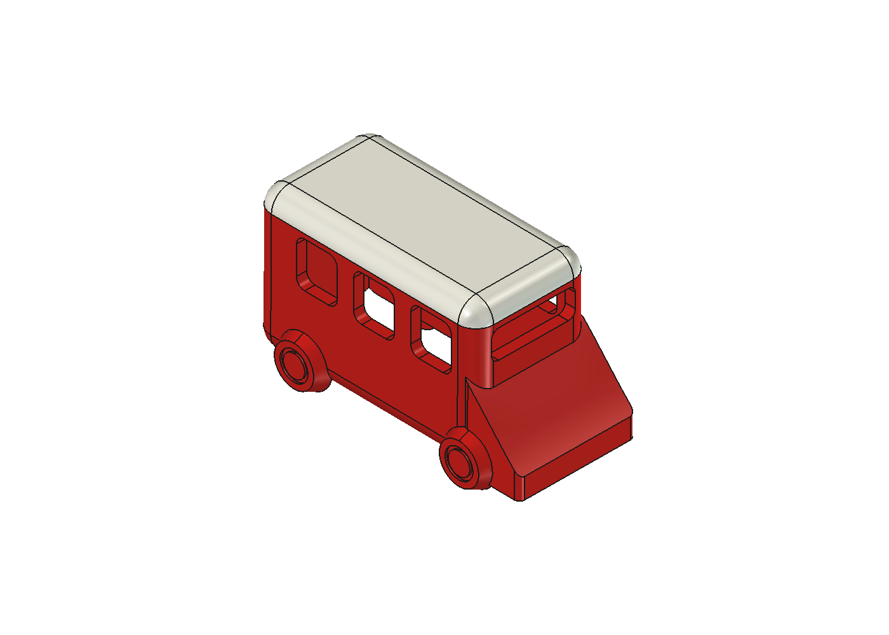
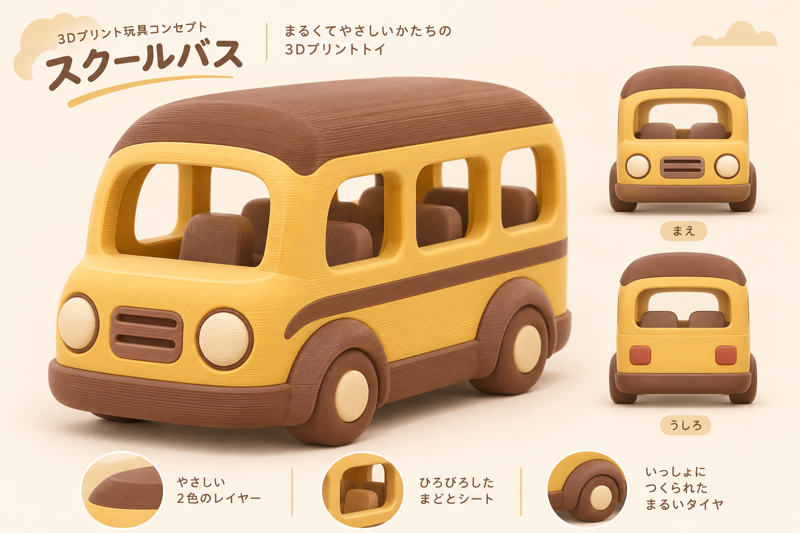
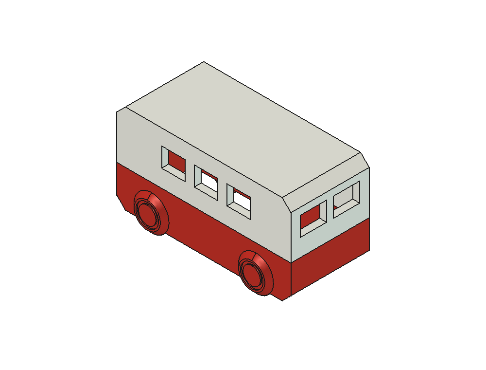
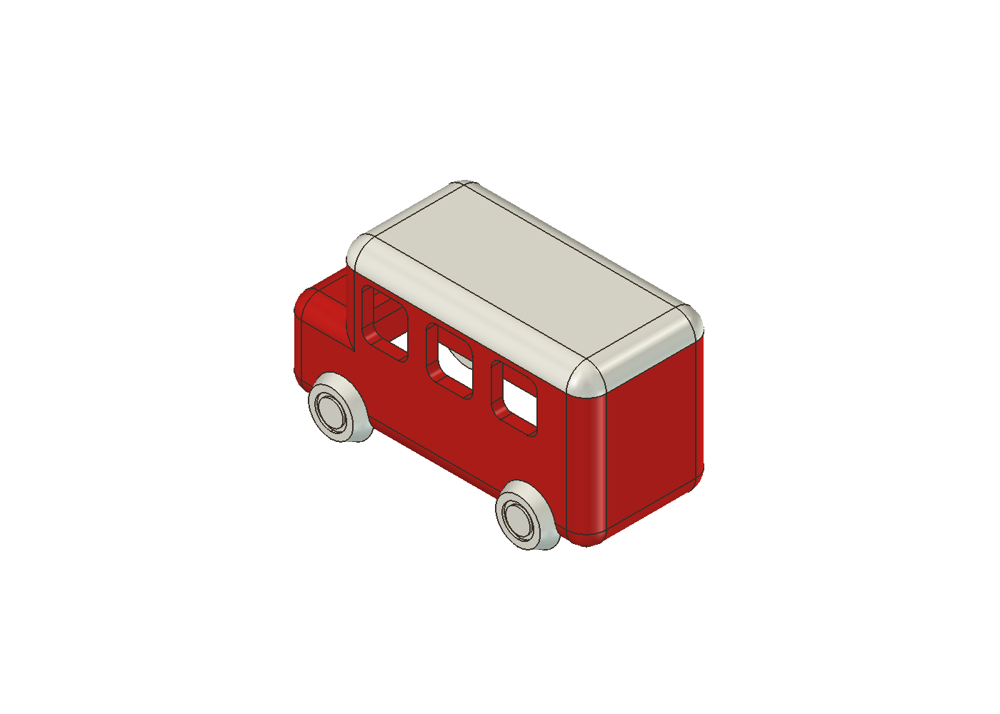
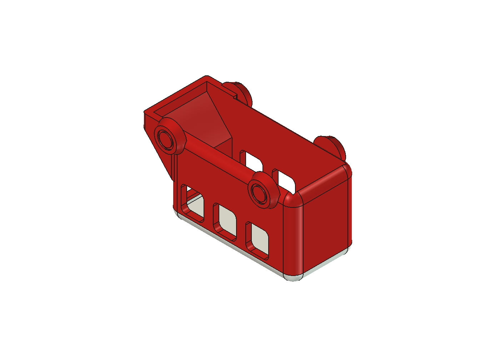
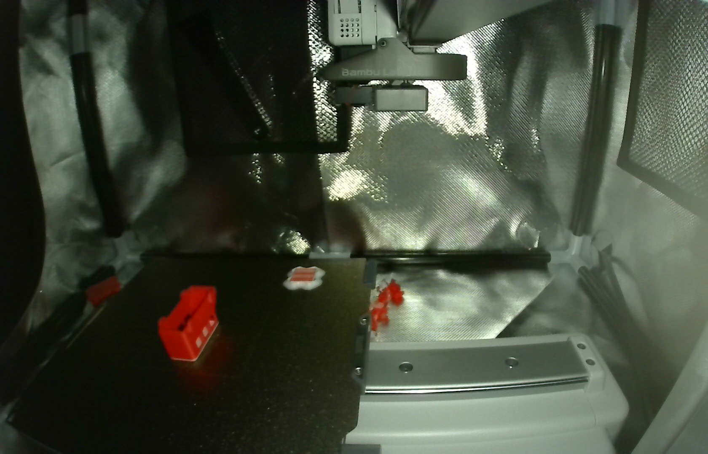

# 初めてのミニバス試作とタイムラプス撮影 ― 3DBenchyから学ぶ40mm級の設計

3Dプリンターでおもちゃを作るとき、最初のハードルになりやすいのが「サイズと印刷時間」です。大きなモデルほど見栄えは良くなりますが、1回の試作に何時間もかかると試行錯誤のテンポが落ちてしまいます。

そこで今回は、3Dプリンターの定番ベンチマーク船「3DBenchy」（約30分）をお手本に、**1時間以内で刷れる40mm級のミニバス** を設計して、Bambu Lab A1 mini で119層完走＆タイムラプス撮影するまでの過程をまとめました。



CADデータやスライス済みの3MF、タイムラプス動画は GitHub リポジトリで公開しています。

https://github.com/Sunwood-ai-labs/NEKONEKO-INDUSTRIES

## ステップ1：3DBenchyを参考に「1時間以内」を狙う

最初の頃は60mm級や大型のバスも検討していましたが、まずはサクッと試作を回せるサイズ感を目指しました。コンセプト画像を参照しながら、小型・シンプル路線へ舵を切ります。



このとき投げたプロンプトがこちらです。

```text
もっとサイズ小さいやつでシンプルにしたアイデア欲しい！ 1時間以内にできるくらいのサイズにして
```

ここから「車体の全長を約40mm前後に抑え、部品分割をなくした一体構造にする」という方針が固まりました。

## ステップ2：上下逆さ・空洞・床なしの「v07」を設計

サイズを小さくしても、屋根や窓まわりにサポート材（印刷時の支え）が大量につくと、印刷時間が伸びるうえに後処理も大変になります。そこで、3DBenchyのような中空構造と「上下逆さの印刷姿勢」を取り入れることにしました。

```text
上下逆にして、中身空洞にしたら？？船を参考にして！ あと、2色にしてほしい！
```

さらに、底面の造形も割り切って簡素化します。

```text
床もなしでいいよ！
```

こうして生まれたのが、床なし・中空構造の **v07** です。



v07 の主なスペックは次のとおりです。

- 外形サイズ：約40 × 20 × 22 mm
- 構造：上下逆さ配置、床なし・車内空洞、立体固定輪
- 配色：白い屋根・赤い車体の2色（色替え1回）
- スライス予測：**28分41秒**・約7.0 g・サポート材なし

色替えを1回に抑えたことで、3DBenchy並みの30分切りが見えてきました。

## ステップ3：v08からv09へ！ボンネットを傾斜にして119層完走

続いて、より写真のようなフォルムに近づけた `v08`（42 × 21 × 24 mm）を作成しましたが、ここで1つ課題が見つかりました。



v08 の形状をそのまま上下逆さで印刷しようとすると、前に突き出たボンネット部分が空中から始まる形になり、サポート材なしでは造形が難しくなります。そこで、ボンネットの形状を見直すことにしました。

```text
ボンネットを滑らかな傾斜にしたら、サポート材使わなくていいよね？…
```

この提案をもとに設計した **v09**（傾斜ボンネット版、42 × 21 × 24 mm）では、ボンネットを連続した滑らかな傾斜に変更しました。上下逆さにした状態で、各層の押出経路が前層としっかり重なることを G-code でも確認しています。



そしていよいよ A1 mini での実機印刷です。結果は **100%・119層を完走** し、タイムラプス撮影まで成功しました。



実際のタイムラプス動画や、モデルの設計スクリプト・経路検証スクリプトも公開リポジトリに収録しています。

## 公開データと「サポートなし印刷」のコツ

公開リポジトリでは、v07 や v09 の FreeCAD データ・STEP・スライス済み 3MF ファイルに加え、実際のタイムラプス動画、設計スクリプト、経路検証スクリプト、再現手順のガイドを公開しています。

自分のモデルで「逆さ印刷＋サポートなし」に挑戦するときは、次の3点を意識すると成功率が上がります。

- **まずは小さく試作する**：1時間以内で刷れるサイズに抑えると、設計と実機確認のサイクルを素早く回せる
- **印刷姿勢を逆さにする**：屋根が平らな乗り物は上下逆さに置くことで、大きなサポート材を省ける
- **段差を傾斜に逃がす**：突き出たボンネットなどは滑らかな傾斜にすると、空中で途切れず安定して積層できる

詳細なデータや再現手順は、GitHub リポジトリから確認できます。

https://github.com/Sunwood-ai-labs/NEKONEKO-INDUSTRIES

## まとめ

「床をなくす」「上下逆さに置く」「ボンネットに傾斜をつける」というちょっとした設計の工夫だけで、サポート材なし・30分前後で刷れるミニバスが形になりました。

ただし、サイズを60mm級に戻したり、屋根のRや窓枠を攻めた設計にしたりすると、実機造形ならではの思わぬ壁にぶつかります。次回は、そのリアルな失敗と「断面レビュー」導入のストーリーを紹介します。

#AI #3Dプリンター #FreeCAD #BambuLab #ものづくり
