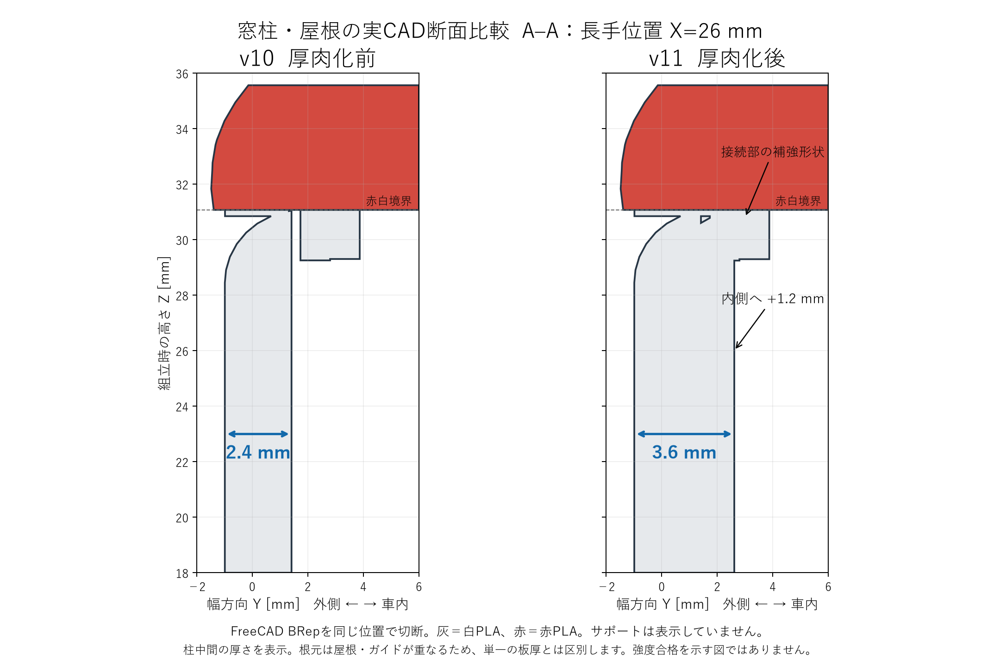
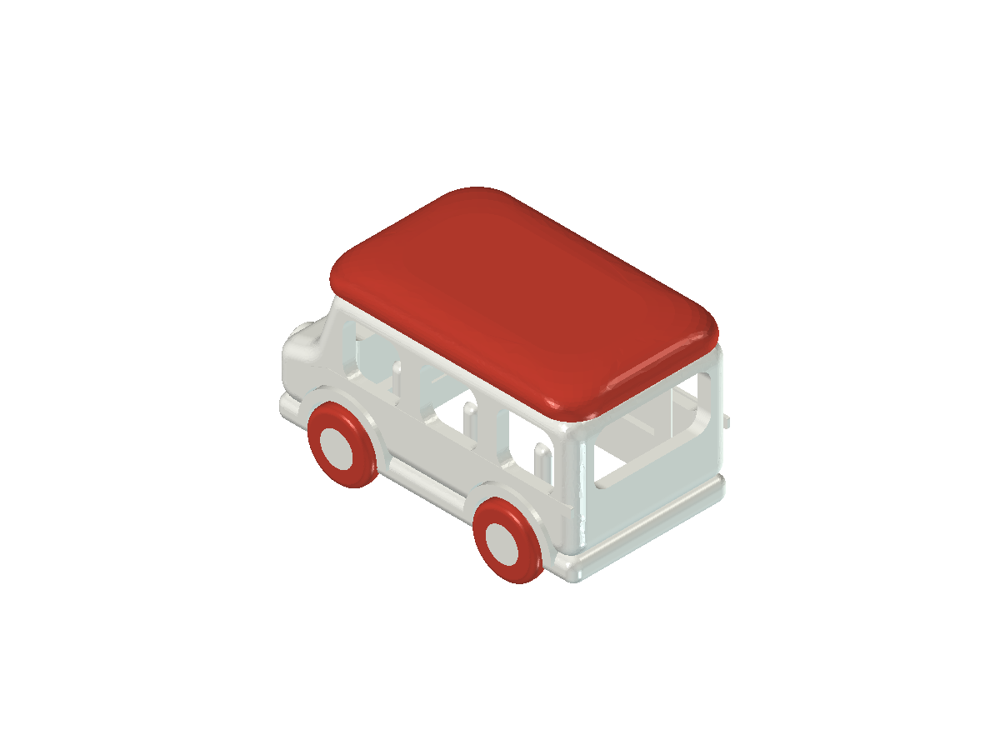
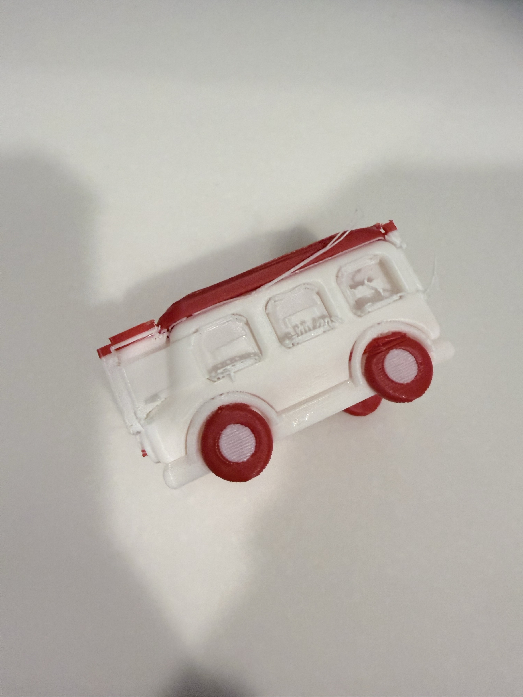
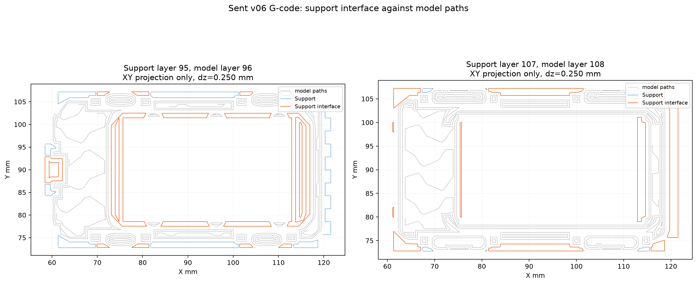
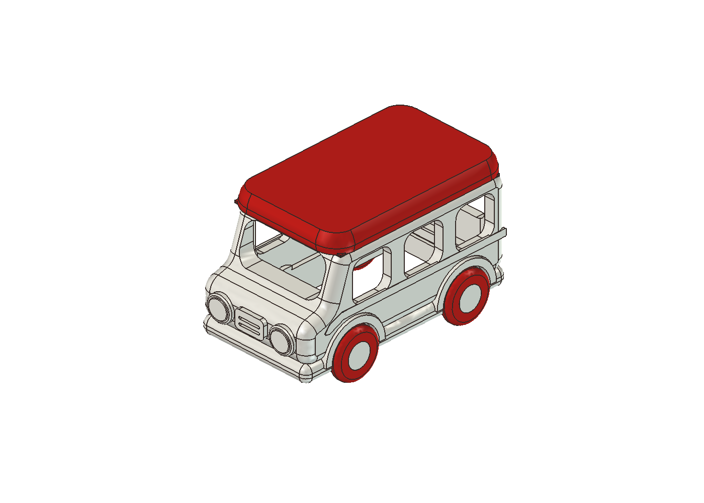
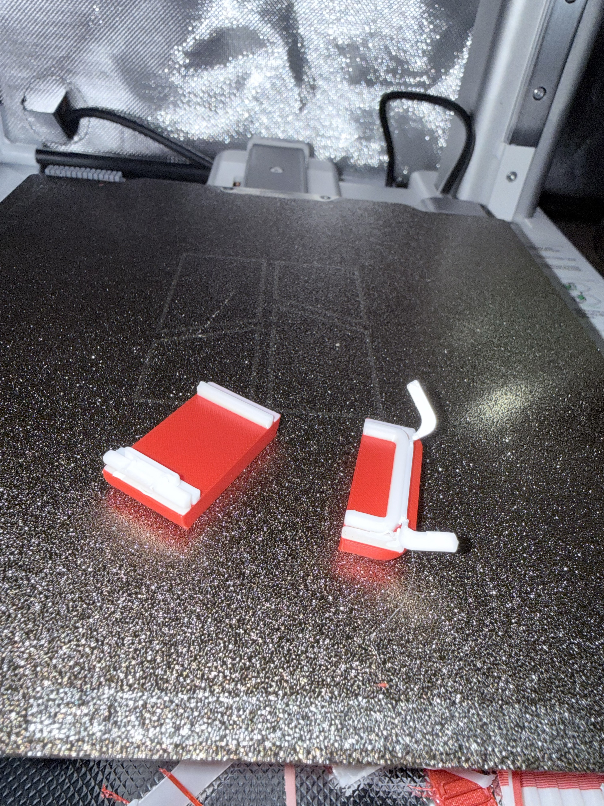
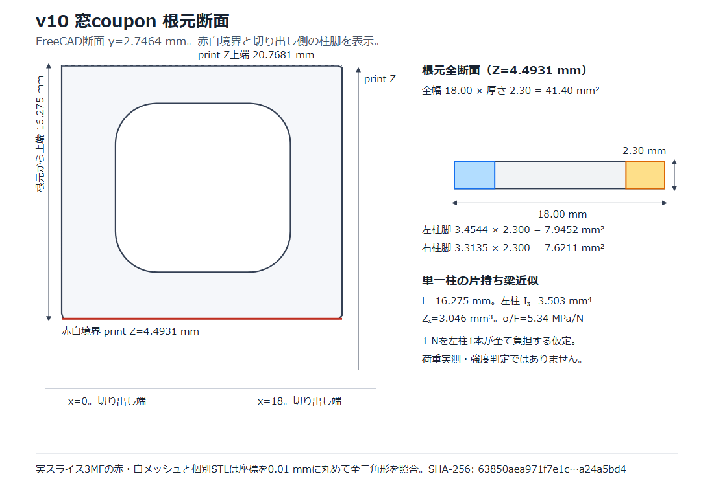

# 実機造形の壁！「サポートが外れない（TR-001）」と窓枠破損（v10）からの断面見直し

CAD画面でどれだけきれいに見えても、実際に3Dプリンターで出力してみると「支えが固くて取れない」「剥がそうとしたら部品が折れた」という壁にぶつかります。

今回は、60mm級のバス試作で起きた **2つのリアルな失敗**（v06赤タイヤ版のサポート固着と、v10の窓枠破損）と、そこから **断面図・強度計算・DRレビューのスキル** を根本から見直すまでの記録をまとめました。



失敗の記録や検証スクリプト、更新したDRスキルはすべて GitHub リポジトリで公開しています。

https://github.com/Sunwood-ai-labs/NEKONEKO-INDUSTRIES

## 失敗1：サポートがほぼ全部外れない！（v06赤タイヤ版 / NEKOMO-TR-001）

最初の大きな壁は、60mm級の空洞バスをベースにした `v06 赤タイヤ版`（赤い屋根・赤いタイヤ、白い車体・ハブ）を出力したときに起きました。



印刷自体は完了したものの、いざサポート材を外そうとすると、まったく歯が立ちませんでした。

```text
サポート剤が取れなかったです！！どうなってるの？？
```

実物の写真を確認すると、屋根の縁や窓の周辺にサポートがびっしり食いついたまま残っています。



原因を調べるために、実際に送ったスライス済み3MFと G-code を解析しました。



すると、AMS の A2 スロットに専用サポート材（GFS02 Support for PLA）が入っていたにもかかわらず、ジョブの設定では `support_filament=0` / `support_interface_filament=0` になっており、**本体と同じPLAでサポート接触面まで印刷していた** ことが分かりました。さらに、窓枠や屋根端の狭い隙間にサポートが入り込み、工具が届きにくい構造になっていました。

この失敗は **過去トラブル記録（NEKOMO-TR-001）** としてまとめ、専用サポート材の明示指定と **事前チェック用スクリプト** による検査を必須にしました。

## 失敗2：専用サポート材を使ったら、今度は窓枠が折れた！（v10）

TR-001 の教訓を受けて、次の `v10` では「屋根の曲面（R）の見直し」「専用サポート材の明示指定」「小さな検証片での事前テスト」を行うことにしました。

```text
じゃあ屋根のRも含めてちゃんと修正して！専用サポート材を使って、まず窓と屋根の検証片を作って確認しよう。
```

修正した本体と検証片（窓・屋根端）を用意し、G-code でも接触面の 1,883 移動すべてが専用サポート材になっていることを確認して印刷へ進みました。



ところが、印刷後にサポート材を剥がしてみると、今度は **細い窓枠の根元がポキッと折れてしまった** のです。



## 原因究明と断面見直し：v10→v11→v12、そしてDRスキルの更新

専用サポート材を使ったのに、なぜ折れてしまったのでしょうか。ここから、レビューのやり方そのものを見直す問いかけがありました。

```text
折れるんだけど、なんで？？ちゃんと断面図とかで確認したり、強度計算した？？… 断面もちゃんとみるようにスキルを更新して
```

そこで v10 の窓枠の根元を断面図で切り出して調べてみると、外側のくびれや薄い肉厚に応力が集中しやすい形状になっていることがはっきり見えました。



この結果をもとに、設計を段階的に改修しています。

- **v11（窓枠厚肉化モデル）**：窓枠を内側へ 1.2 mm 厚肉化し（柱中間の実測厚 2.4 mm → 3.6 mm）、屋根との内側接続部に R0.8 mm の補強を追加
- **v12（根元ストレート化モデル）**：窓上部の外側に残っていたくびれを埋め、根元をストレートな断面へ改善

同時に、設計の審査手順を定めた **DRレビュー用スキル** も更新しました。

- **DR0**：どの部位の断面を確認するか事前に計画する
- **DR1**：実CADの断面で、形状の目的・肉厚・接続・不要な段差を確認する
- **DR2**：断面と荷重経路・積層構成を照合する
- **DR3**：実G-codeの層断面・材料・支持接触・工具の通り道を確認する

「閉じたソリッドでエラーなし」「スライサーの警告なし」だけで合格にせず、必ず断面と実物での除去性をセットで確認する仕組みに変えました。

## 失敗を資産に変えるコツと公開資料

公開リポジトリには、サポート固着の調査をまとめた過去トラブル記録（NEKOMO-TR-001）、スライス済みデータのサポート設定を検査する事前チェック用スクリプト、窓枠厚肉化の設計記録、そして断面審査を組み込んだ DRレビュー用スキルまで一式を収録しています。

AIとのものづくりで同じ失敗を繰り返さないためには、次のサイクルを回すのが効果的です。

- **失敗をトラブル記録として残す**：原因を G-code や断面レベルまで言語化し、再発防止のルールにする
- **事前チェックを自動化する**：サポート材の設定ミスなど、機械的に防げる項目はスクリプトで印刷前に弾く
- **レビュー手順そのものを育てる**：断面確認や工具の通り道まで審査スキルに組み込み、次の設計へ引き継ぐ

これらの記録やスクリプト、レビュー用スキルは GitHub リポジトリからご覧いただけます。

https://github.com/Sunwood-ai-labs/NEKONEKO-INDUSTRIES

## まとめ

3Dプリントの失敗は悔しいものですが、原因を G-code と断面図まで掘り下げて「次の設計とレビュー手順（スキル）」に落とし込むと、同じ失敗を確実に減らせます。

AIと一緒にものづくりをするときは、CADを作るだけでなく「失敗を分析して審査スキルを育てる」ところまで回すのがおすすめです。

#AI #3Dプリンター #FreeCAD #失敗談 #ものづくり
