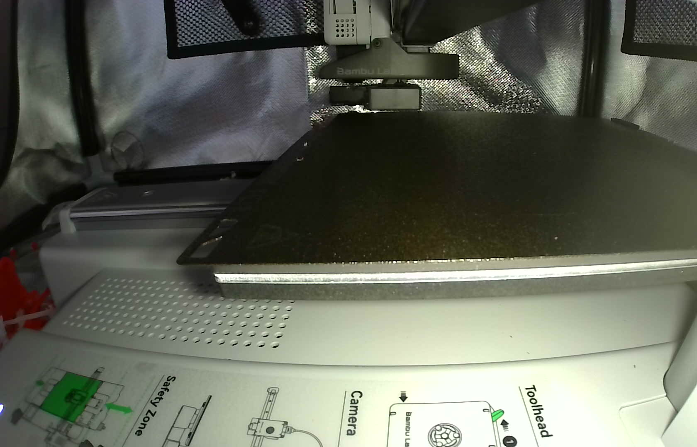
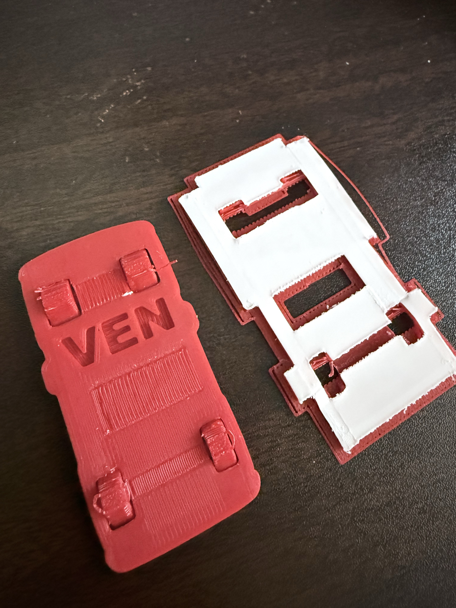
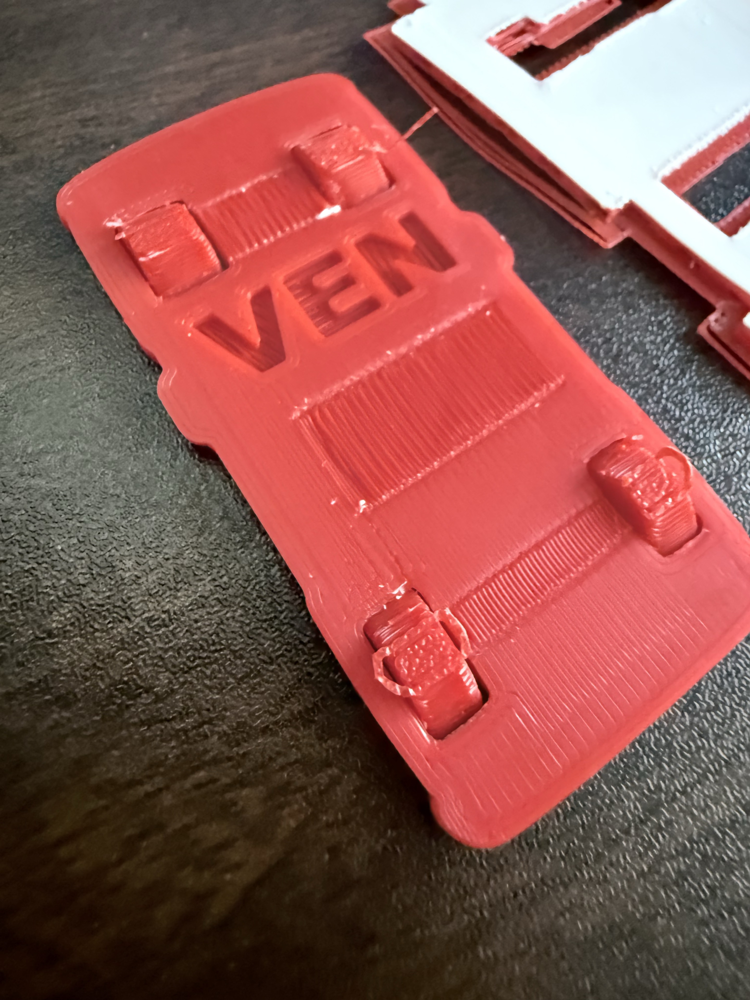

# いきなり本体を刷らない！「Pick-Up Bench」のタイヤ破損（TR-003）と検証片ルール

3Dプリンターで新しい形状やマルチカラー・専用サポート材を試すとき、最初から本体を丸ごと印刷して失敗すると、材料も時間も大きくロスしてしまいます。

そこで NEKOMO プロジェクトでは、本体を刷る前に **底面数ミリだけを切り出した「検証片」** を先に印刷して確かめるルールを運用しています。今回は、長辺約60 mmの車モデル「Pick-Up Bench」で起きたタイヤ周辺の破損（`NEKOMO-TR-003`）と、検証片ルールがどう役立ったかを紹介します。



プロジェクトの全データと不具合記録は、以下の GitHub リポジトリで公開しています。

https://github.com/Sunwood-ai-labs/NEKONEKO-INDUSTRIES

## 1. 造形技法を学ぶために「Pick-Up Bench」を選定（r01）

今回の出発点は、「3Dプリンターのいろいろな造形技法が学べる車のベンチマークモデルを刷ってみたい」という相談でした。実際に投げたプロンプトはこちらです。

```text
バンブーラボのサンプルで、いろいろな3dプリンタの技巧がわかるサンプルってある？ 車とか合ったら嬉しい！
```

そこで選定したのが「Pick-Up Bench」です。元データ（r00）は長辺が約50 mmでしたが、細部を見やすくしつつサイズ感を揃えるため、一様に120%拡大して長辺約60 mm（X 30.79 × Y 60.00 × Z 35.66 mm）の **r01** を作成しました。

印刷条件は Bambu Lab A1 mini（0.4 mmノズル・層高0.20 mm・Textured PEI プレート）です。本体には赤色の PLA Basic を使い、サポート材がモデルに接する部分（界面）には専用の **Support for PLA**（白）を割り当てています。

## 2. 本体を刷る前に「底部4mm検証片」でテスト → タイヤ破損（TR-003）

r01 の本体をそのまま印刷すると予測約83分かかります。そこでルールに従い、高さ4 mmより上をカットした **底部4 mmの検証片**（20層・予測約42分）だけを先にスライスして印刷しました。

ところが、20/20層で印刷自体は無事に完了したものの、実物を確認するとタイヤ周辺が割れてしまいました。実際のチャットでの報告と指示がこちらです。

```text
タイヤの下にもサポート材入れたら？バキバキです
```

```text
不具合としてドキュメントに登録しておいて
```

実際に報告された写真を見ると、支持部材が外れたあとのタイヤ周辺に破損が起きていることがわかります。



このとき、写真から「タイヤ周辺の破損」という事実は確認できましたが、印刷中・プレートからの取り外し中・サポート除去中のどの段階で割れたのか、本当に支持不足が原因なのかはまだ確定できていません。



そのため、推測で原因を決めつけず、写真と送信済み3MFデータを紐づけて不具合記録 **NEKOMO-TR-003** として登録し、**本体の印刷は保留** にしました。もし最初から本体を刷っていたら、さらに長い時間と材料を費やした上で同じ問題に直面していたところです。

## 3. r02でタイヤ下ラフトを追加し、修正検証片（25/25層）へ

r01 ではタイヤの最下部がビルドプレートに直接接していたため、タイヤの真下にサポート材の界面を差し込む余地がありませんでした。そこで次の **r02** では、モデル本体の形状や60 mmの寸法はそのままに、設定ファイルで **3層のラフト**（モデルの下に敷く土台）を追加しています。

- **raft_layers**（ラフト層数）: 0 → 3
- **raft_contact_distance**（ラフト接触距離）: 0.1 mm → 0 mm
- **サポート本体 / 接触界面**: 赤 PLA Basic / 白 Support for PLA

これにより、4輪のタイヤ下面にも白い Support for PLA の界面が接触する経路を作りました。リポジトリ内には、Z=0.8 mm の白い界面経路と Z=1.0 mm の赤い本体経路を照合した実経路図も保存しています。

修正した r02 の検証片（全25層・予測約72分）は、プリンターで **25/25層の印刷完了**（FINISH）まで到達しました。ただし「印刷が終わったこと」と「タイヤが欠けずにきれいに外せること」は別問題です。r02 でも実物の除去性や下面品質の確認が終わるまでは本体印刷を待ち、確認でき次第 `NEKOMO-TR-003` の状態を更新する運用にしています。

## 4. 自分のモデルに応用するときのポイントと公開データ

今回の元の配布データ、120%拡大版の検証片データ、ラフト追加版のデータや実経路図、そして不具合記録 `NEKOMO-TR-003` の詳細は、以下の公開リポジトリにまとめています。

https://github.com/Sunwood-ai-labs/NEKONEKO-INDUSTRIES

ご自身のモデルで試す場合も、以下のポイントを押さえると失敗のコストを大きく減らせます。

- **まずは底面数ミリの検証片から刷る**: スライサーで Z=4 mm 付近より上をネガティブパーツ等でカットし、下部だけを先に印刷して確認します
- **接地部とサポートの干渉を確かめる**: タイヤのように接地面積が小さく壊れやすい部分は、支持材の外しやすさや接地部の強度を見てから本体に進むのがおすすめです
- **原因が確定するまで本体印刷を待つ**: 破損が起きたら写真と設定を紐づけて記録し、ラフト追加などの対策を検証片で通してから本番に進みます

## まとめ

「いきなり本体を刷らず、まず数ミリの検証片で試す」という一手間を入れるだけで、失敗時のコストを半分以下に抑えつつ、問題箇所をピンポイントで切り分けられます。次は r02 の実物確認を経て、いよいよ本体の屋根ブリッジ部分の造形へ進む予定です。

#3Dプリンター #BambuLab #A1mini #ものづくり #個人開発
