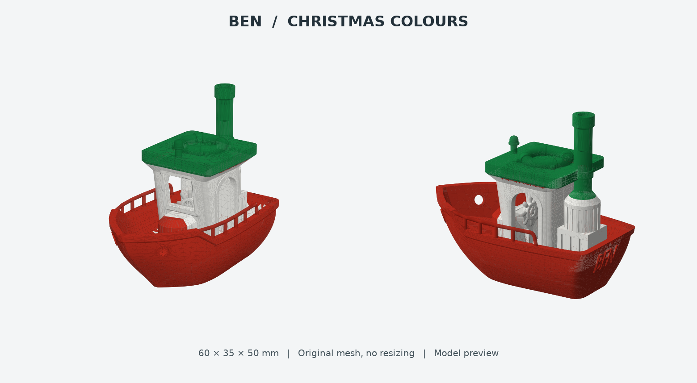
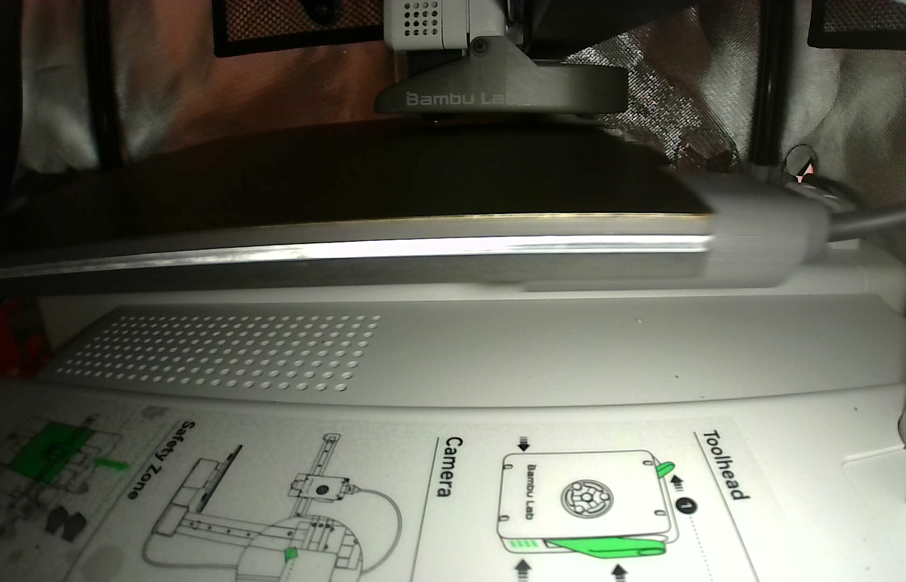
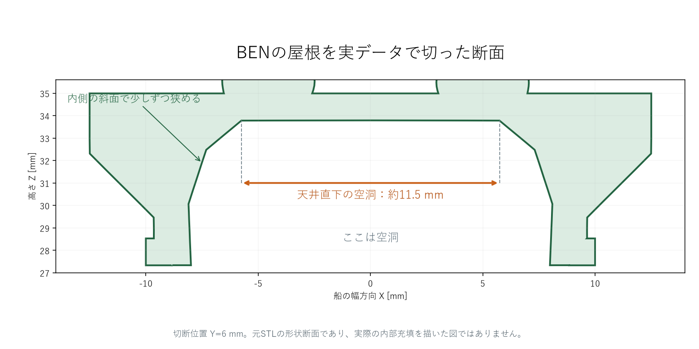
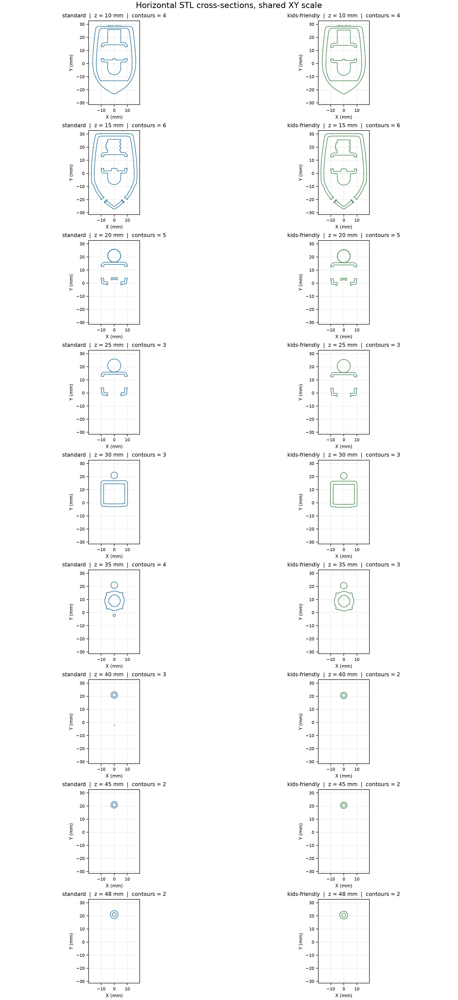

# 名作船「BEN」をベンチマーク分析！サポートレスで250層完走する天井ブリッジの秘密

3Dプリンターで船のモデルを印刷しようとすると、「操舵室の屋根や窓の上って、サポート材（支え）なしだと空中に垂れて崩れるのでは？」と心配になりますよね。

ところが、浮かぶ船の定番ベンチマークモデル「BEN」を赤・白・濃い緑の3色で印刷してみたところ、**サポート材ゼロ・250層完走** で最後まで刷り切ることができました。今回はその印刷記録と、なぜ天井が空中で成立するのかを断面・G-code から数値化した知見をまとめます。



今回の印刷データや断面解析スクリプトは、以下の GitHub リポジトリで公開しています。

https://github.com/Sunwood-ai-labs/NEKONEKO-INDUSTRIES

## 1. 浮かぶ船「BEN」を3色マルチカラーで印刷（サポートなし・250層）

きっかけは、「公式や定番モデルから、水に浮かぶ船のベンチマークを探して印刷してみたい」というリクエストでした。実際に投げたプロンプトはこちらです。

```text
バンブーラボで印刷したいです 公式とかから、浮かぶ船を調査してほしい
```

```text
BEN をマルチカラーにして
```

今回使用したのは、vandragon_de 氏作「BEN the floating BENCHMARK」の通常版（全長約60.0 × 幅35.0 × 高さ50.0 mm）です。形状と縮尺は1:1のまま、船体・操舵室・屋根などを赤・白・濃い緑の3色に塗り分けました。



A1 mini（0.4 mmノズル・層高0.20 mm・壁2周・内部充填15％）で印刷した結果、**サポート経路0件** のまま **250/250層を完了** しました。なお、実際に使った濃い緑のフィラメント（`#234D40`）は予想図の緑（`#168744`）より少し落ち着いた色味で、色替え回数の予測は89回（スライサー予測約4時間9分）でした。

## 2. なぜ天井も印刷できるのか？断面とG-codeで造形知見を数値化

無事に印刷が終わったあと、ふと湧いた疑問がこちらです。

```text
これってなんで天井も印刷できてるの？？断面とか見たらわかるかな？？ この知見をちゃんと残してほしい
```

そこで、STL形状の断面と実際にプリンターへ送った G-code（印刷経路データ）を突き合わせて、**ベンチマークモデルの分析** と **造形知見の数値化** を行いました。



断面を見ると、天井がいきなり空中に現れているわけではないことがはっきり分かります。

1. まず下から柱・壁・窓枠を積み上げて両側の「足場」を作る
2. 屋根の内側が **斜面** になっており、各層で少しずつ内側へ迫り出して空洞を狭める
3. 最後に残った隙間を、両端の足場をつなぐ **ブリッジ**（水平に樹脂の線を渡して冷却で固める動き）で閉じる

この断面（STL の長手方向 Y=6 mm・高さ Z=33.78 mm 位置）で測ると、天井直下の空洞幅は **約11.49 mm**（11.489124 mm）でした。さらに実 G-code を確認すると、Z=31.2、34.0、34.2 mm 付近に正の押出を伴う Bridge 経路があり、高さ29〜35 mmにある直線の Bridge 移動（283本）のうち最長線分は **約18.515 mm**（足場上の移動部分を含む長さ）でした。



この調査から、「空洞や天井があるからといって、最初から無条件でサポート必須と決めつけない」という設計指針が得られました。もちろん材料や冷却、求める下面のきれいさによって結果は変わりますが、内側の斜面と足場の位置を断面で確認する習慣はとても有効です。

## 3. 比較：別の船「Stern Trawler」をCLIで色分け見積もりすると？

同じ「クリスマスカラーの3色の船」として、別の船モデル「Stern Trawler」を CLI（コマンドライン）で赤・白・緑に塗り分けてスライス見積もりを取ったケースも比較してみましょう。

P1S（0.4 mmノズル・層高0.20 mm）条件で試算したところ、予測時間は **約10時間57分5秒**、色替え回数は **308回**（総材料 188.56 g）という結果になりました。さらに支持できないオーバーハングの警告（13領域）も残っています。

この比較から分かる通り、A1 mini へ適用するには機種設定だけでなく、サポート材・専用界面材の明示的な割り当てと検証片での確認が欠かせません。同じ3色船でも、サポートレス設計が練り込まれた BEN の優秀さが際立ちます。

## 4. 自分のモデルに応用するときのポイントと公開データ

今回の3色化データや印刷完了記録、断面解説と数値化したブリッジ知見のまとめ、さらに比較用の船モデルの見積もり記録は、以下の公開リポジトリで公開しています。

https://github.com/Sunwood-ai-labs/NEKONEKO-INDUSTRIES

ご自身のモデルで「サポートなしで天井や空洞を刷れるか」を見極めたいときは、次のポイントを確認してみてください。

- **空洞の両側に足場があるか**: 天井の直下に、橋渡しの起点と終点になる壁や柱が下から積み上がっているかを確認します
- **内側の斜面で空洞を狭められているか**: いきなり水平に飛ばすのではなく、各層で少しずつ迫り出してブリッジ距離を短くできているかを見ます
- **断面とスライサーの経路をセットで確認する**: 見た目だけでなく、断面で空洞幅を測り、スライサー上でブリッジ経路として認識されているかを確認すると判断しやすくなります

## まとめ

「なぜサポートなしで刷れるのか？」を断面と G-code で数値化しておくと、次のオリジナル設計でも「ここは斜面で空洞を狭めればブリッジでいけるな」と判断できるようになります。ベンチマークモデルは刷って終わりではなく、断面を覗いてみると面白い発見がたくさんありますよ。

https://x.com/hAru_mAki_ch

#3Dプリンター #BambuLab #A1mini #3Dモデリング #ものづくり
