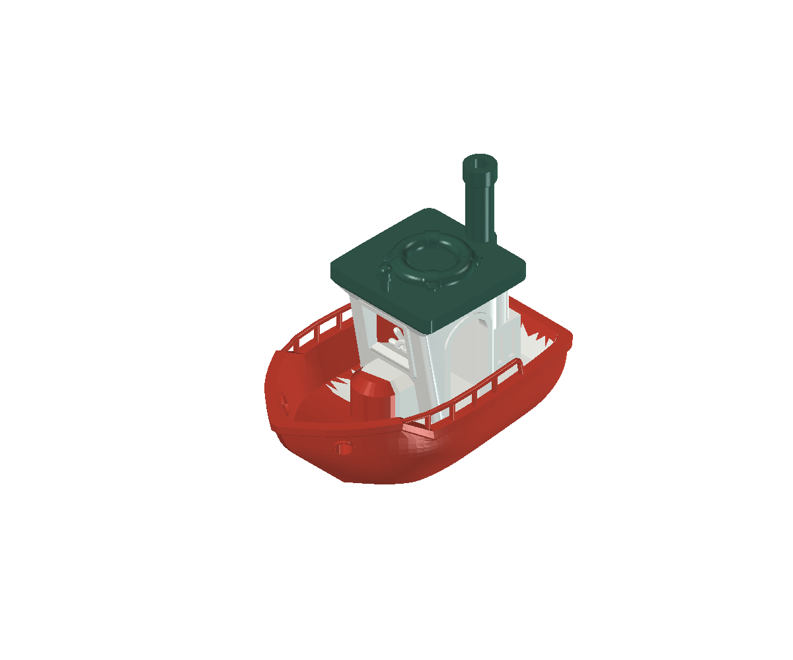
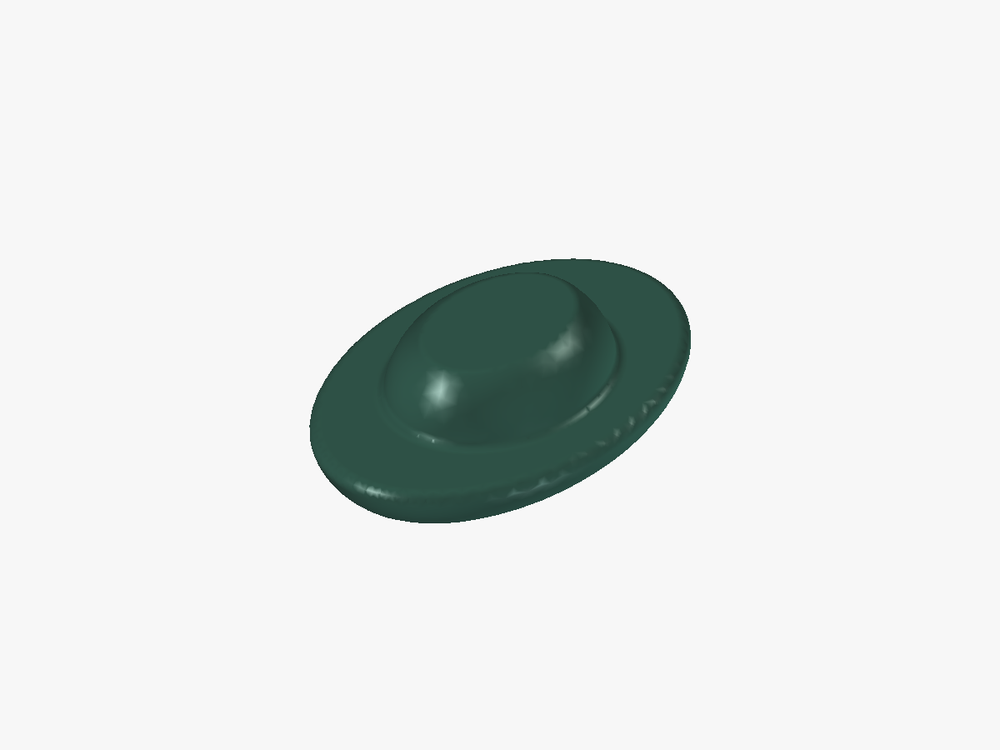
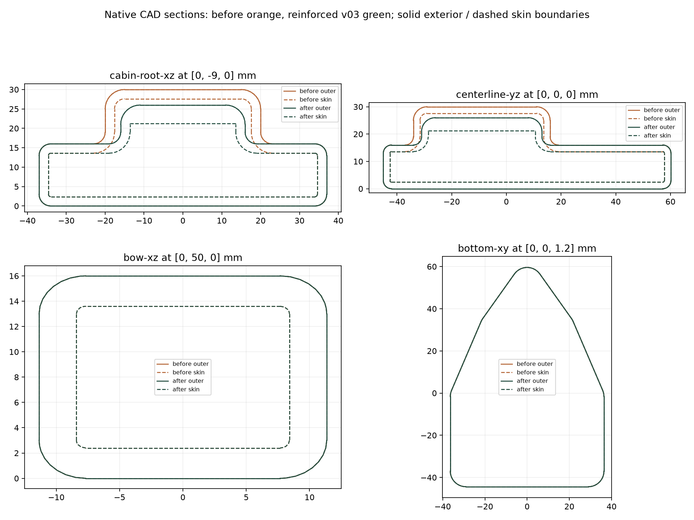
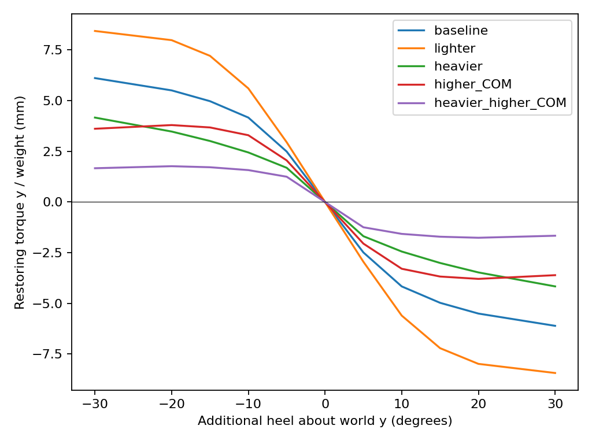
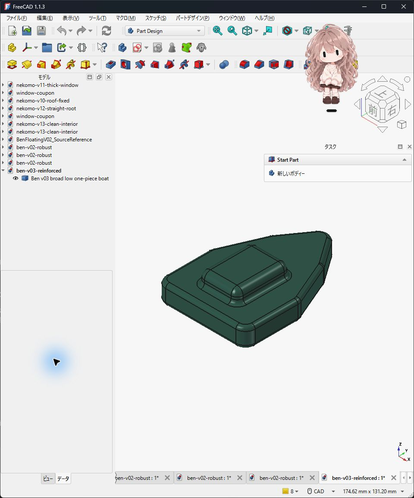

# STL（94,376面）をFreeCADソリッドに忠実再現！基準データを手で直せる形にする

ネットからダウンロードした素敵な船の3Dデータ（STL）を「1歳児向けの安全なおもちゃ」に改良しようとしたとき、思いがけない壁が2つ立ちはだかりました。

1つは **「家庭ではおもちゃの破壊試験ができない」** という品質審査の壁、もう1つは **「安全のために角を丸めすぎて、元の船の見た目が消えてしまった」** という設計の差し戻しです。今回は、デザインレビュー（DR）手順の改訂と、元STLの全94,376面を FreeCAD のソリッドへ忠実再現した記録をお届けします。



再現スクリプトや検証記録、改訂後のDR定義は、以下の GitHub リポジトリで公開しています。

https://github.com/Sunwood-ai-labs/NEKONEKO-INDUSTRIES

## 1. 1歳児向けDR審査で「家庭で試験はできない」→ DR手順を改訂

最初は「1歳の幼児向けおもちゃとして安全か、DR（デザインレビュー）を全部通して確認したい」という依頼から始まりました。

```text
$nekomo-dr-review 全部通して確認してね！ 1歳の幼児向けのおもちゃにしたいです
```

```text
家なので試験はできないよ
```

家庭にある3Dプリンター環境では、専門機関のような引張試験・噛み付き試験・破壊試験はできません。だからといって「できない試験を省略して合格扱いにする」のは危険です。

そこで NEKOMO では DR の定義（version 2）を改訂し、DR0〜DR4 を **設計・解析・造形データ・総合判断** の枠組みへ再編しました。

- **DR0**（要求と検証計画）: 対象年齢やリスク、家庭でできる確認とできない確認を切り分ける
- **DR1**（形状設計審査）: 保存された CAD / STL の寸法、肉厚、断面を審査する
- **DR2**（解析・シミュレーション審査）: 浮力や強度など、要求に応じた解析結果を審査する
- **DR3**（造形データ審査）: 最終 3MF と G-code の設定・経路を審査する
- **DR4**（総合判断）: 各段階の証拠をまとめ、未実施の実物試験は正直に「未実施（承認不可）」として残す

「データ審査で言えること」と「実物試験が必要なこと」を明確に分けたことで、無理のない誠実な品質管理ができるようになりました。

## 2. 補強版モデルが「外観逸脱」で差し戻しに

並行して、元の船「BEN」から細い突起（煙突や手すりなど）をなくし、丸みのある頑丈な形に作り直した補強版（v02/v03系）の検討も進めていました。ところが、この見た目が元の BEN から大きく離れてしまい、ユーザーから厳しいフィードバックが入ります。

```text
これマジで何してんの？形状が意味不明です！ もとのやつ見た？？
```

```text
BENをまずはFreeCADで完全再現するところからやったら？？
```

実際に比較してみると、補強を優先したモデル（candidate-05 などの板状・丸み強調案）は、元の BEN が持つ愛嬌ある船室や手すりのシルエットとは別物になっていました。



断面比較や、静水での復元性解析（傾いたときに元の姿勢に戻るかの計算）といった解析ワークフロー自体は大きな前進でしたが、「そもそも元の BEN の形を基準として保持できていない」状態では、どこをどれだけ変えたのかも比較しづらくなります。





## 3. 元STL（94,376面）をFreeCADソリッドへ忠実再現！

そこで方針を切り替え、**STLからFreeCAD基準データへの忠実再現** を行いました。

元データの STL が持つ **94,376枚の三角面** から、隙間や破綻のない「閉じた有効な1個のネイティブソリッド」を FreeCAD 再現スクリプトで生成しています。



本当に形が変わっていないか確かめるため、変換後の全頂点・全三角面を元 STL の座標（小数点以下6桁に丸めた値）と照合して一致を確認しました。寸法も幅 35.000 mm × 長さ 60.002 mm × 高さ 49.998 mm と、元データのサイズをそのまま保っています。

なお、このデータは元 STL に由来する面ベースのソリッド（スケッチや押し出しの履歴を持つパラメトリックモデルではない）であり、再現できたこと自体は強度や幼児使用の安全性を保証するものではありません。それでも、船体・手すり・操舵室・窓・操舵輪・屋根・浮輪・煙突・「BEN」の文字まで揃った「手で直せる基準データ」が手に入った意味はとても大きいです。

## 4. 自分のモデルに応用するときのポイントと公開データ

原形と一致する FreeCAD ソリッドデータ、FreeCAD 再現スクリプト、94,376面の一致や寸法を記録した検証データ、そして改訂版 DR0〜DR4（version 2）の定義は、以下の公開リポジトリで公開しています。

https://github.com/Sunwood-ai-labs/NEKONEKO-INDUSTRIES

ご自身のモデルで STL データをベースに安全改良や形状修正を行うときは、次のポイントを意識すると進めやすくなります。

- **最初に元の STL を忠実な基準ソリッドとして保存する**: いきなり大きく形を丸めたり削ったりせず、「変更前の基準データ」を手元に確保してから改修に入ります
- **変換後に頂点・面数と寸法の一致を確かめる**: ソリッド化の際に形が崩れたり穴が空いたりしていないか、元のデータと照合して確認しておきます
- **できる確認とできない確認を分けて記録する**: 家庭環境でできる寸法・断面・造形データの審査と、専門試験が必要な項目を混ぜずに整理しておくと、無理のない品質管理ができます

## まとめ

安全性を高めようと焦って見た目を変えてしまうと、愛着のある元のモデルが迷子になってしまいます。まずは元の STL を忠実な基準ソリッドとして FreeCAD に取り込み、改訂した DR ルールに沿って「どこを変えて、どこを残すか」を丁寧に積み上げていくのが近道でした。

https://x.com/hAru_mAki_ch

#FreeCAD #3Dプリンター #3Dモデリング #品質管理 #ものづくり
