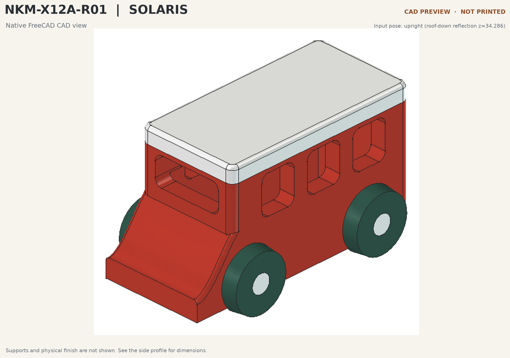
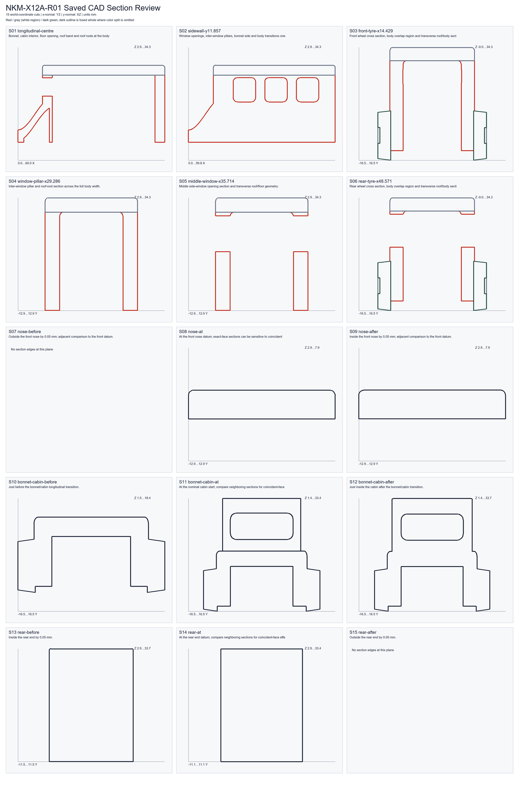
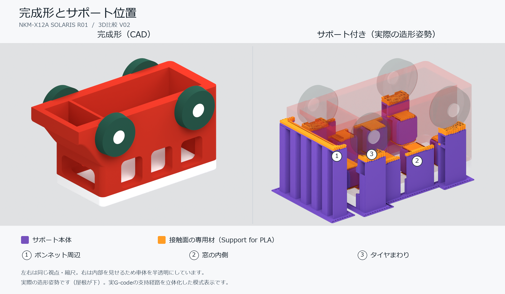
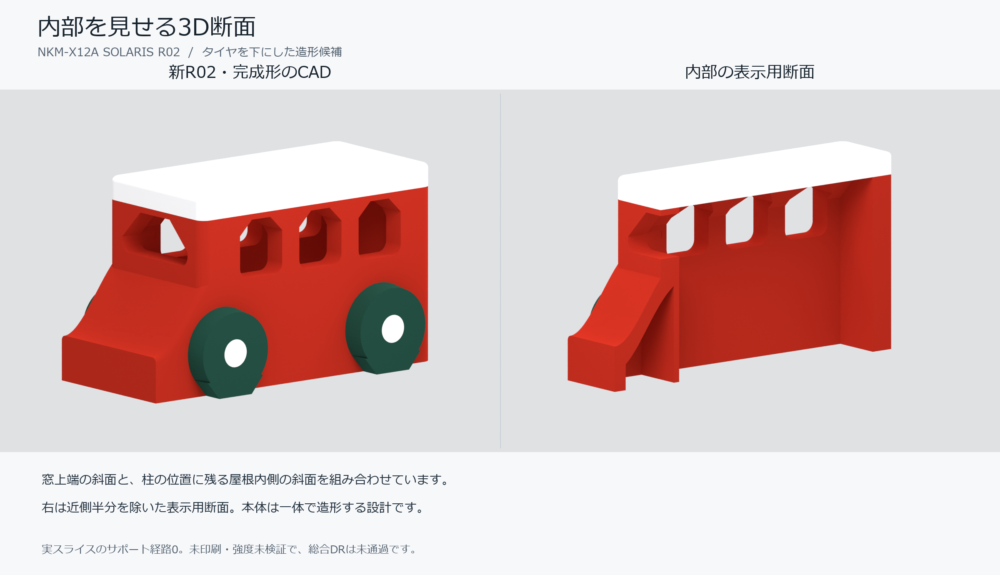
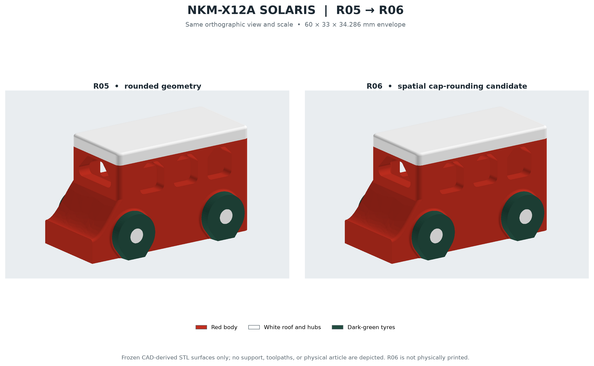
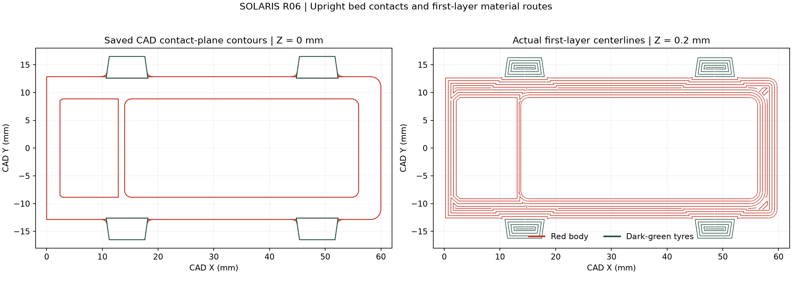

# 子ども向けおもちゃに「5段階DR（設計審査）」を導入！ソラリスと印刷保留の決断

前回の「v09・傾斜ボンネット版」のミニカーをベースに、今回は子ども向けのおもちゃとしてさらに本気で作り込んでみたお話です。

全長を約60 mmにサイズアップし、タイヤを大きくして、赤・白・濃緑の3色マルチカラーで仕上げた新モデルが **「NKM-X12A ソラリス」**（Solaris）です。見た目が良くなっただけでなく、このプロジェクトから **5段階のDR**（Design Review：設計審査）を本格導入し、最終データができあがったあとも「安全基準を満たすまで本体印刷を保留する」という判断を下しました。

まずは、全長60 mm級・3色モデルとして立ち上げたR01のプレビュー画像をご覧ください。



今回使用した設計データ、審査記録、スライス済みの3MFファイルはすべて以下の GitHub リポジトリで公開しています。

https://github.com/Sunwood-ai-labs/NEKONEKO-INDUSTRIES

---

## Step 1：v09から60 mm級・3色「ソラリス」への進化

まずは「前回のv09をベースに、マルチカラー化とサイズ拡大をしたい！」というところからスタートしました。実際に AI エージェントへ投げたプロンプトはこちらです。

```text
v09・傾斜ボンネット版をベースに進化させたいです！ 変えたいところは、マルチカラー化と全体的にサイズの拡大化（全長60mm前後）、とくにタイヤの大きさアップです
```

最初は寸法確定前の80 mm案（R00）が先行して作られましたが、全長60 mm前後と方向性が固まったことで、60 × 33 × 34.2857 mm の **R01** へと作り直しました。

サイズが大きくなると、外見だけでなく「中身がちゃんとつながっているか」「空洞や壁の厚みに無理がないか」を確認する必要があります。そこで S01 から S15 までの断面を一気に切り出してチェックしました。



断面を並べてみると、ボンネットの傾斜、車内の空洞、タイヤまわりの肉厚がひと目で確認できます。

---

## Step 2：3Dサポート図の可視化と「BEN」の知見によるサポート削減

R01をスライサー（3Dデータを3Dプリンターの移動経路に変換するソフト）にかけてみると、窓のまわりにサポート材（印刷中に宙に浮く部分を支える仮の柱）が付くことが分かりました。

ただ、2次元の断面図や数値のレポートだけでは、どこにどんなサポートが付くのかイメージしづらいものです。そこで、次のようにリクエストしました。

```text
この図だと分かりづらいから、サポート付きの全体像を3Dで見せて！
```

出力された3Dの比較画像がこちらです。



3Dで見ると、窓や車体下部にサポートがびっしり付いている様子がよく分かります。子どもが遊ぶおもちゃでは、サポートを剥がしたあとのバリやザラつき、取り残したサポート片がケガや誤飲の原因になるため、できればサポートなしで印刷したいところです。

そこで、3Dプリンターのベンチマークモデルとして有名な **「3DBenchy」**（通称 BEN）の考え方を応用することにしました。

```text
窓ってなんでサポート剤が必要なの？？ BENの知見を活用してほしい
```

3DBenchy は、サポート材を使わずに窓枠やアーチ、屋根をきれいに印刷するための工夫が詰まった定番モデルです。屋根の張り出し角度や天井のブリッジ（空間をまたぐ橋渡し印刷）の形状を見直すことで、サポートに頼らなくても重力に負けず印刷できる設計にできます。

この知見を取り入れて窓・天井・タイヤまわりを改修したのが **R02** です。



R02ではスライス時のサポート経路と界面経路がゼロになり、見た目と造形しやすさを両立する方向が見えてきました。

---

## Step 3：5段階DR（設計審査）と R05 → R06 の改良ループ

ここからは、おもちゃとしての安全性や強度をデータ上でしっかり検証するため、**DR0〜DR4の5段階の設計審査** を回していきました。各段階の役割は次のとおりです。

| 段階 | 主な審査内容 | 今回チェックした項目 |
| --- | --- | --- |
| DR0 | 要求・仕様の確定 | 対象年齢、外形寸法、安全条件の定義 |
| DR1 | 形状・干渉の確認 | CADの閉じ具合、意図しない溝や欠陥の有無 |
| DR2 | 解析・シミュレーション | 構造解析のメッシュ収束性、局所応力 |
| DR3 | 造形経路の検証 | スライス後の1層目接地、ブリッジ・オーバーハング経路 |
| DR4 | 総合データ判定 | 書類・ハッシュ・検証計画の整合性 |

R04での構造解析では、前窓に意図しない盲溝（行き止まりの溝）が見つかったり、窓上部の角に応力が集中したりする課題が出ました。そこで角や車輪根元を改修した **R05** を作り、さらに空洞の端面に残っていた鋭い角を R1.2 mm で丸めた **R06** へと進化させました。



外観はほとんど同じですが、内部の空洞端面が滑らかになり、赤・白・濃緑の3色領域を保ったまま形状を整えています。

また、実際に印刷したときに1層目がしっかりベッド（印刷台）に張り付くかどうかも、R06で細かく確認しました。



---

## Step 4：最終3MFは `PASS_FILE_ONLY`、それでも「印刷保留」にした理由

R06の最終候補は、Bambu Lab A1 mini（0.4 mmノズル・層高0.20 mm・充填率100%・サポートなし）の条件でスライスされ、3色印刷用の3MFファイルが完成しました。

ここで私は、次のように指示を出しました。

```text
これでいけそうなら印刷開始して
```

ところが、システム側の審査判定は **「印刷を保留する」** というものでした。

理由は大きく2つあります。

1. **スライスの事前検査は `PASS_FILE_ONLY` だったこと**
   - `PASS_FILE_ONLY` とは、「3MFやG-codeファイル上のサポート経路が0件であることは確認できた」という意味であり、**実際のフィラメントで正しく造形できるか・小さな検証片で問題が起きないかは未確認** という状態です。
2. **DR2**（構造解析）と実物検証が未完了だったこと
   - R06のDR0（35/35）とDR1（7/7）は通過したものの、DR2の構造解析が途中エラーで全ケース比較に至っておらず、DR2・DR3・DR4の段階ゲートおよび全体ゲートは未通過の状態でした。

「せっかく3MFファイルまでできたのだから、とりあえず印刷ボタンを押しちゃおう」と進めることもできます。しかし、子ども向けのおもちゃを設計するプロジェクトだからこそ、**データ審査の通過と実物確認の未完了を曖昧にせず、基準を満たすまで印刷に踏み切らない** というルールを徹底しました。

---

## 読者が真似できる「設計審査（DR）」の工夫

今回のソラリス開発で効果的だった、AI ものづくりに取り入れやすい工夫は次の3つです。

- **断面図や3D比較図を出力させて目で確認する**
  - 数値のレポートだけでなく「S01〜S15の断面を並べて」「サポート付きの全体像を3Dで見せて」と指示すると、空洞や肉厚、サポートの付着箇所を直感的に見抜けます。
- **定番モデルの知見をプロンプトで引き出す**
  - 「3DBenchy（BEN）の知見を活用して」のように基準となる設計パターンを指定すると、オーバーハングやブリッジ形状の具体的な改善案を引き出しやすくなります。
- **「データ審査の通過」と「実物確認」を切り分ける**
  - スライスファイルが生成できても、安全基準や検証条件を満たしていなければ「印刷を保留する」という判断基準を先に決めておくと、手戻りや無駄な印刷を防げます。

---

## まとめ

今回は、v09をベースに全長60 mm・3色化した「NKM-X12A ソラリス」の設計と、5段階DRの導入についてご紹介しました。

- 3Dでのサポート可視化と BEN の知見で、サポートなし造形への道筋を作った
- R00〜R06の改修ループで、断面・空洞端面・1層目接地を徹底的にチェックした
- 最終3MFが `PASS_FILE_ONLY` でも、実物検証片での確認やDR未通過を理由に「印刷保留」を貫いた

次回は、もうひとつのプロジェクトである **月面探査ローバー**（R11）を実際に3色印刷してみた結果と、47層目で起きた造形トラブル・再キャリブレーションのお話をお届けします！

https://x.com/hAru_mAki_ch

#AI #3Dプリンター #ものづくり #個人開発 #設計審査
