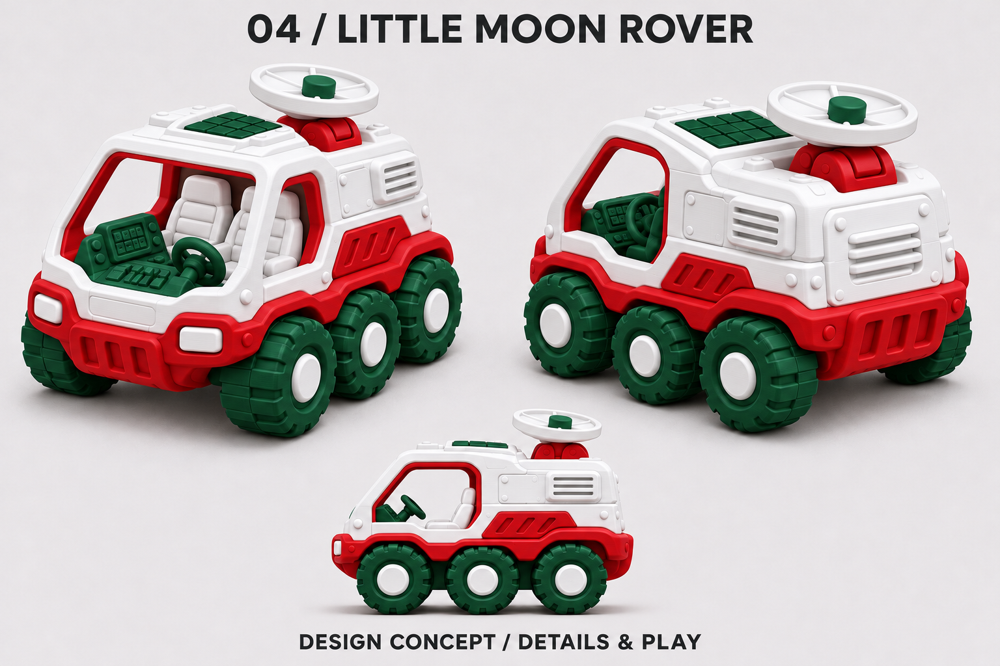
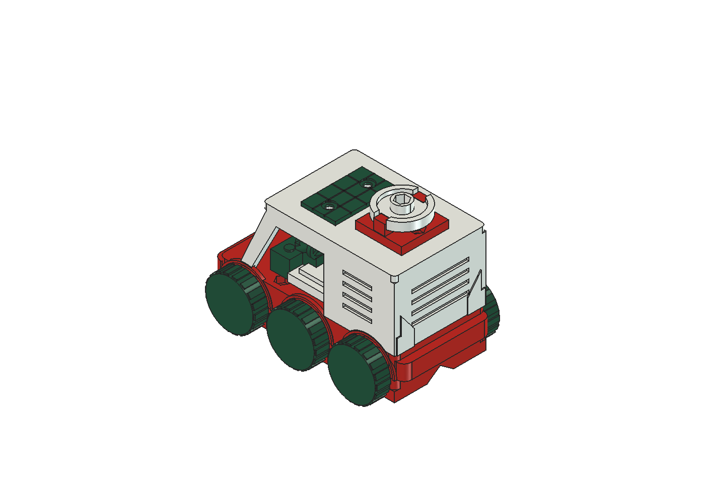
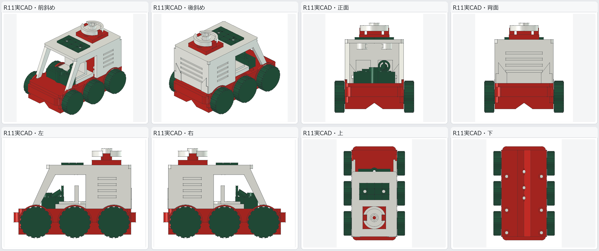
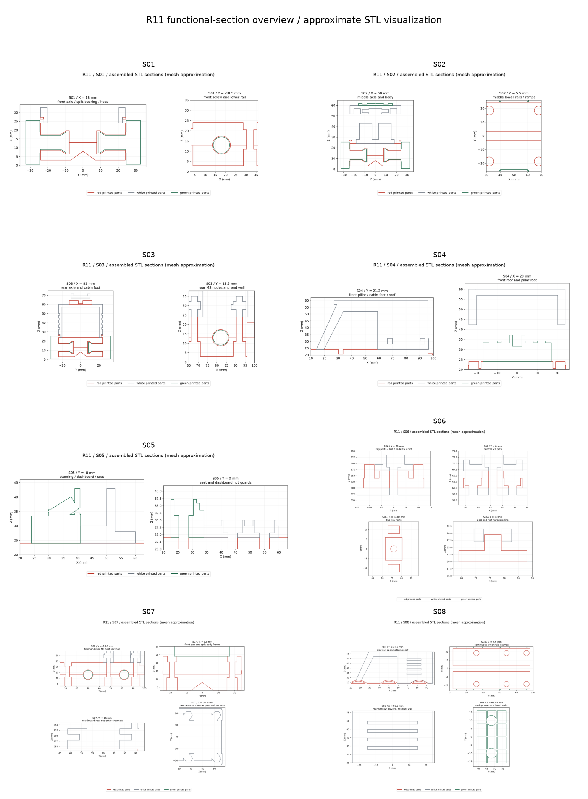
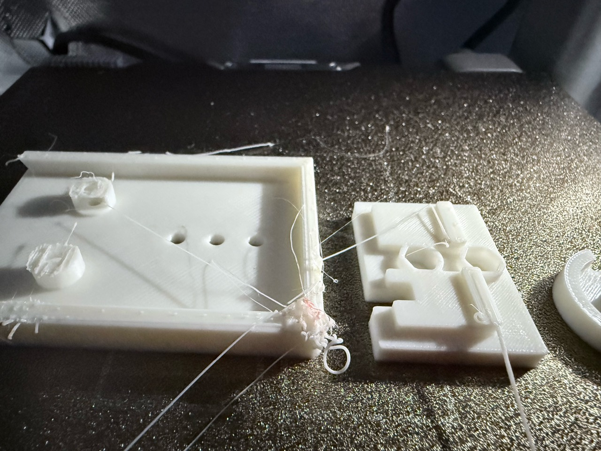
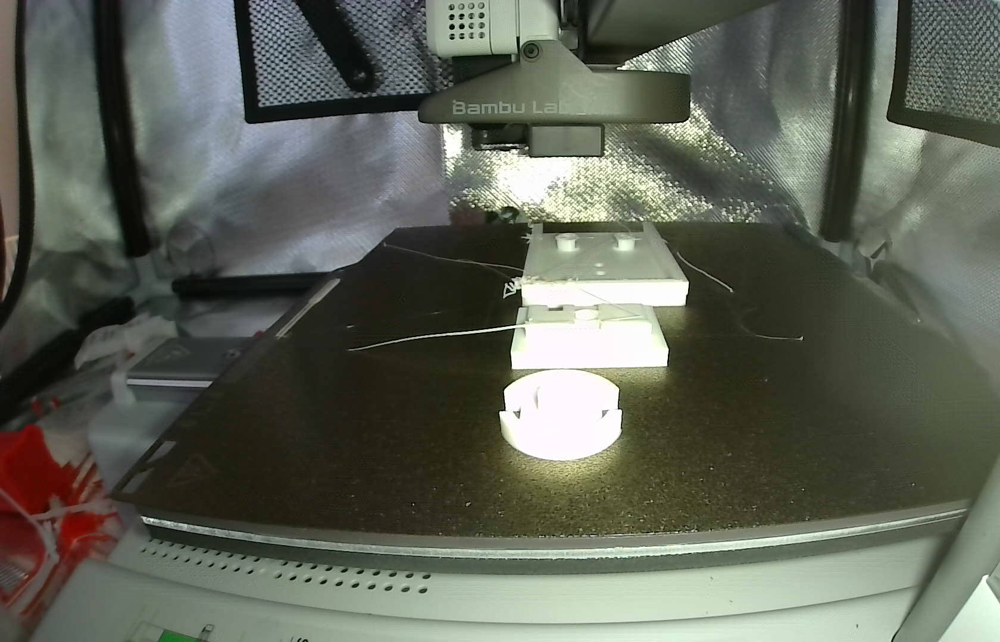
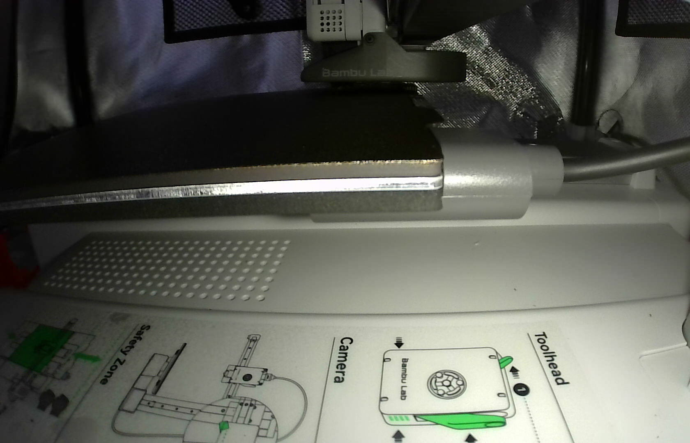

# 月面探査ローバー（R11）の3色設計と、47層目の造形不良・再キャリブレーション

ソラリスと並行して進めていたもうひとつのプロジェクトが、6輪の **月面探査ローバー「NKM-LMR-01」** です。

こちらは R00 から R11 まで12回もの設計改修を重ねて DR0〜4（データ審査）を通過し、ついに Bambu Lab A1 mini での3色実機印刷へと進みました。しかし、順調にいくかと思われた白パーツの印刷中、**47層目** で造形の乱れが発生して緊急停止することになりました。

今回は、コンセプトアートの生成から R11 の3色CAD設計、そして実機トラブルと再キャリブレーションまでの流れをご紹介します。

まずは、赤・白・緑の3色ブランドカラーで描いた月面探査ローバーのコンセプトアートからご覧ください。



設計データや実機の記録はすべて以下の GitHub リポジトリで公開しています。

https://github.com/Sunwood-ai-labs/NEKONEKO-INDUSTRIES

---

## Step 1：4車種のコンセプトアートを「赤・白・緑」の3色に展開

プロジェクトの始まりは、「子どもでも遊べる、そこそこ作り込まれたミニチュアおもちゃをいくつか考えたい」というアイデア出しでした。最初に投げたプロンプトはこちらです。

```text
こんな感じで、そこそこ作り込まれてるけど、子供でも遊べるミニチュアのコンセプトシートを4つ生成して
```

タグボート、消防車、蒸気機関車、月面探査ローバーの4車種が提案されたところで、手元にあるフィラメント（赤・白・緑）に合わせた統一カラーをお願いしました。

```text
いいね！それぞれ、赤、白、緑の3色をいい感じに使って欲しい
```

こうして生まれた3色コンセプトの中から、まずは6輪の **月面探査ローバー** を選んで3D CAD化していくことになりました。

---

## Step 2：R00〜R11の12回改修と、DR0〜4データ審査の通過

コンセプトをそのまま3Dデータにするのは簡単そうに見えますが、実際に「ねじとナットで組み立てられる6輪ローバー」として設計すると、細かい不具合が次々と見つかります。

- 初回CADでの部品干渉や、約0.6 mmの薄い車軸受けの強度不足
- ねじ頭・ナットの干渉と、ナットが抜けてしまう保持方向の誤り
- 後部ナットの挿入経路や、通路床に現れた支持不足の箇所

こうした課題を R00 から R11 まで合計12の候補版で1つずつ潰していきました。最終的に完成した **R11** は、外形約 **100 × 66.8 × 73.56 mm**、**14個の部品** で構成される本格仕様です。



多方向からの見た目やプロポーションも、マルチビュー図で確認しています。



さらに、内部のねじ穴・ナットの収まり・空洞の厚みに無理がないかを確認するため、機能ごとの断面図も一括で出力してチェックしました。



この結果、R11 は DR0〜4 の28項目の必須確認をすべて通過（`overall_gate_passed = true`）し、データ審査をクリアしました。なお、データ審査の通過はあくまで設計・解析・スライスデータの整合性確認であり、実物の強度や子ども向け使用の最終承認は実機テストで確認する立て付けになっています。

---

## Step 3：3プレート・約9時間32分の実機印刷へ！

データ審査を通過したところで、いよいよ実機印刷にゴーサインを出しました。

```text
じゃあ、このローバーを印刷して！
```

R11 は赤・白・緑の3色パーツを **3プレート合計で約9時間32分・フィラメント使用量約189 g** で印刷する計画です。緑や赤のパーツを造形しているときの実機の様子がこちらです。



ところが、白パーツのプレートに進んだところで異変が起きました。

進捗46％・**47/225層目** に差し掛かったところで、カメラ越しに造形の乱れが確認され、安全のため印刷を一時停止しました。



奥の大きな部品の左端（屋根の角やねじ固定部の上面付近）に樹脂の塊と乱れができ、長い糸状の樹脂が周囲に伸びています。プリンター自体にエラー表示は出ていませんでしたが、そのまま続行するとさらに崩れるおそれがあったため、この時点で停止しています。

---

## Step 4：A1 mini 移動後の再キャリブレーションと「原因を断定しない」姿勢

実はこの印刷の前に、プリンター（Bambu Lab A1 mini）の設置場所を移動していました。本体の振動特性やベッド（印刷台）の傾きが変わっている可能性を考え、すぐに再キャリブレーションを指示しました。

```text
再キャリブレーションして
```

振動補正とベッドレベリングが走り、実機上で完了100％・エラーなしを確認した様子がこちらです。



ここで私は、気になっていた質問を投げかけました。

```text
キャリブレーションの値に変化はあった？？
```

すると AI からは、非常に冷静で誠実な回答が返ってきました。

- **確認できたこと**：振動補正とベッドレベリングがエラーなく100％完了したこと
- **確認できないこと**：校正前後の振動補正係数やベッド各点の高さの数値（事前に数値を取得・保存していなかったため、比較ができない）

したがって、「再キャリブレーションが完了したことだけで、今回の47層目の造形不良の原因がキャリブレーションずれだったとは断定できない」という記録を残しました。推測で原因を決めつけず、観測できた事実と未確認の事実を分けて記録しておくのは、次の対策を考えるうえでも大切なポイントです。

---

## 設計から実機トラブル対応までで意識したいポイント

ローバーの設計〜印刷の一連の流れから、他の 3D プリント開発でも応用しやすいポイントをまとめます。

- **手元のフィラメント色からコンセプトアートを逆算する**
  - 先に「赤・白・緑の3色を使う」と制約を決めてコンセプトアートを作ると、その後のマルチカラーCAD設計やプレート分割がスムーズになります。
- **機能別断面図で締結部（ねじ・ナット）を事前チェックする**
  - 外見だけでなく「ねじ穴やナットの挿入経路」に特化した断面図を出させることで、組み立て不能や強度不足を実機印刷前に潰せます。
- **原因が比較できないときは推測で断定しない**
  - 再キャリブレーション前後で数値の比較記録がない場合は、「完了したこと」と「比較できないこと」を分けて記録しておくと、次の対策を冷静に立てられます。

---

## まとめ

今回は、6輪の月面探査ローバー「NKM-LMR-01（R11）」の3色設計から、実機印刷でのトラブル対応までをお届けしました。

- コンセプトアートを赤・白・緑の3色に展開し、14部品・R11の3色CADへ落とし込んだ
- 3プレート約9時間32分の印刷中、白プレート47/225層目で屋根角・ねじ固定部付近の乱れを検知して停止した
- 再キャリブレーションはエラーなく完了したが、前後数値が未保存のため原因断定は避け、事実のみを記録した

さて、ここまでソラリスとローバーの2つの開発を進めてきましたが、実はどちらのプロジェクトも完了までに **7時間半以上** という長い時間がかかっていました。

次回の第9回では、**「なぜこんなに時間がかかったのか？」** を AI 自身に徹底調査させ、HTMLレポートに可視化してもらった結果をお届けします！

https://x.com/hAru_mAki_ch

#AI #3Dプリンター #BambuLab #ものづくり #個人開発
