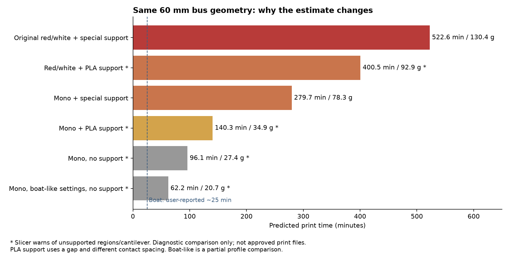
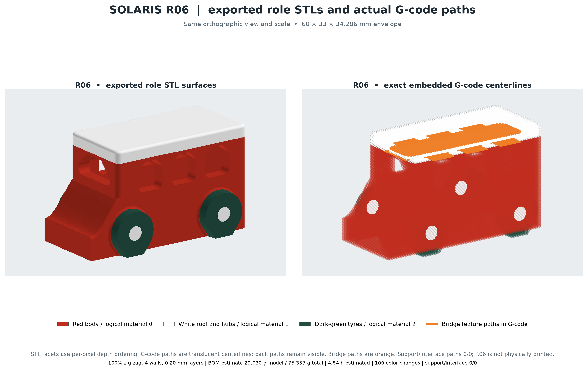
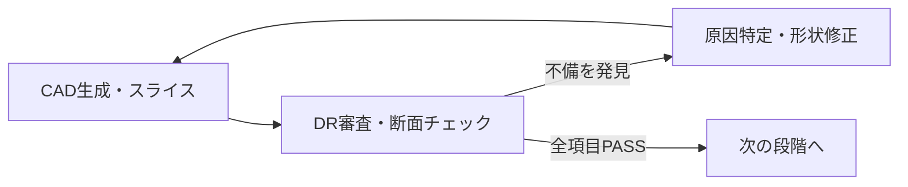
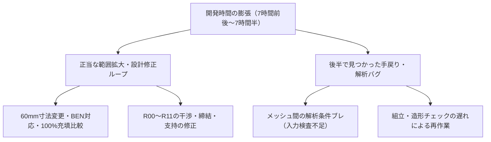

# なぜ開発に7時間半以上かかったのか？AIに自分の「遅延原因」を徹底調査させた話

第7回・第8回でお届けした「ソラリス」と「月面探査ローバー」の2つのプロジェクトですが、実は裏側でどちらも完了までに **7時間前後〜7時間半以上** という長い時間がかかっていました。

「AI に任せているのに、なんでこんなに時間がかかっているんだろう？ どこかで無限ループやバグが起きていないかな？」

そう疑問に思った私は、**AI 自身に過去の作業ログを徹底的に調査させ、遅延の理由とバグの有無を HTML レポートに可視化してもらう** ことにしました。

まずは、開発の中で時間比較の基準にもなっていた造形時間の比較画像と、ソラリスのモデル・経路全体図をご覧ください。





調査用の集計スクリプトや生成された HTML 形式の遅延調査レポートはすべて以下の GitHub リポジトリで公開しています。

https://github.com/Sunwood-ai-labs/NEKONEKO-INDUSTRIES

---

## Step 1：「メチャ時間かかってます なんで？」と直接聞いてみる

まずは2つのメインスレッドのセッションIDを指定して、そのまま率直に原因調査を依頼しました。

```text
01a1cacb-987e-7612-a47b-152e856122fd / 01a1cb1a-7a36-72e2-8a9b-4471d813553a でメチャ時間かかってます なんで？
```

さらに、文字だけの報告だと全体のタイムラインがつかみにくいため、レポートの可視化もお願いしました。

```text
htmlとかで可視化して
```

AI は作業ログ（JSONL形式のイベント履歴）を解析する集計用スクリプトを書き上げ、重複区間を取り除いた実測タイムラインを集計して HTML 形式の遅延調査レポートを作成してくれました。

### 実測された時間とやり取りの規模

ログを精密に集計したところ、**「放置されていた空白時間」ではなく、実際に膨大な推論と検証が走っていた** ことが数字で明らかになりました。

| 項目 | ソラリス | 月面探査ローバー |
| --- | --- | --- |
| 全DR作業の区間 | 約6時間50分（締め時点でR05改修中） | 約7時間31分（R11でDR0〜4通過） |
| 親スレッドの Reasoning 区間 | 約3時間59分 | 約4時間44分 |
| 履歴圧縮にかかった時間 | 約15分27秒 | 約13分24秒 |
| コマンド実行の完了記録 | 900件 | 542件 |

※親スレッド全体では、サブエージェントの起動要求が **41回**（開始確認は40回）、エージェント間の連絡は **497回**（締め再集計で498回）にのぼっていました。

---

## Step 2：「正当な修正ループ」と「変なバグ」を切り分ける

時間がかかっていたこと自体は分かりましたが、一番知りたいのは **「その7時間半は意味のある時間だったのか、それとも無駄なバグで空転していたのか？」** という点です。そこで次のように切り分けを求めました。

```text
ちゃんとレビューされて修正のループで長いならいいよ！ 辺なバグとかある？
```

この問いに対して、AI は調査結果を **「健全な設計レビュー・修正ループ」** と **「解析コードや入力データのバグ」** の2つにきれいに切り分けて報告してきました。

### 健全に機能していたレビュー＆修正ループ

結論から言うと、**無限ループやデッドロックの証拠は見つかりませんでした**。

ローバーが R00 から R11 まで12回も版を重ねたのは、初回CADの部品干渉や約0.6 mmの薄い軸受け、ナットが抜けてしまう保持方向の誤り、通路床の支持不足候補など、**実際の設計不具合をレビューで検出し、修正して再審査するループが正しく回っていたため** でした。



ソラリス側も、途中で「60 mmへの寸法確定」「サポート削減（BEN知見）」「100%充填との比較」といった仕様の拡張が加わったことが、作業範囲を広げた大きな要因でした。

### 一方で、見つかった「3つの解析バグ・入力不整合」

ただし、すべてが健全なループだったわけではなく、**防げたはずの実装バグや入力の不整合が3件** 見つかりました。

1. **ソラリスの解析条件がメッシュごとに変わっていた**
   - 構造解析でメッシュを細かくして収束性を確認する際、荷重面積（15.8288 / 15.6190 / 15.0948 mm²）、固定条件の選択、材料の割当がメッシュごとにズレていました。同じ条件での比較になっておらず、収束判定と修正を余計に繰り返す原因になっていました。
2. **ローバーの解析コードに参照ミスがあった**
   - R11の最終パッケージを Kaggle で計算した際、計器盤の接合情報の読み取りミスで1度停止しました（ただし修正から再実行完了までは約5分40秒であり、7時間半全体の主因ではありませんでした）。
3. **ソラリス R05 の荷重面が色境界で分割されていた**
   - CADとしては有効な形状でも、色境界によって15.6 mm²の荷重面が2つに割れており、そのまま解析入力に使えない問題が起きていました。

---

## Step 3：AI開発を高速化するために見えてきた教訓

今回の自己調査によって、AI による自律設計・審査ワークフローのボトルネックがくっきり見えました。



- **解析を投げる前の「入力検査」を自動化する**
  - メッシュ間で荷重面積や固定条件が一致しているか、荷重面が単一平面になっているかを、計算ジョブへ投げる前に自動チェックするだけで、無駄な再計算ループを大幅に減らせます。
- **組立・造形チェックを初期段階へ前倒しする**
  - ねじ・ナットの挿入経路や層ごとの支持不足を、CAD を作った直後の統合チェックに組み込んでおけば、後半で R09 → R10 → R11 と作り直す手間を圧縮できます。

---

## 自分の開発でも真似できる「AI自己監査」のやり方

「AI エージェントに長時間タスクを任せたら、ログからどこに何分使ったか分析させる」という手法は、他の AI 開発プロジェクトでもそのまま応用できます。今回の流れを真似するなら、次の3ステップでプロンプトを投げるのがおすすめです。

1. **まずは率直に時間を聞く**：「この作業に時間がかかっている理由は？」とログの集計を依頼する
2. **HTML などで可視化させる**：「htmlとかで可視化して」と頼み、タイムラインや内訳を一覧できるようにする
3. **健全なループとバグを切り分ける**：「ちゃんとレビューや修正で長いならOK、変なバグや空転はある？」と問いかけ、改善すべき実装ミスだけを洗い出す

集計用スクリプトや HTML レポートの実例は、冒頭の GitHub リポジトリでも確認できます。

---

## まとめ

今回は、ソラリスと月面探査ローバーの開発に7時間半以上かかった理由を、AI 自身にログ調査・可視化させた結果をお届けしました。

- 親スレッドの Reasoning 区間だけでソラリス約3時間59分、ローバー約4時間44分が動いており、無限ループはなかった
- 長時間化の多くは「不備発見 → 修正 → 再審査」の健全な設計ループと仕様追加によるものだった
- 一方で、メッシュ別の解析条件ブレなどのバグ3件も特定でき、初期の入力検査を強化すべき教訓が得られた

AI にものづくりを任せるだけでなく、**「なぜ時間がかかったのか」「バグはなかったか」まで AI 自身に監査させる** ことで、開発プロセス自体をどんどん賢くしていける手応えを感じました！

#AI #エージェント #開発ログ #3Dプリンター #個人開発
