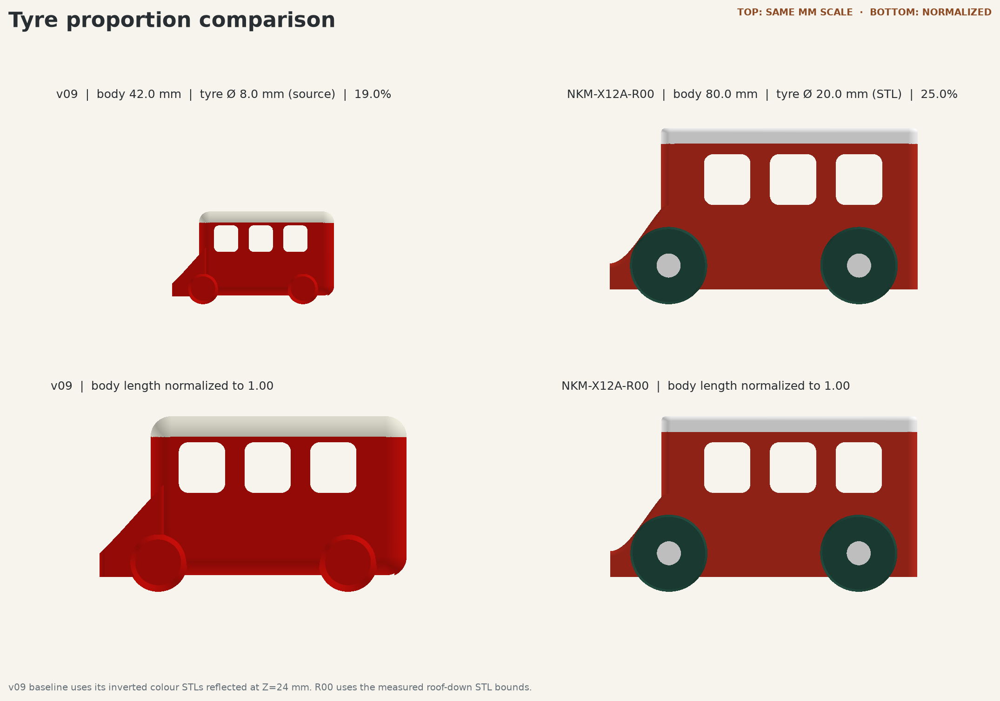
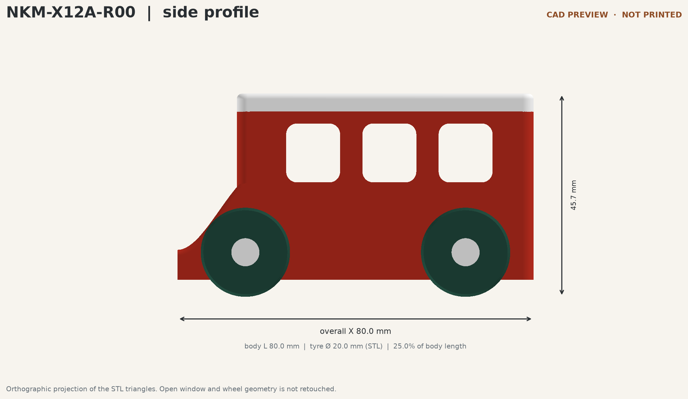
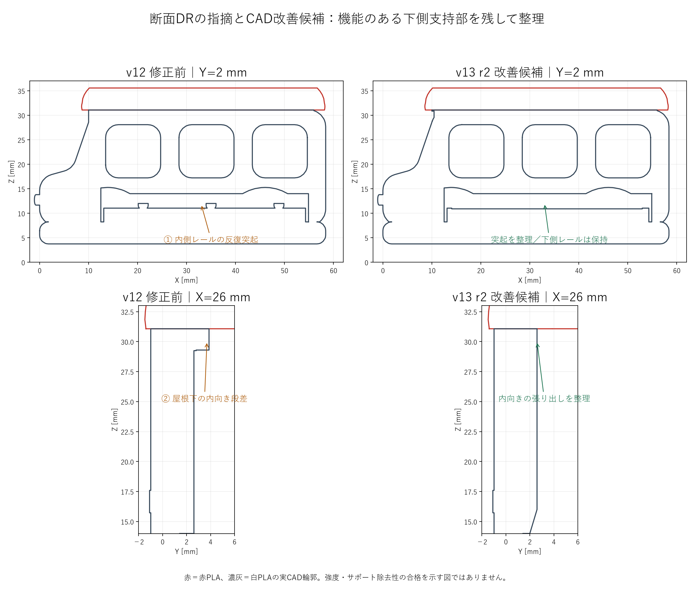
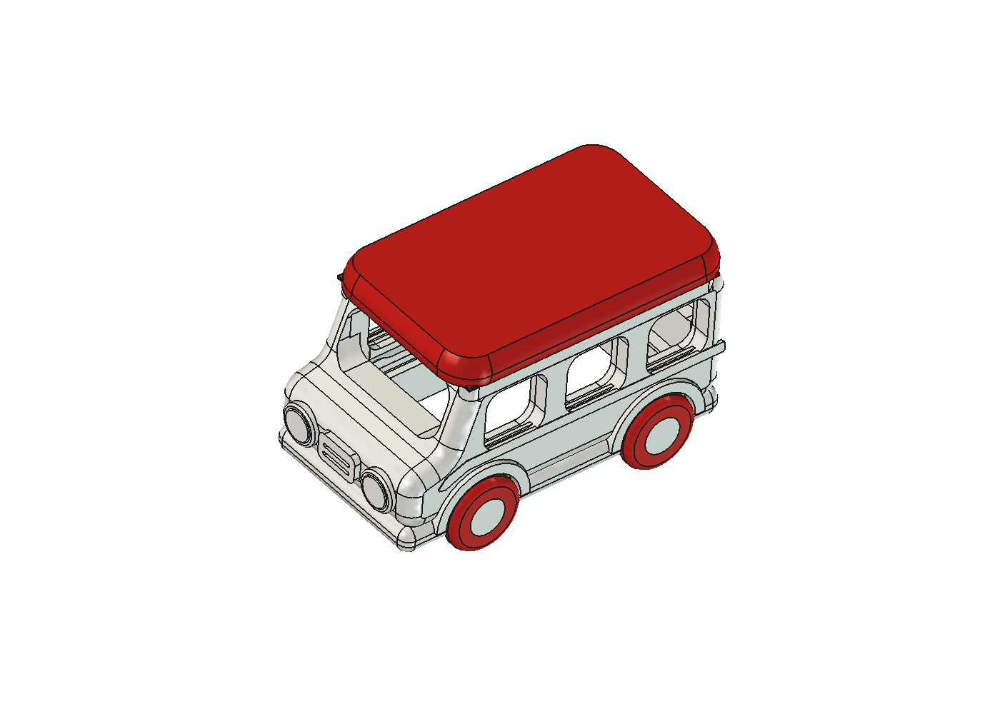

# 設計データが迷子にならない！開発コードネーム配下へのリビジョン統一ルール

3DプリンターやCADで試作を重ねていると、「あれ、さっきの修正前のモデルどこにいったっけ？」「どの版を印刷して、なぜこの形に変えたんだっけ？」と迷子になることがよくあります。

NEKOMOプロジェクトでも、バスの試作がv01からv13、さらに派生版へと増えるにつれて、修正前後のデータや「誰がどう確認したのか」を追いづらくなる課題が出てきました。そこで今回は、**開発コードネーム配下へのリビジョン統一ルール**と、人間レビュー・エージェント検査を分けた「星取表」、そしてGitHubのREADMEを画像たっぷりに整備した流れを紹介します。

今回紹介するルールや設計データは、以下のリポジトリで公開しています。

https://github.com/Sunwood-ai-labs/NEKONEKO-INDUSTRIES

---

## 「修正前後のデータと変更理由を残す」と決めたきっかけ

試作を繰り返すうち、同じフォルダのファイルを上書きしてしまったり、どの版から派生したのかがフォルダ名だけでは分からなくなったりする場面が増えてきました。そこで、まずは設計の基本原則をAIに指示してルール化しました。

実際に投げたプロンプトはこちらです。

```text
設計の原則して、修正前後のデータは残すようにして
また、なにがあってどんな変化したのかもちゃんと記録して欲しい！
```

さらに、整理先がバラバラにならないよう、親フォルダのルールも追加で指定しました。

```text
開発コードネームのフォルダの下にしてね！
```

この2つの指示から決まったのが、`開発コードネーム/r00/`、`r01/`、`r02/`……とリビジョン単位でフォルダを積み上げるルールです。

```text
開発コードネーム/
  README.md              リビジョン一覧と現在の採用版
  r00/
    README.md            初版の要求・設計意図・結果
    cad/                 編集可能なCAD
    source/              生成スクリプトとパラメータ
    exports/             STEP・STL
    print/               スライス設定と実G-code入り3MF
    evidence/            画像・断面・解析・検証・実物の記録
    manifest.csv         この版のファイル一覧とSHA-256
  r01/
    README.md            r00で何が起き、なぜ、何を変えたか
    ...
```

ポイントは、**修正するときに前の版を絶対に上書き・削除しない**ことです。失敗案や不採用案もそのまま残し、`r01/README.md` に「何が起きたか」「なぜ、何を変えたか」「確認結果と残った問題」を前版との差分として記録します。比較画像も同じ視点・縮尺で並べることで、変化が一目で追えるようになりました。

こちらは、v09とNKM-X12A（v12系）の比較画像と、側面寸法を確認した画像です。





また、v13系のクリーンな車内モデルでは、DR（デザインレビュー）前後の変化もこうして対比して残しています。





---

## 「人間のレビュー」と「エージェントの検査」を区別する星取表

設計データが残るようになると、次に困るのが「結局、人間がOKを出した版と、AIがファイル検査だけした版が混ざって見える」という点です。そこで、レビューの主体をはっきり分けるよう指示しました。

```text
私のレビュー（人間）とエージェントのレビューとかは区別してね
```

この指示をもとに整理したのが、バスの版一覧ドキュメントにまとめた2種類の「星取表」です。

1つ目は **版別の人間レビューと印刷状況**（人間が何を要望したか、採用・印刷指示を出したか、実際に印刷して現物報告をしたか）をまとめた表です。

2つ目は **旧DR定義v1によるエージェントの審査記録**（CADの閉鎖性、STEP・STL形状、スライス設定やG-codeの経路検査など、AI側が機械的・技術的に確認した項目）をまとめた表です。

「ファイル検査が通ったこと」と「人間が実物を見て納得したこと」を別の表で管理することで、AIの自動チェックだけで「完成！」と誤認してしまうのを防いでいます。

---

## 「readme完全整備したの？？ なんか画像とかたりなくね？」から始まったREADME刷新

リポジトリの表玄関である `README.md` も、最初は画像が1枚しかなく、どの版がどう違うのかパッと見て伝わりにくい状態でした。そこで投げたのがこの一言です。

```text
readme完全整備したの？？ なんか画像とかたりなくね？
```

この指摘を受けて、READMEの設計ギャラリーを一気に拡充しました。

- **掲載画像を1枚から7枚へ拡充**（現在の注目案であるv09の正面画像に加え、v02、v03、v04、v07の上面・底面、v09の逆さ姿勢など、各版のCADレンダを追加）
- **11の版・派生を一覧表で整理**（v01からv09までの派生版を含む11系統について、設計の違い・FreeCADファイル・造形データ・記録へのリンクを整理）
- **ロゴやブランド情報の導線も追加**（採用ロゴ「ねこ船長」やコンセプトへのリンクを冒頭に配置）

文字だけの説明ではなく、形の変化や底面の空洞、逆さ印刷時の姿勢まで視覚的に追えるようになったことで、初めてリポジトリを開いた人にもプロジェクトの流れが伝わりやすくなりました。

---

## 公開リポジトリでの活用方法

公開リポジトリでは、今回整備した設計変更の記録ルールやひな形、人間レビューとエージェント検査を分けた星取表、各版のファイル整合性をチェックする検証スクリプトなどをまとめて公開しています。

自分のプロジェクトに同じルールを取り入れたい場合は、リポジトリ内のフォルダ構成とREADMEひな形を参考に、ご自身の開発コードネームに合わせて書き換えるだけで流用できます。

---

## まとめ

試作が増えるほど「前の版を残すこと」「変更の理由を書くこと」「人間の判断とAIの検査を分けること」が効いてきます。開発コードネーム配下に `r00/`、`r01/` と積み上げるルールを作ったことで、過去の判断を振り返りながら次の試作へ進みやすくなりました。

https://x.com/hAru_mAki_ch

#3Dプリンター #FreeCAD #AI活用 #設計管理 #ものづくり
