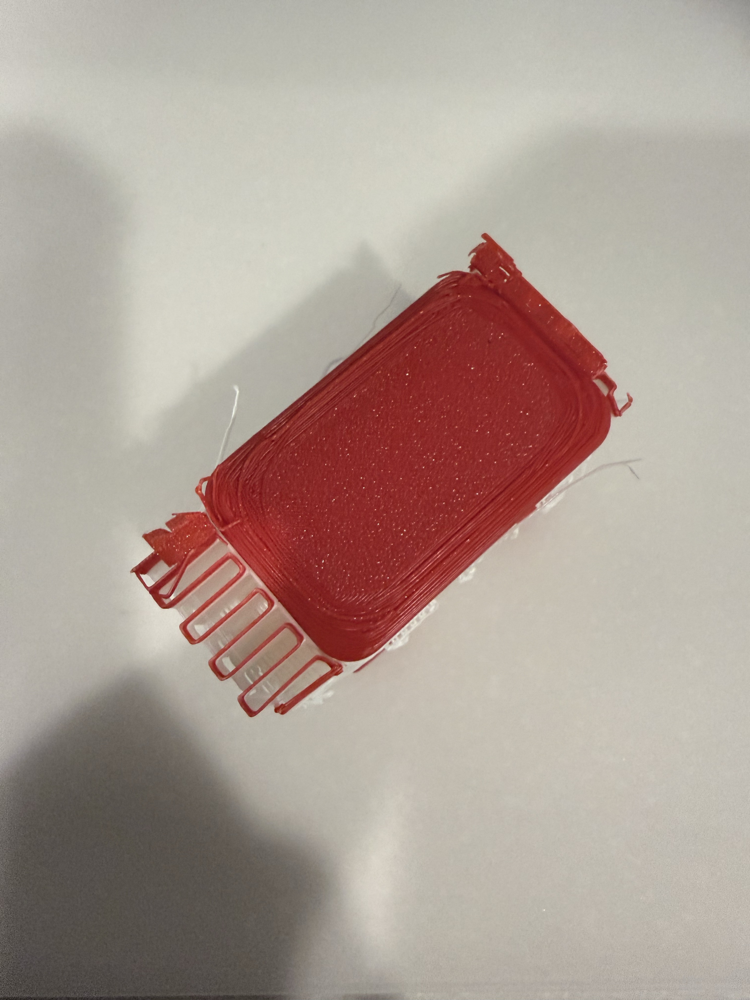
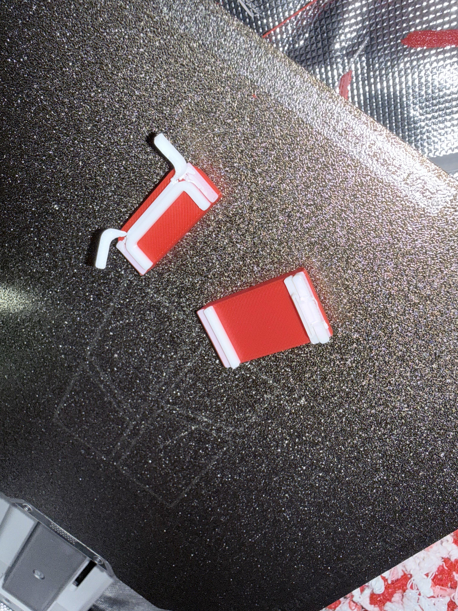
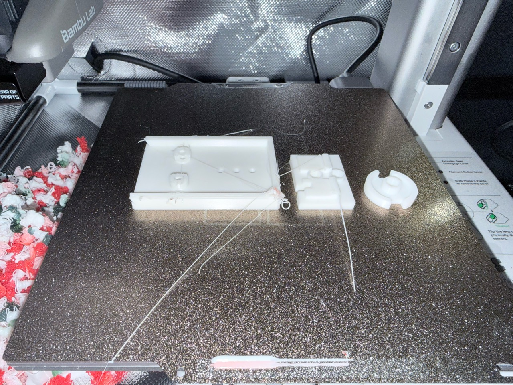
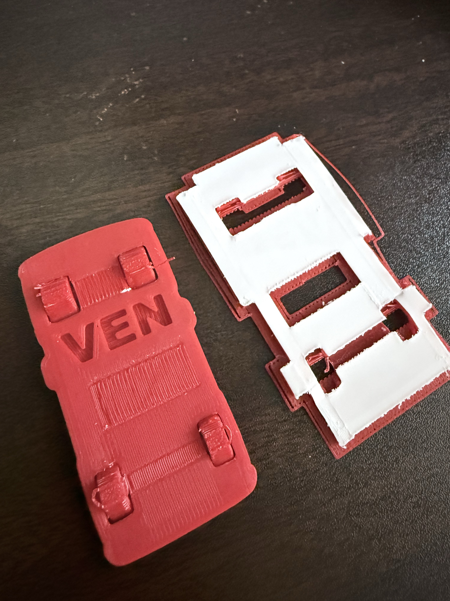
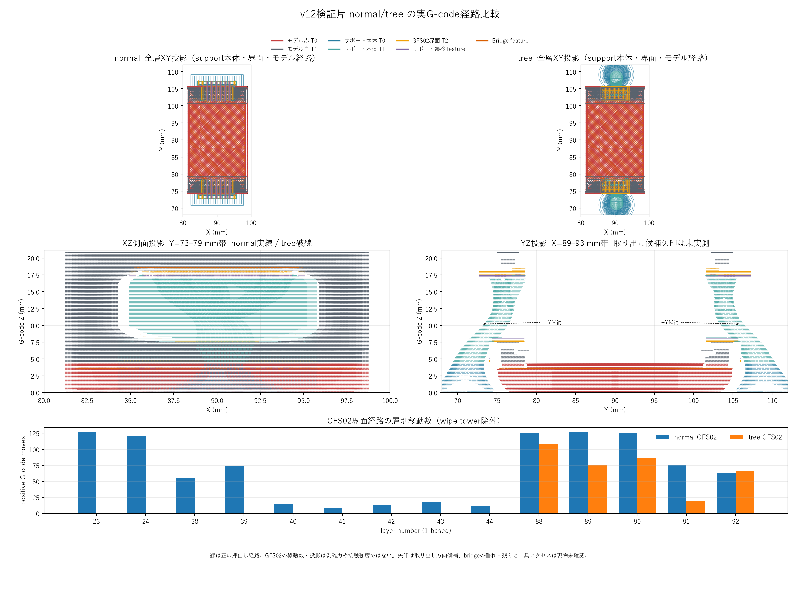

# 増えすぎた20スレッドを棚卸し！失敗を「過去トラ」と「AGENTS.md」に刻んで次に活かす

AIエージェントと一緒に3Dモデルの設計や印刷を繰り返していると、気づけばチャットのスレッドがどんどん増えていきます。「前に同じようなサポート材の失敗をした気がするけれど、どのスレッドで何が起きたんだっけ？」と探すだけでもひと苦労です。

そこで今回は、NEKOMOの開発をいったん立ち止まって振り返り、**過去のチャット履歴を総点検して「過去トラ（過去のトラブル事例集）」にまとめ、さらにAIの行動規範である `AGENTS.md` に再発防止ルールとして刻み込んだ取り組み**を紹介します。完成や総集編ではなく、継続中の開発を前に進めるための「品質改善回」の記録です。

今回まとめたドキュメントや調査スクリプトは、以下のリポジトリで公開しています。

https://github.com/Sunwood-ai-labs/NEKONEKO-INDUSTRIES

---

## 過去のスレッドを徹底的に調査してドキュメント化する

きっかけは、これまで積み上がった過去の会話や作業ログから、失敗や不具合をきちんと拾い上げて資産化したいという思いでした。実際に投げたプロンプトはこちらです。

```text
過去のスレッドを徹底的に調査してから不具合事例とかちゃんとドキュメントにしておいてね！！
```

対象となったのは、NEKOMOの作業フォルダで始まったルートチャット20件と、その裏で動いていた関連子セッション197件です。まず履歴棚卸しスクリプトを使って全セッションのメタデータや件数・ハッシュを棚卸しし、設計・造形・記録に関わる15件を「バス」「船・ローバー」「ソラリス・作業記録」の3系統に分けて徹底的に調べました。

調査にあたっては、ごまかしや思い込みを防ぐために厳しい基準を設けています。

- **対策案を作っただけで「解決済み」にしない**（修正データを作った事実と、実際に印刷して改善したかは別）
- **ファイル検査の合格と「実物確認」を区別する**（スライサーやスクリプトでエラーが出なくても、実物で外れなければ失敗）
- **原因は確定事項と仮説を分ける**（証拠写真やログで裏付けられた事実だけを書く）

---

## 「写真もちゃんと載ってる？」実物の証拠写真15枚と代表4事例

調査を進めるなかで、やはり文字だけでは当時の状況が伝わりにくいという話になり、こんなやり取りをしました。

```text
マークダウンに写真とかもちゃんと記載してある？
```

この一言をきっかけに、元の写真を加工せずに保存した証拠写真15枚を「証拠写真リスト」として整理し、主だった実物不具合の写真を「過去の不具合と再発防止ドキュメント」の本文にも直接掲載しました。

ここでは、その中でも特に教訓になった代表的な4つの事例を紹介します。

### 1. ミニバスv06（赤タイヤ版）のサポート除去NG

本体と同じPLAのサポートが隙間に入り込み、ほぼ全部外れなかった事例です。専用サポート材（Support for PLA）をAMSに装着してはいたものの、実際の送信データには割り当てられていませんでした。



### 2. バスv10の窓・屋根検証片の破損

専用界面材を指定したデータで印刷したにもかかわらず、サポートを剥がしている最中に細い窓枠が折れてしまった事例です。「専用材を使えば絶対に安全」ではなく、工具がどう入ってどこに力がかかるかまで見ないと破損を防げないことが分かりました。



### 3. ローバーR11の白部品の造形不良

屋根の角に樹脂の塊ができたり、ねじ固定部の上面が崩れたりして印刷を中止した事例です。ナット穴の支え方、フィラメントの押出状態、プリンター移動後の再キャリブレーションなど、複数の要因を切り分ける必要があり、原因未確定のまま記録しています。



### 4. Pick-Up Bench r01（底部4 mm検証片）のタイヤ破損

専用界面材を使い、20/20層まできれいに印刷完了したにもかかわらず、実物のタイヤ周辺が破損してしまった事例（TR-003）です。後続のr02ではタイヤ下の支持を追加していますが、実物での改善確認はまだ完了していないため「未確認」として区別しています。



なお、これらの実物失敗を受けて、v12系の監査ではサポート経路の比較画像も残し、ファイル上で経路の違いを確認できるようにしています。



---

## 失敗を「AGENTS.md」に刻んで次の設計へ

過去トラのドキュメントと証拠写真の整理ができたら、いよいよそれを「次の作業でAIが必ず思い出す仕組み」に落とし込みます。

```text
いいね！過去事例としてちゃんと残しておいて
```

このやり取りを経て、プロジェクトの `AGENTS.md` に再発防止ルールを明文化しました。AIエージェントは作業を始める前に `AGENTS.md` を読むため、ここに書いておけば過去の同じ失敗を繰り返しにくくなります。

`AGENTS.md` に刻んだ主なルールは次の通りです。

1. **設計変更の前後データと経緯を残す**（`開発コードネーム/r00/`、`r01/`……とリビジョン単位で保存し、過去の失敗案も消さない）
2. **製作前に過去トラと証拠写真を必ず確認する**（過去の不具合と再発防止ドキュメントと証拠写真リストを参照する）
3. **専用サポート材の明示指定と事前検査（preflight）を行う**（装着しただけ・自動選択を合格扱いにせず、事前検査スクリプトで界面経路と本体混入をチェックする）
4. **ファイル検査と実物結果を混同しない**（代表形状の小さな検証片で「工具が届いて欠けずに外せるか」を確かめてから本体へ進む）
5. **天井・窓上部のブリッジ知見の適用範囲を守る**（BENの印刷完了データなどを一般的な限界値に流用しない）

---

## 公開リポジトリでの構成と活用方法

今回の棚卸し結果と再発防止ルールは、公開リポジトリ内に以下の内容としてまとめています。

- **再発防止ルール（`AGENTS.md`）**：AIエージェントが作業前に必ず読む行動規範
- **過去の不具合と再発防止ドキュメント**：実物不具合4事例・設計上の問題・未確認事項のまとめ
- **履歴棚卸しレポート・証拠写真リスト**：20ルートチャット・197子セッションの調査入口と、原本を保持した証拠写真15枚の対応表
- **履歴棚卸しスクリプト・事前検査スクリプト**：セッションのメタデータ集計や、スライス済み3MFのサポート界面経路を検査するスクリプト

自分の開発プロジェクトに活かしたいときは、`AGENTS.md` の「過去の失敗ドキュメントを必ず参照してから設計・出力に進む」という構成を真似するだけでも、同じミスの再発をぐっと減らせます。

---

## まとめ

20スレッド分の試行錯誤を棚卸しして分かったのは、「失敗そのもの」よりも「何が確認できていて、何がまだ未確認なのかが曖昧になること」が一番危ないということでした。証拠写真付きの過去トラと `AGENTS.md` のルールを土台にして、また次の試作と検証に進んでいきます。

#3Dプリンター #AIエージェント #品質改善 #トラブルシューティング #ものづくり
