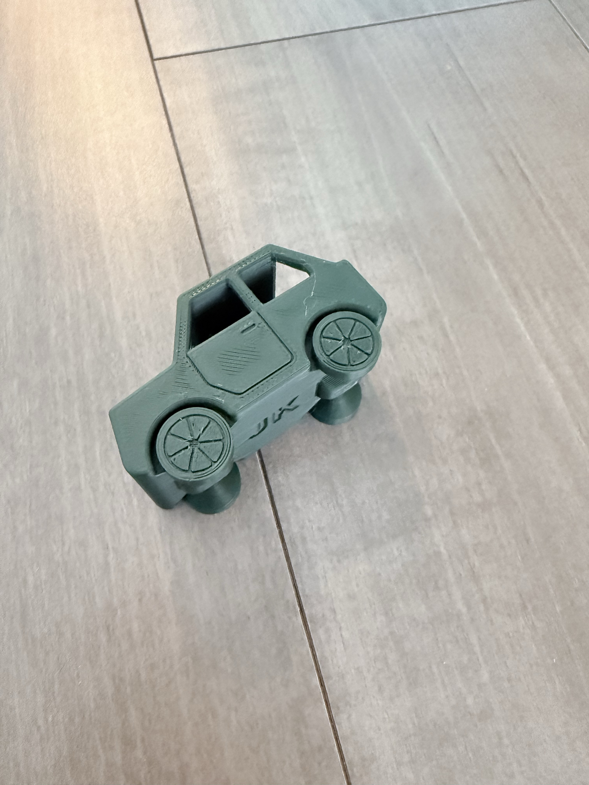
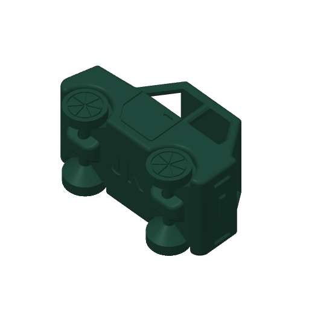
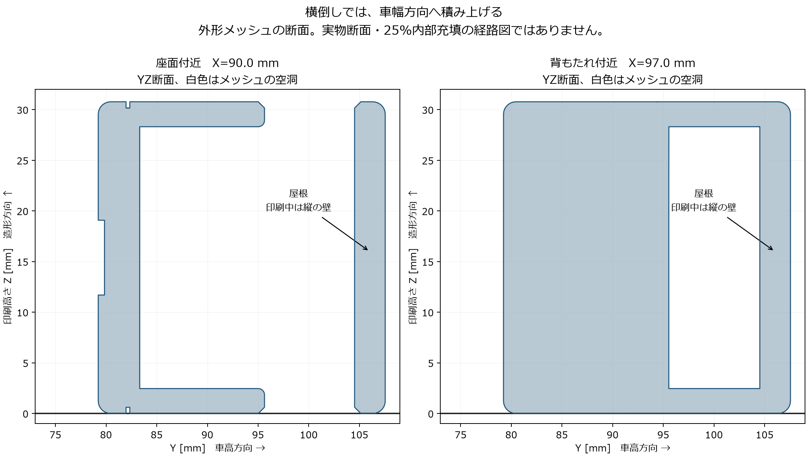
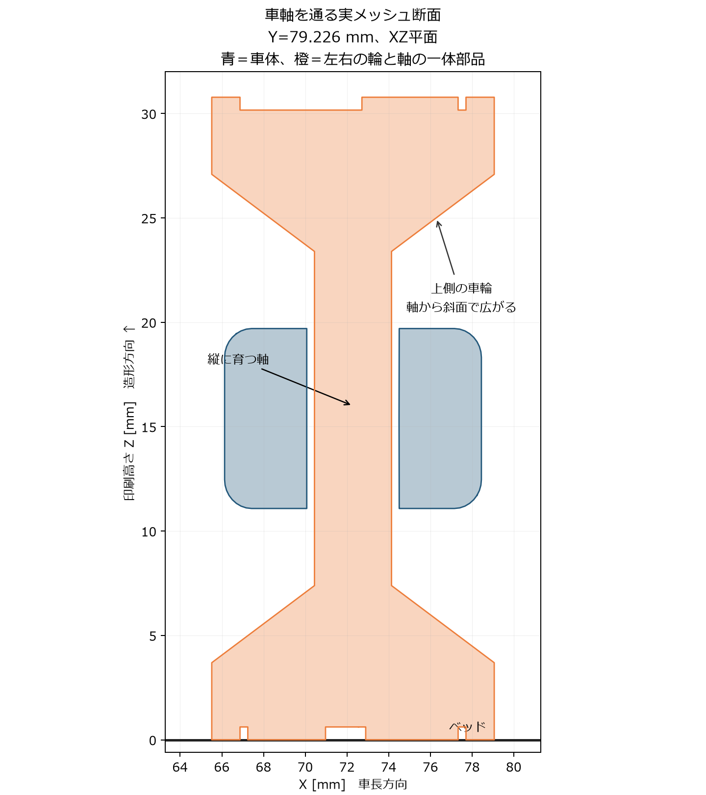
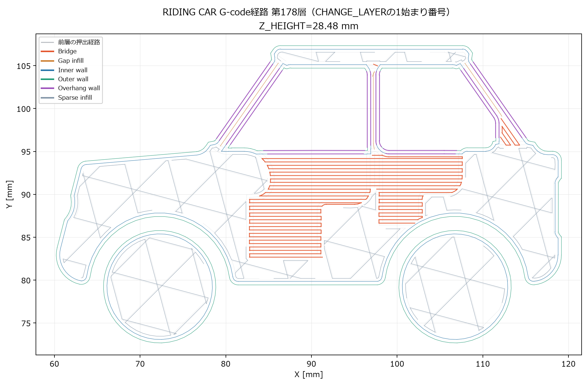
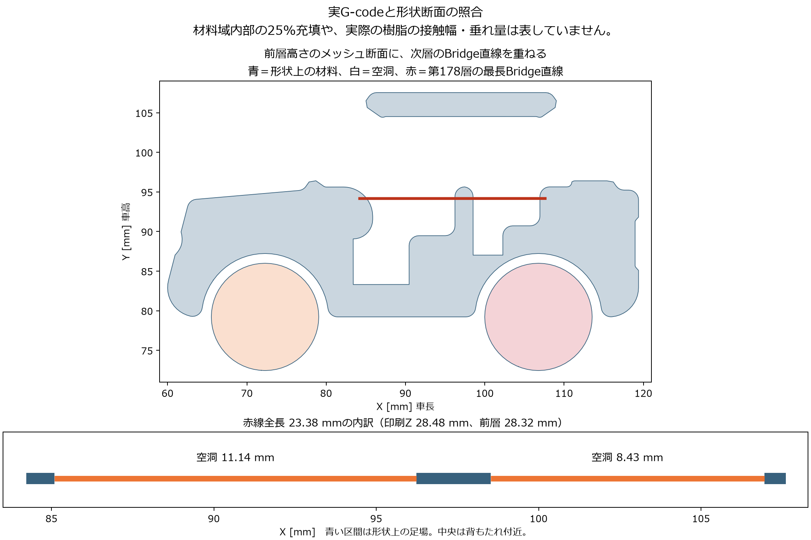

# サポート材なしで一体印刷！ベンチマーク車モデルを断面図とG-codeで徹底解剖

普段は車のモデルを設計するときに「サポート材の除去で窓枠が折れる」「タイヤと車体がくっついて回らない」と悩みがちですが、今回はちょっと視点を変えて、MakerWorldで公開されているJaKubina氏の人気モデル**Riding Car Model**（60mm版）をベンチマークとして印刷してみました。

使ったプリンターはBambu Lab A1 mini（0.4mmノズル・層高0.16mm・サポート無効）です。192層・印刷時間1時間22分47秒・使用フィラメント18.65gで、パーツの組み立てなしに車輪まで動く車がそのまま完成しました。しかもこれが子どもに大好評で、手に取った瞬間に転がして遊んでくれました。



開発中の資料や知見をまとめているネコネコインダストリープロジェクトのリポジトリはこちらです。

https://github.com/Sunwood-ai-labs/NEKONEKO-INDUSTRIES

---

## 「なんでサポート材がいらないの？」をAIに徹底調査してもらった

あまりの完成度に「これをSNSで紹介したい！」と思い、まずはAIエージェントにこんな相談を投げました。

```text
ベンチマークで印刷してみた みたいな投稿したいです！！！提案して
```

ところが、投稿案を眺めているうちにふと疑問が湧きました。自分の設計では窓や車軸まわりのサポート除去にあれだけ苦労していたのに、**なぜこのモデルはサポート材を完全にオフにしたまま一発で印刷できたのか**が気になったのです。そこで続けてこうお願いしました。

```text
次は、これについて徹底的に分析して なんでサポート材不要なの？？ 断面図とかで徹底的に調べて
```

スライサー上のプレビュー画面と実際のG-code（造形経路データ）、そして3Dモデルの断面図を並べて解析してもらった結果、サポート材なしで成立する**3つの明確な構造的理由**が見えてきました。



---

## 解明された3つの構造的理由

### 1. 横倒し配置による屋根・窓の「壁化」

1つ目の理由は、車体を普通にタイヤを下にして置くのではなく、**真横に倒した姿勢**で配置していることです。外形は長さ60.0mm × 高さ35.092mm × 幅30.783mmとなっており、車の「片側の側面」から「反対側の側面」へ向かって下から上へ積み上げていきます。

この向きに倒すと、普段の姿勢では大きな天井として空中に浮くはずの**屋根**や、上辺が崩れやすい**窓枠**が、ビルドプレートから垂直に立ち上がる「壁」に変わります。そのため、窓の穴を閉じるためのサポート材を一切立てずに済むのです。



### 2. 車輪＋車軸の一体連続造形と円すいテーパー

2つ目の理由は、空中に浮きがちな反対側のタイヤをどうやって支えているかという構造です。断面を切ってみると、下側の車輪・車軸・上側の車輪は別々のパーツではなく、**1本の連続した部品**としてつながっていました。

下側の車輪がビルドプレートにしっかり接地し、そこから垂直に車軸が伸びて、上側の車輪の内側は**垂直から約53.13°**のなだらかな円すい状の斜面（テーパー）になって広がっています。層高0.16mmで計算すると、1層あたりの張り出し量は**約0.213mm**にとどまるため、サポート材なしでも崩れずに積み上がります。

一方で、車軸と車体の穴の間には**約0.360mm**の隙間が設けられているため、一体で印刷しても車体とくっつかず、取り外した直後から車輪がくるくる回る仕組みになっていました。



### 3. 内装（背もたれ）を途中の足場にしたブリッジ分割

3つ目の理由が、今回の解析で一番の発見でした。横倒しにしても、最後に反対側の側板（ドアやボディの側面）を閉じるタイミングでは、どうしても車内の空洞をまたぐ「ブリッジ（橋渡し）」が発生します。

実際のG-codeを確認すると、**第178層**（高さ28.48mm）に**全長23.380mm**の長いブリッジ経路がありました。23mm超の橋渡しはそのままでは中央が垂れ下がりそうですが、1つ前の層と断面を重ねてみると、なんと車内の**座席の背もたれ**（幅**約2.285mm**）がちょうど途中の足場になっていたのです。



背もたれを中間地点の支えとして使うことで、23.380mmのブリッジは実質的に**約11.139mm**と**約8.431mm**という2つの短い空洞区間に分割されていました。この距離なら、サポート材がなくても十分に橋渡しできます。



---

## まとめ：内装も「造形上の足場」として評価する

今回のベンチマーク解析から得られた最大の設計知見は、**「内装を見た目だけの装飾と思って削ると、ブリッジが長くなって造形が破綻しうる。内装も造形上の足場として評価する」**ということです。

車内のシートや仕切りは、つい「見えない部分だからシンプルにしよう」「中を空洞にして軽くしよう」と削ってしまいがちです。しかし今回のRiding Carのように、**印刷姿勢・車軸のテーパー・内装を使ったブリッジ分割**の3つがかみ合うと、サポート材ゼロでも子どもがそのまま遊べる品質の車が一体印刷できます。

自分のオリジナル車両の設計にも、この「内装を足場として活かす」という視点をしっかり取り入れていきたいと思います。

https://x.com/hAru_mAki_ch

#AI #3Dプリンタ #BambuLab #個人開発 #ものづくり
